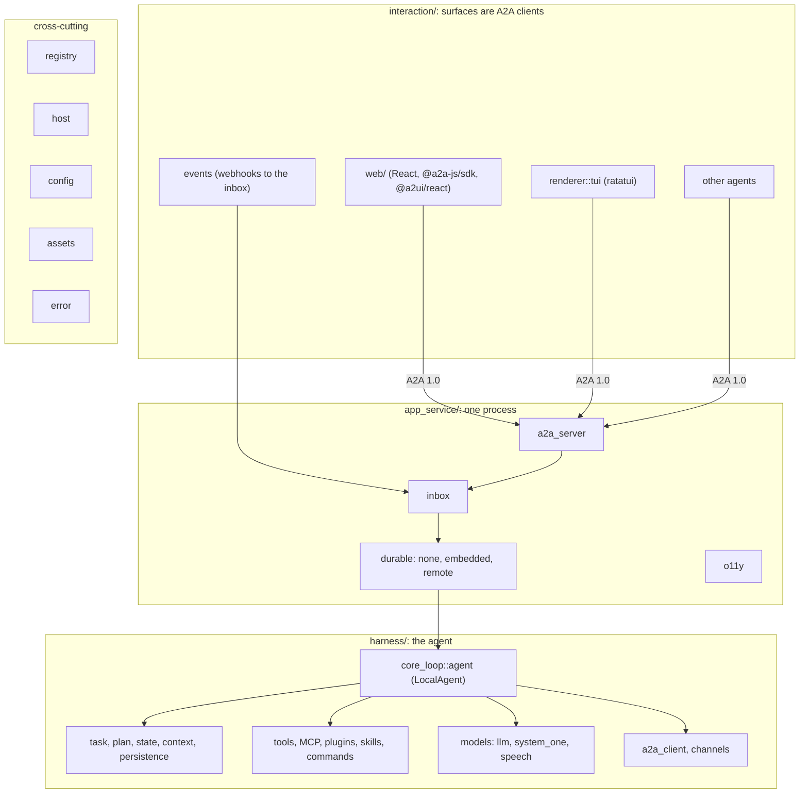
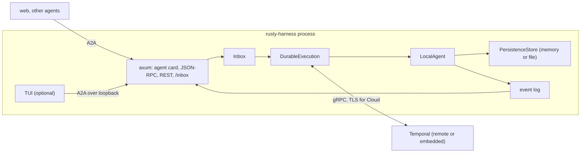

# Architecture

How rusty-harness is put together: one Rust core in three layers plus cross-cutting
modules, three thin packaging adapters, and one process that serves A2A. Each section
links the capability docs that describe current behaviour and the design that produced
it ([issue #3's `design.md`][design]).

## Layer 1: interaction

Everything a person or another agent touches is an **A2A 1.0 client** of the harness:
the TUI (`interaction::renderer::tui`, ratatui), the web renderer (`web/`, React on
shadcn AI Elements and the official `@a2a-js/sdk`) and any other agent. A surface
declares what it renders; the harness sends A2UI from the basic catalog where it can and
plain text where it cannot. Webhooks enter through the inbox, never the loop directly.
Capability docs: [surfaces](../capabilities/surfaces.md),
[the TUI](../capabilities/tui.md), [the web renderer](../capabilities/web.md),
[voice](../capabilities/voice.md).

## Layer 2: the application service

One process, feature-gated: the A2A server (`app_service::a2a_server`, the official Rust
SDK behind an authorization and participant gate, JSON-RPC and REST bindings), the
durable inbox (the single ingestion path, stored before answered), the heartbeat,
durable execution in three modes (`none` in process, `embedded` and `remote` on Temporal)
and observability as hooks (one OTLP trace per task). Capability docs:
[server](../capabilities/server.md), [inbox](../capabilities/inbox.md),
[heartbeat](../capabilities/heartbeat.md), [durable execution](../capabilities/durable.md),
[observability](../capabilities/observability.md).

## Layer 3: the harness

The agent itself. `LocalAgent` runs the core loop (open the task, build the context,
call the model, run tools, deliver, commit) over one `TaskRecord` aligned with A2A, a
plan DAG the model edits with `plan.update`/`plan.step_done`, schema-checked state and
an atomic commit journal. Around it: models behind one `Llm` trait (OpenAI over the
Responses API or Chat Completions, Anthropic Messages, speech), tools and MCP, plugins,
skills, commands run before the loop, sub-agents and participant asks over A2A, and a
hook catalogue around every operation. Capability docs: [loop](../capabilities/loop.md),
[task](../capabilities/task.md), [models](../capabilities/models.md),
[tools](../capabilities/tools.md), [plugins](../capabilities/plugins.md),
[skills](../capabilities/skills.md), [channels](../capabilities/channels.md),
[commands](../capabilities/commands.md), [hooks](../capabilities/hooks.md).

## Cross-cutting modules

The registry gives every pluggable unit one identity; the host is the only door to the
platform (HTTP, WebSocket, clock, randomness, secrets, files, processes, audio, logs),
native by default and supplied by the page on `wasm32`; the configuration is one typed
`Config` with a published JSON schema; assets are the prompt fragments and the string
catalog; `error.rs` maps every failure to an A2A error once. Capability docs:
[registry](../capabilities/registry.md), [host](../capabilities/host.md),
[config](../capabilities/config.md), [assets](../capabilities/assets.md),
[the browser](../capabilities/browser.md).

## Runtime topology

The default deployment is one process that is server, worker and (optionally) TUI client
at once. The TUI never talks to the harness in-process: it is an A2A client of the
loopback server, which is what makes `--url` (attach to a remote harness) the same code
path.

## Packaging

The same core reaches three ecosystems, each through a thin adapter that holds no logic
([embed the SDK](../guide/embed-the-sdk.md)): crates.io (`rusty_harness`, with the
`Harness` SDK verbs `send_message`, `get_task`, `cancel_task`, `subscribe`), PyPI
(`rusty_harness`, awaitable with `*_sync` twins, `TypedDict`s generated from the schema)
and npm (`rusty-harness`, the harness compiled to WebAssembly with a page-supplied host).
The `rusty-harness` binary ships as `@rusty-harness/cli` (one npm package per platform)
and `rusty-harness-cli` (a platform wheel), built with the size-first `dist` profile
([decision-006](../decisions/decision-006.md)).

## Workspace

One Cargo workspace, three crates, one version
([tech stack](../development/tech-stack.md)):

| Crate | Role | Ships as |
|---|---|---|
| `crates/rusty-harness` | All logic. Async, runtime-agnostic. | crates.io `rusty_harness` |
| `crates/rusty-harness-py` | PyO3 adapter: awaitable + `*_sync` per async API. | PyPI `rusty_harness` |
| `crates/rusty-harness-wasm` | wasm-bindgen adapter: `Promise` per async API. | npm `rusty-harness` |

## Runtime seam

`rusty_harness::runtime::Runtime` is the only way the core spawns or waits. Implementations
are feature-gated — `rt-tokio` (`TokioRuntime`) and `rt-wasm` (`WasmRuntime`, `wasm32`
only) — and there is no default. `MaybeSend` stands in for `Send` so the same bounds hold
on `wasm32`. See the [async model](../guide/async-model.md) and
[decision-001](../decisions/decision-001.md).

## Layers and cross-cutting modules (issue-3)

The core crate's module tree is the architecture diagram of
[issue #3](https://github.com/MadaraUchiha-314/rusty-harness/issues/3): one top-level
module per layer, one sub-module per box, plus five cross-cutting modules that belong to
no layer. A contract test keeps the tree equal to the one
[`design.md`](https://github.com/MadaraUchiha-314/rusty-harness/blob/loop/issue-3-spec/docs/specs/issue-3/design.md)
draws.

| Module | Role | Capability doc |
|---|---|---|
| `interaction/` | layer 1: surfaces, renderers, inbound events | [surfaces and renderers](../capabilities/surfaces.md), [the terminal renderer](../capabilities/tui.md), [the web renderer](../capabilities/web.md) (`web/`), [inbox](../capabilities/inbox.md) (events) |
| `app_service/` | layer 2: A2A server, inbox, channels API, heartbeat, durable execution, o11y | [server](../capabilities/server.md), [inbox](../capabilities/inbox.md), [heartbeat](../capabilities/heartbeat.md), [durable execution](../capabilities/durable.md), [loop](../capabilities/loop.md), [observability](../capabilities/observability.md) |
| `harness/` | layer 3: the core loop and its entities, prompts, skills, tools, hooks, models, A2A client, channels, plugins, commands | [loop](../capabilities/loop.md), [task](../capabilities/task.md), [models](../capabilities/models.md), [tools](../capabilities/tools.md), [plugins](../capabilities/plugins.md), [skills](../capabilities/skills.md), [channels](../capabilities/channels.md), [commands](../capabilities/commands.md), [hooks](../capabilities/hooks.md) |
| `self_improvement/` | layer 4: placeholders, out of scope | — |
| `registry/` | entity identity and resolution | [registry](../capabilities/registry.md) |
| `host/` | the platform behind typed capabilities (HTTP, clock, secrets, files, processes, audio, log sink); native defaults, host-supplied on `wasm32` | [host](../capabilities/host.md), [the browser](../capabilities/browser.md) |
| `config/` | typed configuration, layered loading, published schema | [config](../capabilities/config.md) |
| `assets/` | prompt fragments and the string catalog, embedded by `build.rs` | [assets](../capabilities/assets.md) |
| `error.rs` | `HarnessError` and the one mapping to A2A error codes | — |

[design]: https://github.com/MadaraUchiha-314/rusty-harness/blob/loop/issue-3-spec/docs/specs/issue-3/design.md
