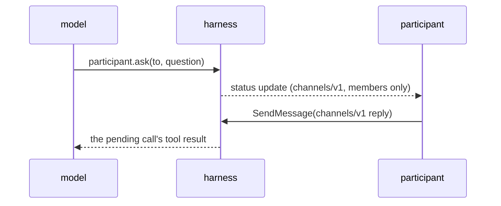

# Capability: sub-agents, participants and channels

> Every sub-agent is called over A2A through one tool; a participant is asked through a
> channel the harness owns, or given a task of their own, and the model chooses between
> the two explicitly.

## What it is

`RemoteAgent` wraps an A2A transport (the official client natively, the crate's own
JSON-RPC over the host's HTTP client in the browser, an in-memory loopback to the
harness itself) and is registered only after its card validated. The `agent.call` tool
runs `a2a.send`, links the sub-task on the parent and returns the reply as the tool
result; a loopback sub-agent is indistinguishable from a remote one. `participant.ask`
opens a `Channel` with the addressed members, suspends the loop and shows the question
as the task's status message under `channels/v1`; members see it, other subscribers see
the state change only; the reply, a follow-up message on the channel, resolves the
suspended call. `participant.delegate` creates a task for a participant, linked as a
sub-task. The six extension payloads have JSON schemas under `specs/a2a-ext/`.

## Current behaviour

- WHEN a sub-agent's card fails to fetch or validate THEN the system SHALL refuse the
  registration and never list the agent to the model.
- WHEN the model calls an unregistered agent THEN the call SHALL be denied before any
  message is sent.
- WHEN `agent.call` runs THEN the system SHALL send an A2A message through the agent
  interface, link the sub-task on the parent and return the reply or artifacts.
- WHEN `participant.ask` runs THEN the task SHALL wait in `input-required` with the
  question on its status message, visible to the channel's members only.
- WHEN a reply arrives on a channel THEN the system SHALL refuse a non-member as
  not-found and resume the original suspended call for a member, however late.
- WHEN `participant.delegate` runs THEN the system SHALL create a task with the delegate
  as assignee and the current assignee as reporter, linked both ways.

## Design

- [`design.md` § Sub-agents over A2A, § Participants and channels, § A2A extensions][design]
  (R15.3–4, R17, R18, Q12).
- Code: `crates/rusty-harness/src/harness/{a2a_client,channels}/`, `specs/a2a-ext/`.

## History

| Work item | What changed | Links |
|-----------|--------------|-------|
| issue-3 (M2, task 18) | Remote, loopback and browser transports, `agent.call`, channels and the participant tools, extension schemas | [spec](https://github.com/MadaraUchiha-314/rusty-harness/blob/loop/issue-3-spec/docs/specs/issue-3/), PR #8 |

[design]: https://github.com/MadaraUchiha-314/rusty-harness/blob/loop/issue-3-spec/docs/specs/issue-3/design.md
