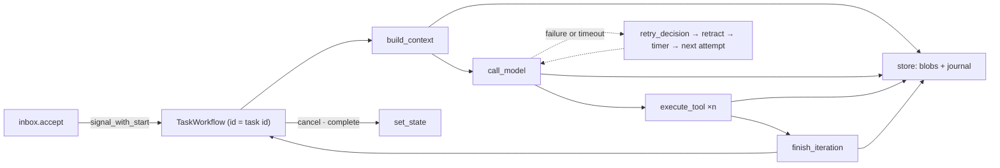

# Capability: durable execution

> A task's loop survives crashes: on Temporal, every phase is an activity, retries are
> the workflow's own, and a killed worker is picked up by another; without Temporal, the
> same phases run in process.

## What it is

Three modes behind one `DurableExecution` interface (R22.1): `none` runs the loop in
process (no durability, the only mode on `wasm32`), `embedded` runs the Temporal SDK's
ephemeral dev server in this process (development only, Q3), `remote` talks to a Temporal
service, Temporal Cloud included, with the address, namespace and API key by reference.
One `TaskWorkflow` per task (workflow id = task id) is started or signalled by the inbox
and schedules the loop's four phases as activities: `build_context`, `call_model`,
`execute_tool` (one per call) and `finish_iteration`, plus `set_state` and
`retry_decision`. Activities exchange store keys (`ctx/<task>/<n>`, `turn/<task>/<n>`,
`tool/<task>/<n>/<call>`), never content. Every client carries a data converter that
refuses a payload holding a resolved secret (boundary 6).

## Current behaviour

- WHEN an event arrives for a task THEN the inbox SHALL start the task's workflow or
  signal the running one, idempotently on the task id (R22.6); `cancel` and `complete`
  reach it as signals, from the server, a parent's terminal state or a stall policy.
- WHEN an activity fails, with its own error or a timeout from a crashed worker THEN the
  workflow SHALL run `retry_decision`: `durable.activity_failure`, then the schedule's
  proposal through `durable.activity_retry`; a retry commits the retraction of the failed
  attempt first and sleeps the decided wait; a stop fails the task (R22.3–4). The engine's
  own attempts are fixed at one.
- WHEN an activity runs THEN it SHALL heartbeat at the harness heartbeat's interval under
  a start-to-close and a heartbeat bound, so a killed worker's attempt times out and is
  re-dispatched once, with the hooks running on the surviving worker (R22.5, R23.4).
- WHEN the workflow worker dies THEN another worker SHALL replay the history; a tool whose
  result is in the history is not run again (R22.4).
- WHEN `agent.call` runs THEN it SHALL commit an intent (`outbound/<task>/<n>/<call>`)
  before sending, reconcile by the call's own context on a retry, adopt the peer's task
  instead of sending again, and record the peer's id the moment it is named (R17.4).
- WHEN a long-running task waits THEN the workflow SHALL wait for the next signal, counted
  from the iteration's start so a signal that arrived during the iteration is not lost.
- WHEN mode is `none` THEN a run that ends waiting SHALL run again when the inbox already
  holds an unapplied message (the signal that arrived after the loop's last boundary), and
  the file store SHALL stay coherent across processes by replaying the journal before
  reads and commits.
- WHEN `remote` is configured but unreachable THEN the binary SHALL refuse to start with
  exit code 2 (fail-closed list); nothing falls back to `none`.
- WHEN a task is restored after a restart THEN the workflow SHALL continue from the
  record's persisted iteration (R14.4); the recorded history replays against the current
  workflow code (T1 fixture).

## Design

- [`design.md` § Durable execution][design] (R22), § Heartbeat (R23.4), § Security design
  (boundary 6); [decision 004](../decisions/decision-004.md).
- Code: `crates/rusty-harness/src/app_service/durable/` (`none`, `temporal/{workflow,
  execution, codec, ping}`), the phases in `harness/core_loop/agent.rs`.
- Guide: [Run durably](../guide/run-durably.md).

## History

| Work item | What changed | Links |
|-----------|--------------|-------|
| issue-3 (M2, task 15) | The `none` mode: the loop in process under the retry policy | [spec](https://github.com/MadaraUchiha-314/rusty-harness/blob/loop/issue-3-spec/docs/specs/issue-3/), PR #8 |
| issue-3 (M4, tasks 28–31) | Temporal client, worker and dev server; the task workflow and its activities; retry orchestration, timeouts and crash recovery; outbound reconciliation | PR #10 |

[design]: https://github.com/MadaraUchiha-314/rusty-harness/blob/loop/issue-3-spec/docs/specs/issue-3/design.md
