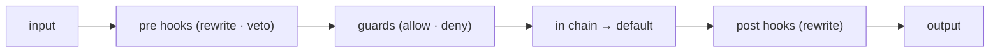

# Capability: hooks on the whole lifecycle

> Every lifecycle operation can be observed, rewritten, guarded, replaced or vetoed, from
> code in this process or from another one.

## What it is

The dispatcher runs every operation of the catalogue (40 points, named `area.operation`)
through four stages: `pre` hooks that may rewrite the input or veto, a **guard** stage
where policy allows or denies the final input, the `in` chain that wraps or replaces the
implementation, and `post` hooks that may rewrite the output. Remote hooks over JSON-RPC
or as MCP tools implement the same traits. Observability is itself a hook set.

## Current behaviour

- WHEN an operation runs THEN the system SHALL run its `pre` hooks in order (priority,
  then `after` constraints, then registration), stopping at the first veto.
- WHEN every `pre` hook has run THEN the system SHALL run every guard on the final input;
  a guard cannot mutate and a guard failure always fails the operation.
- WHEN an `in` hook calls `next` with an input whose identity differs from the one the
  guards approved THEN the system SHALL fail the operation with `TargetChanged`.
- WHEN a `pre` or `post` hook fails THEN the system SHALL apply the point's policy:
  fail-closed on `tool.execute`, `a2a.send`, `state.persist` and `inbox.accept`
  (not configurable), log-and-continue elsewhere unless configured otherwise.
- WHEN a hook is remote THEN it SHALL receive `{cx, input}` (task id, context id,
  traceparent) over JSON-RPC (`hook.<phase>.<point>`) or as an MCP tool
  (`hook_<phase>_<point>`) and answer with the same outcomes a local hook returns.
- The catalogue SHALL cover sherma's twenty points (a contract test checks the design's
  mapping table against `HookPoint::ALL`).

## Design

- [`design.md` § Hooks][design] (R4), with the catalogue and sherma mapping.
- Code: `crates/rusty-harness/src/harness/hooks/`.

## History

| Work item | What changed | Links |
|-----------|--------------|-------|
| issue-3 (M1, tasks 5–6) | Catalogue, dispatcher with the guard stage, remote hooks | [spec](https://github.com/MadaraUchiha-314/rusty-harness/blob/loop/issue-3-spec/docs/specs/issue-3/), PR #7 |

[design]: https://github.com/MadaraUchiha-314/rusty-harness/blob/loop/issue-3-spec/docs/specs/issue-3/design.md
