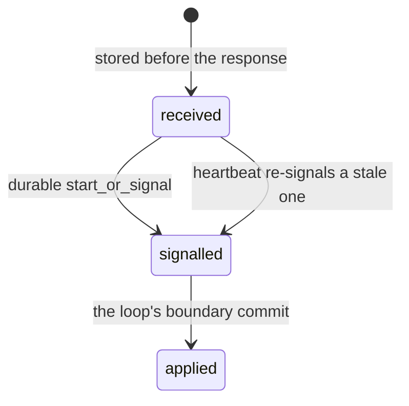

# Capability: the durable inbox

> Everything that happens to a task arrives as an event through one door, is stored
> before it is answered, and is applied exactly once.

## What it is

An `InboxEvent` is one A2A `StreamResponse` (a message, a status or artifact update)
addressed to a task or a context, with its sender, its delivery policy and its trace
context. Two routes feed it: every `SendMessage` through the server's executor, and
`POST /inbox` for webhooks and other agents' push notifications, translated by a
`WebhookAdapter`. `Inbox::accept` validates (the task exists and is not terminal, the
context matches, only a message may create a task), runs the `inbox.accept` hooks
(fail-closed), stores the event as `Received`, starts or signals durable execution and
marks it `Signalled`; the loop applies it at its next boundary and the commit that does
records it as `Applied` on the task, so a duplicate signal applies nothing twice.

## Current behaviour

- WHEN an event arrives for a running task THEN it SHALL be applied at the next loop
  boundary at the latest; a message interrupts, a sub-agent's update queues until the
  step awaiting it completes (R20.4).
- WHEN an event arrives for a task waiting in `input-required` THEN the task SHALL wake
  and run the turn.
- WHEN the same event is signalled twice THEN it SHALL be applied once (R20.5).
- WHEN an event names a terminal task THEN it SHALL be refused and no task created; a
  follow-up starts a new task in the same context with `referenceTaskIds` (R21.6).
- WHEN `POST /inbox` is called THEN the same gate and participant guard SHALL apply as to
  any A2A operation: `202` with the event's reference, `404` for a stranger, `409` for a
  terminal task, `400` for a body that is not an event (boundary 2).
- WHEN an event carries no `traceparent` THEN it SHALL join the task's persisted trace.

## Design

- [`design.md` § Inbox and events][design] (R20, R21.5–6, boundary 2).
- Code: `crates/rusty-harness/src/app_service/inbox/`,
  `crates/rusty-harness/src/interaction/events/`.

## History

| Work item | What changed | Links |
|-----------|--------------|-------|
| issue-3 (M3, task 22) | The inbox, its tri-state events, the delivery policy, the webhook adapters | [spec](https://github.com/MadaraUchiha-314/rusty-harness/blob/loop/issue-3-spec/docs/specs/issue-3/), PR #9 |
| issue-3 (M3, task 27) | The `/inbox` route behind the gate and the participant guard | PR #9 |

[design]: https://github.com/MadaraUchiha-314/rusty-harness/blob/loop/issue-3-spec/docs/specs/issue-3/design.md
