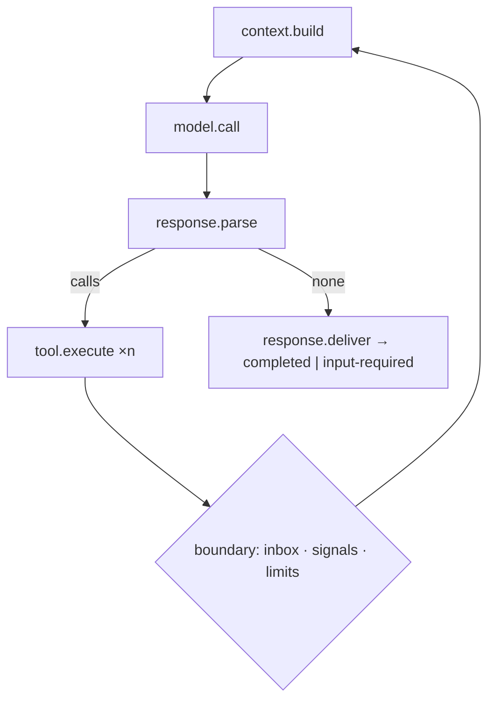

# Capability: the core loop

> sherma's agent in A2A types, running the canonical loop with every step hookable,
> limits that stop with a typed outcome, and a context window assembled from positions
> and compacted before it overflows.

## What it is

`Agent` is sherma's base agent translated to the official A2A types (`card`, `schemas`,
`send_message` as a stream, `cancel_task`). `LocalAgent` runs the loop: build the
context (`context.build`), call the model (`model.call`), parse tool calls
(`response.parse`), execute them (`tool.execute`), repeat; the whole run is `task.run`.
A response without tool calls is delivered and the task's mode decides between
`completed` and `input-required`. Events and stop signals that arrive while a step runs
are observed at the loop boundary. The context is built from ordered positions with the
stable prefix first and a cache breakpoint after it; content from users, tools,
sub-agents and skills enters only as framed data. Compaction summarises the oldest
turns above the threshold, keeping the recent and pinned ones verbatim. Durable mode
`none` runs the same loop in process and resumes open tasks after a restart.

## Current behaviour

- WHEN a task runs THEN each of the four steps SHALL be a hook point and the run itself
  SHALL be `task.run`.
- WHEN the model answers without tool calls THEN the system SHALL deliver the response
  and close a one-shot task or move a long-running one to `input-required`.
- WHEN a limit is reached THEN the loop SHALL stop with `LimitReached` and move the task
  to `input-required` (degraded) or `failed` per `[loop] on_limit`.
- WHEN a message, a cancel or a complete arrives for a running task THEN the system SHALL
  apply it at the next loop boundary at the latest; a complete or cancel cancels
  in-flight tools through their token.
- WHEN a parent task reaches a terminal state THEN its non-terminal sub-tasks SHALL be
  cancelled (the default policy).
- WHEN the context is assembled THEN the stable positions SHALL come first with the
  breakpoint after them, every untrusted position SHALL follow the framing fragment, and
  the token estimate SHALL be reported on the trace and corrected from provider usage.
- WHEN the estimate exceeds the threshold THEN the system SHALL summarise the oldest
  turns, keep pinned and recent ones verbatim, and persist the summary.
- WHEN the harness restarts in mode `none` THEN it SHALL resume every non-terminal
  task from its last persisted iteration.

## Design

- [`design.md` § Agent and the core loop, § Context window manager, § Compaction,
  § Durable execution][design] (R11, R15, R16, R22.7).
- Code: `crates/rusty-harness/src/harness/core_loop/{agent.rs,context_window,compaction}`,
  `crates/rusty-harness/src/app_service/durable/none/`.

## History

| Work item | What changed | Links |
|-----------|--------------|-------|
| issue-3 (M2, tasks 16–17) | Context builder and compactor, the agent trait and the loop, durable mode `none` | [spec](https://github.com/MadaraUchiha-314/rusty-harness/blob/loop/issue-3-spec/docs/specs/issue-3/), PR #8 |

[design]: https://github.com/MadaraUchiha-314/rusty-harness/blob/loop/issue-3-spec/docs/specs/issue-3/design.md
