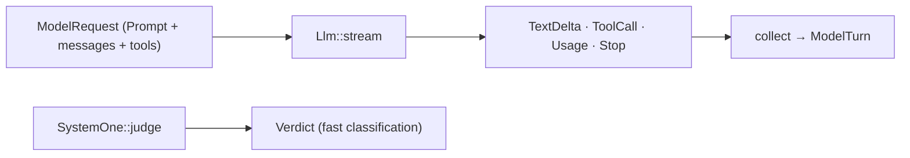

# Capability: models, LLM and System One

> One `Llm` interface over every provider, streamed, retried and modality-checked; a
> `SystemOne` fast judge beside it; `/model` and `/effort` switch the next call.

## What it is

The loop talks to a model through one trait, `Llm::stream(ModelRequest)`, which yields
text deltas, complete tool calls, usage and a stop reason. Two thin clients implement it
over each provider's HTTP API (OpenAI Chat Completions and anything compatible through
`base_url`; Anthropic Messages with cache breakpoints), both built for native and
`wasm32` from the same code (Q16). `Retrying` wraps any model with the configured
backoff on retryable failures; `ModelRouter` resolves the alias the task's selection
names, so a command can switch models between calls without a restart.

## Current behaviour

- WHEN a model is configured under `[models.<alias>]` THEN the system SHALL build the
  provider's client with its credential resolved from a `SecretRef` and register it
  under the alias; `default` is the alias the loop starts with.
- WHEN a request carries a modality the model lacks THEN the system SHALL fail before
  any event with a non-retryable error naming the modality.
- WHEN a provider answers with a retryable status THEN `Retrying` SHALL wait the
  configured backoff (honouring `Retry-After`) and try again up to `max_attempts`.
- WHEN `/model <alias>` or `/effort <level>` runs THEN the next call SHALL use the new
  selection; nothing restarts.
- WHEN the context builder places a cache breakpoint THEN the Anthropic client SHALL set
  `cache_control` there and the OpenAI client SHALL keep the prefix stable.
- WHEN a System One judgement is needed THEN the system SHALL ask the configured HTTP
  classifier or, absent one, the LLM on the `system-one/classify` fragment.
- WHEN a provider refuses with a body that echoes the credential THEN the error SHALL
  carry `[redacted]` where the credential was (abuse 7).

## Design

- [`design.md` § Models][design] (R9).
- Code: `crates/rusty-harness/src/harness/models/`, `crates/rusty-harness/src/harness/commands/` (`ModelRouter`).

## History

| Work item | What changed | Links |
|-----------|--------------|-------|
| issue-3 (M2, tasks 11, 13) | `Llm`, OpenAI and Anthropic clients, `Retrying`, System One, the model router behind `/model` and `/effort` | [spec](https://github.com/MadaraUchiha-314/rusty-harness/blob/loop/issue-3-spec/docs/specs/issue-3/), PR #8 |

[design]: https://github.com/MadaraUchiha-314/rusty-harness/blob/loop/issue-3-spec/docs/specs/issue-3/design.md
