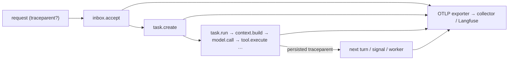

# Capability: observability

> One trace per task from the request to the terminal state, exported over OpenTelemetry;
> Langfuse as a hook set; structured logs that never carry a credential.

## What it is

Tracing is a hook set on the public catalogue: `TracingHooks` wraps every operation in a
span carrying the task id, the context id, the point name, the outcome and the
operation's summary attributes. A task adopts a W3C `traceparent` when it is created
(the caller's, else a fresh one) and persists it on its record and on every inbox event,
so the spans of every later turn, signal and worker join the same trace. Export is OTLP
over HTTP when `[o11y] otlp_endpoint` is set; Langfuse is a second hook set behind
`[o11y] langfuse`. Every sink sees fields through the redaction layer.

## Current behaviour

- WHEN a request is received THEN the system SHALL open a trace that spans every
  operation of the task until it is terminal, and every span SHALL carry the task id and
  the context id (R24.1).
- WHEN the request carries a valid `traceparent` THEN the new task SHALL adopt that trace;
  otherwise it SHALL mint one. A later request for the same task, with or without a
  `traceparent` of its own, SHALL join the task's persisted trace.
- WHEN `[o11y] otlp_endpoint` is set THEN spans SHALL be exported over OTLP/HTTP
  (protobuf) to that endpoint; a URL naming only the collector gets `/v1/traces`
  appended (R24.2). Without it nothing is exported.
- WHEN `[o11y] langfuse = true` THEN `task.run`, `model.call` and `tool.execute` SHALL
  carry Langfuse's observation attributes (`langfuse.observation.type` agent, generation,
  tool; `langfuse.session.id`; `gen_ai.request.model`; `gen_ai.usage.*`) on a child span,
  as a hook set and not core code (R24.3).
- WHEN the harness logs THEN credential-shaped fields SHALL read `[redacted]`, content
  fields SHALL be truncated above `debug`, and token *counts* SHALL stay visible (R24.4).
- WHEN a provider refuses a call with a body that echoes the credential THEN the error
  recorded on the task SHALL carry `[redacted]` in its place (abuse 7).
- WHEN the binary starts THEN it SHALL install the subscriber from `[o11y]` before
  anything else runs, and flush the exporter on exit.

## Design

- [`design.md` § Observability][design] (R24), § Security design (abuse 7).
- Code: `crates/rusty-harness/src/app_service/o11y/` (`trace`, `langfuse`, `redact`).

## History

| Work item | What changed | Links |
|-----------|--------------|-------|
| issue-3 (M1, task 9) | Tracing hooks, OTLP export, the redaction layer | [spec](https://github.com/MadaraUchiha-314/rusty-harness/blob/loop/issue-3-spec/docs/specs/issue-3/), PR #7 |
| issue-3 (M3, task 26) | One persisted trace per task, Langfuse hook set, the end-to-end canary | PR #9 |

[design]: https://github.com/MadaraUchiha-314/rusty-harness/blob/loop/issue-3-spec/docs/specs/issue-3/design.md
