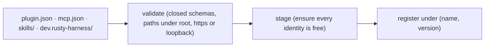

# Capability: agent plugins

> A directory in the Agent Plugins format (or the same spec in memory) contributes
> skills, MCP servers, hooks, commands and prompt fragments, all versioned and refused
> whole when any part is invalid.

## What it is

`PluginLoader` discovers `plugin.json` under the configured paths, validates every
file against the closed schemas (unknown fields reported and ignored only where the
specification says so), substitutes `${PLUGIN_ROOT}` and `${PLUGIN_DATA}`, and installs
the plugin in one all-or-nothing step: skills, MCP servers, declared remote hooks,
declared commands and prompt fragments are staged, every identity is checked for
conflicts, and only then registered under the plugin's `(name, version)`. A plugin's
`system/base` fragment replaces the default system prompt without a code change.

## Current behaviour

- WHEN a plugin directory is discovered THEN the system SHALL parse its manifest, its
  `mcp.json` and its skills, reporting unknown fields and refusing a name outside the
  specification's pattern.
- WHEN a configured plugin path cannot be listed (missing, unreadable, or relative to
  a different working directory) THEN the harness SHALL fail to build with an error
  naming `paths` and the directory, rather than start without the plugins it was given.
- WHEN any file of a plugin is invalid (a command outside the plugin root, an `http`
  endpoint off loopback, a hook on a point the catalogue lacks) THEN the system SHALL
  refuse the whole plugin and register nothing.
- WHEN a plugin is installed THEN every entity it contributes SHALL carry the plugin's
  version, and a second install of the same identity SHALL fail with a conflict naming
  the holder.
- WHEN a plugin ships a fragment with the id of a built-in prompt THEN the plugin's
  version SHALL replace the default.
- WHEN a plugin declares a command THEN it SHALL run on the plugin's JSON-RPC endpoint or
  MCP server through the same transport as a remote hook, with the role check applied.

## Design

- [`design.md` § Plugins][design] (R5), decision on the `dev.rusty-harness` namespace (Q17).
- Code: `crates/rusty-harness/src/harness/plugins/`; fixture `tests/fixtures/plugins/demo/`.

## History

| Work item | What changed | Links |
|-----------|--------------|-------|
| issue-3 (M2, tasks 12–13, 15) | Discovery, validation, all-or-nothing install, declared hooks and commands, MCP servers from `mcp.json` | [spec](https://github.com/MadaraUchiha-314/rusty-harness/blob/loop/issue-3-spec/docs/specs/issue-3/), PR #8 |
| issue-3 (M7, task 51) | An unlistable configured plugin path fails the build instead of being skipped; found when the demo ran from the wrong directory | PR #13 |

[design]: https://github.com/MadaraUchiha-314/rusty-harness/blob/loop/issue-3-spec/docs/specs/issue-3/design.md
