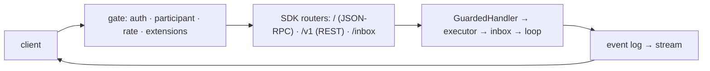

# Capability: the A2A server

> One binary serves the agent over A2A 1.0 on the official SDK, behind a gate that
> authenticates, limits and negotiates extensions, and refuses to be reachable without
> credentials.

## What it is

`rusty-harness` serves the agent card, JSON-RPC and REST bindings from the official
`a2a-server-lf` routers. The harness's executor turns every `SendMessage` into an inbox
event and streams the task's own event log back (the `Task` snapshot first, replies on
status updates, the stream ending when the turn ends). A `GuardedHandler` wraps the SDK's
handler with the participant guard, the membership filter on `ListTasks`, the stream
budget and the per-viewer channel redaction. An axum layer in front, the *protocol gap*,
does what the SDK does not: authentication, the participant header, rate limiting and
the `A2A-Extensions` negotiation and echo. Push-notification webhooks go only to
allowlisted hosts.

## Current behaviour

- WHEN `[server.security]` is absent THEN the server SHALL bind a loopback address only
  and refuse any other `bind` at startup (fail-closed list).
- WHEN a bearer token or API key is configured THEN every request except the agent card
  SHALL present it (constant-time compared) or be answered `401` before any task exists.
- WHEN a request names a task the caller does not participate in THEN the answer SHALL
  be `TaskNotFound`, and `ListTasks` SHALL list only the caller's tasks (abuse 2).
- WHEN a request carries `x-rusty-harness-participant` THEN that participant SHALL be the
  caller; otherwise the authenticated principal, or `operator` on loopback.
- WHEN a caller exceeds `[server.limits] requests_per_minute` or holds
  `streams_per_caller` streams THEN the next request or stream SHALL be refused while
  other callers' streams continue (abuse 8).
- WHEN a request names `A2A-Extensions` THEN the server SHALL activate the ones it
  advertises, echo them in the response, and ignore the rest (R19.3); the reserved
  internal headers SHALL never be trusted from a client.
- WHEN a request names A2A-Version below 1.0 THEN it SHALL be rejected (R19.9).
- WHEN a push-notification config names a host outside `[server.push] allow_hosts`, an
  IP literal, or anything when the list is empty THEN it SHALL be refused (abuse 9).
- WHEN the card is built THEN it SHALL come from the configuration minus every credential
  reference, advertise the six `rusty-harness` extensions and A2UI, and name the bound
  address (snapshotted in `tests/snapshots/agent_card.json`).
- The official TypeScript SDK's conformance suite (`web/tests/`) SHALL pass against the
  binary in CI (T3).

## Design

- [`design.md` § A2A API server, § Security design][design] (R19, boundaries 1–2,
  abuse 2, 8, 9).
- Code: `crates/rusty-harness/src/app_service/a2a_server/` (`protocol_gap`,
  `channels_api`), `crates/rusty-harness/src/bin/rusty-harness.rs`.
- Guide: [Run the server](../guide/run-the-server.md).

## History

| Work item | What changed | Links |
|-----------|--------------|-------|
| issue-3 (M3, tasks 20–21, 23, 25) | Server on the official SDK, the protocol gap, channels on the server, the `cli` binary | [spec](https://github.com/MadaraUchiha-314/rusty-harness/blob/loop/issue-3-spec/docs/specs/issue-3/), PR #9 |
| issue-3 (M3, task 27) | The `/inbox` route, the conformance suite in CI | PR #9 |

[design]: https://github.com/MadaraUchiha-314/rusty-harness/blob/loop/issue-3-spec/docs/specs/issue-3/design.md
