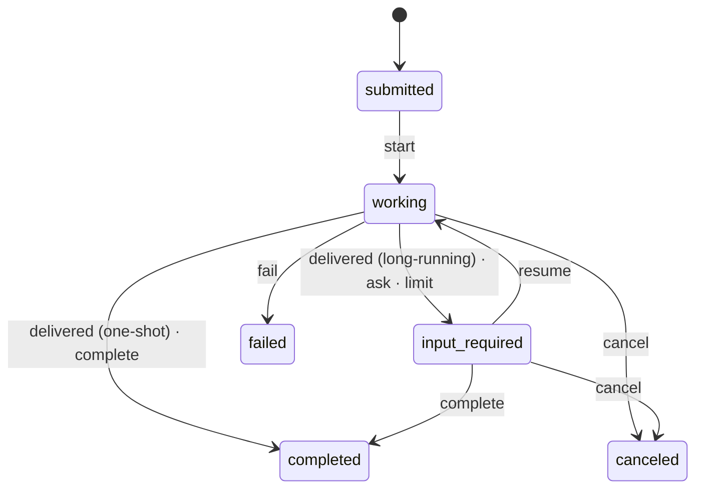

# Capability: tasks, plans, state and persistence

> One task record aligned with A2A, a plan as a DAG, schema-checked state, and one
> atomic commit path into a memory or file store that survives a crash.

## What it is

`TaskRecord` carries what A2A does not (name, goal, acceptance criteria, mode,
participants with roles, sub- and parent-task links, the pending calls) and projects to
an A2A `Task` whose metadata holds those fields under the `task/v1` and
`participants/v1` extensions. The A2A `state` only ever holds standard values; what A2A
cannot say is a sub-state on the status message. `transition` is the one state machine.
`Plan` is a DAG of steps with inline topological ordering; `AgentState` holds JSON under
keys, validated against a declared schema. `PersistenceStore::commit` lands a task's
step atomically and idempotently; `MemoryStore` is the default and `FileStore` is a
journal from which every other record is rebuilt on open.

## Current behaviour

- WHEN a task changes state THEN the system SHALL accept only the moves of the diagram,
  run the `task.state_change` hooks and emit the A2A status update; an illegal move is a
  typed error that changes nothing.
- WHEN a task is exposed over A2A THEN its extra fields SHALL ride in `metadata` under
  the extension URIs and its sub-state on the status message.
- WHEN a plan edit would close a cycle THEN the system SHALL refuse it and leave the plan
  unchanged.
- WHEN the model calls `plan.update` THEN the task's plan SHALL be set to those steps and
  dependencies (steps that keep their id keep their progress), persisted through
  `plan.persist`; WHEN it calls `plan.step_done` THEN the step's outcome SHALL go through
  the `step.execute` hooks and be recorded on the plan (R13.3).
- WHEN a task has a plan THEN the model SHALL see it at the context's `Plan` position and
  the surfaces SHALL receive it as an `application/vnd.rusty-harness.plan+json` artifact
  under `plan/v1`, drawn in the TUI's plan strip and the web's task panel (R13.4).
- WHEN a state write violates the key's schema THEN the system SHALL refuse it with the
  JSON pointer of the offending value.
- WHEN a commit carries events already in the log THEN the store SHALL skip them; WHEN
  the writer's expected version is stale THEN the store SHALL refuse the commit; WHEN
  the task is terminal THEN the store SHALL refuse further writes.
- WHEN the file store reopens after a crash THEN it SHALL replay its journal and rebuild
  any view the journal is ahead of.
- WHEN a subscriber tails a task THEN it SHALL see only the events its channels admit.

## Design

- [`design.md` § Task and lifecycle, § Plan and Step, § State and persistence][design]
  (R12–R14, R21).
- Code: `crates/rusty-harness/src/harness/core_loop/{task,plan,state,persistence}/`.

## History

| Work item | What changed | Links |
|-----------|--------------|-------|
| issue-3 (M2, task 14) | Record and state machine, plan DAG, schema-checked state, memory and file stores, chaos test | [spec](https://github.com/MadaraUchiha-314/rusty-harness/blob/loop/issue-3-spec/docs/specs/issue-3/), PR #8 |
| issue-3 (M7, task 53) | The `plan.update` and `plan.step_done` tools, the `step.execute` operation, the plan to the context and to surfaces as a `plan/v1` artifact | PR #13 |

[design]: https://github.com/MadaraUchiha-314/rusty-harness/blob/loop/issue-3-spec/docs/specs/issue-3/design.md
