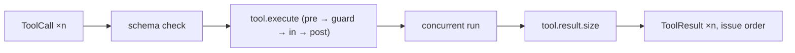

# Capability: tools and MCP

> The model's calls run concurrently and come back in issue order; every call is
> validated, policed by the guard stage and sized before it enters the context; MCP
> servers contribute tools under their own namespace.

## What it is

A `Tool` is an entity with a descriptor (name, description, JSON schema, idempotency).
`ToolExecutor` validates each call against the schema, runs `tool.execute` per call
(the `ToolPolicy` guard decides by role), executes the model's calls together and
returns their results in the order the model issued them. An unknown tool, invalid
input, a veto or a failure becomes a typed tool error for the model, never a task
failure. `tool.result.size` truncates or summarises a result above the configured
size. MCP servers are reached over the official `rmcp` crate natively and over the
host's channel in the browser; each remote tool registers as `<server>/<tool>`. A tool
may suspend the loop (a question to a participant, a sub-agent to wait for).

## Current behaviour

- WHEN the model issues several calls THEN the system SHALL run them concurrently and
  return every result in issue order.
- WHEN a call names an unregistered tool or violates the schema THEN the system SHALL
  return a typed tool error and continue the task.
- WHEN a `pre` hook vetoes or the policy guard denies THEN the tool SHALL NOT run and
  the model SHALL receive a denied error; admins and assignees may call every tool,
  other roles only idempotent ones unless an allowlist says otherwise.
- WHEN a result exceeds `[tools] max_result_bytes` THEN the system SHALL apply the
  configured policy (`truncate` keeps head and tail; `summarise` asks a model).
- WHEN an MCP server is configured THEN the system SHALL connect (stdio with a scrubbed
  environment, or streamable HTTP), list its tools and register each under the server's
  identity; the legacy SSE transport is refused.
- The memory and sandbox providers are typed seams with no implementation (S2).

## Design

- [`design.md` § Tools and MCP][design] (R8, Q14).
- Code: `crates/rusty-harness/src/harness/tools/`; fixture server `tests/fixtures/plugins/demo/bin/echo-mcp.rs`.

## History

| Work item | What changed | Links |
|-----------|--------------|-------|
| issue-3 (M2, task 15) | Executor, policy guard, size policy, MCP over `rmcp` and the host channel | [spec](https://github.com/MadaraUchiha-314/rusty-harness/blob/loop/issue-3-spec/docs/specs/issue-3/), PR #8 |

[design]: https://github.com/MadaraUchiha-314/rusty-harness/blob/loop/issue-3-spec/docs/specs/issue-3/design.md
