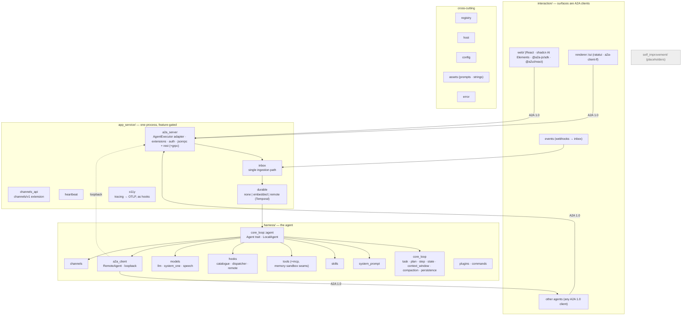
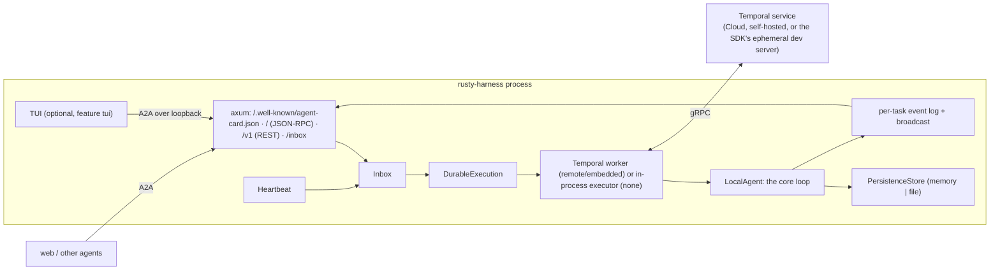
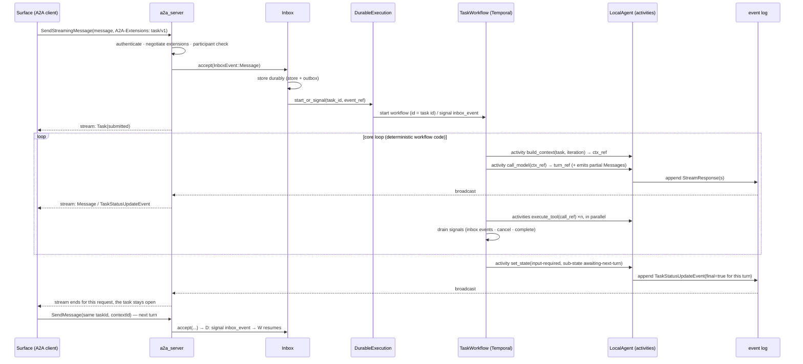
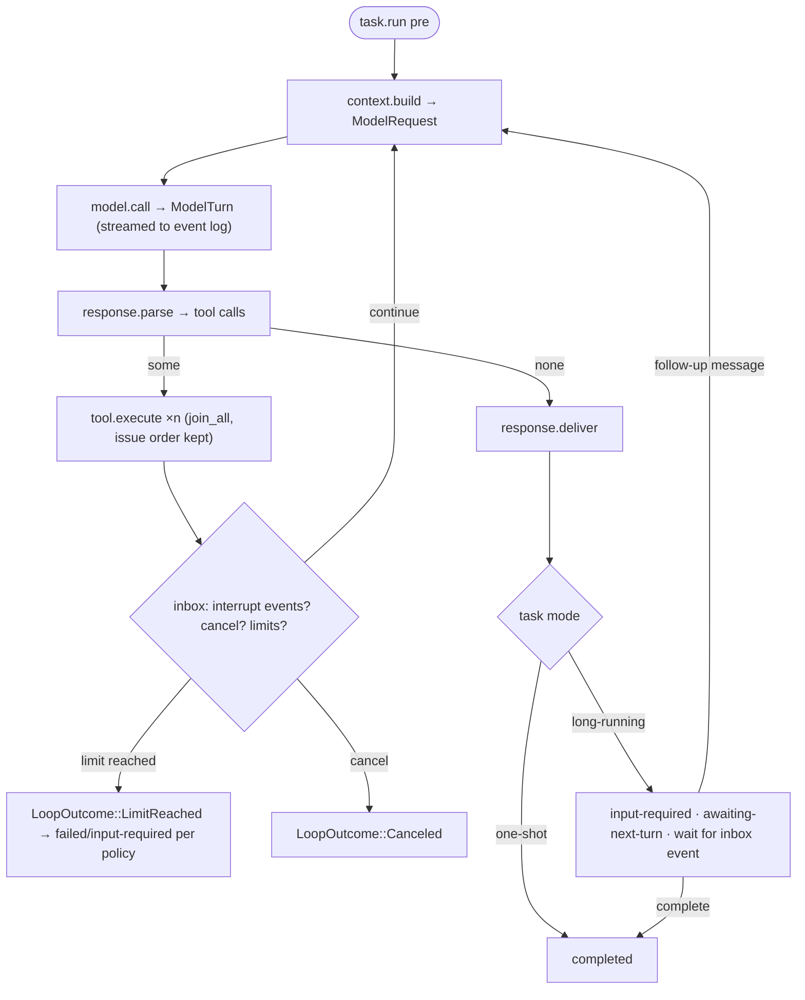
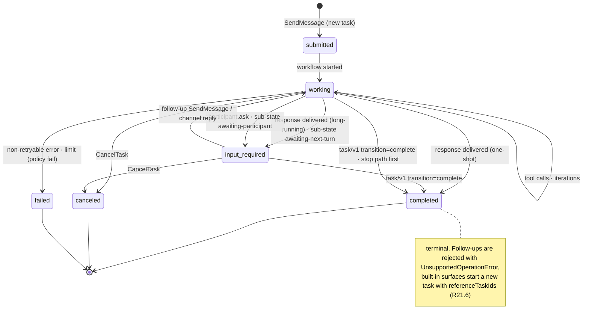
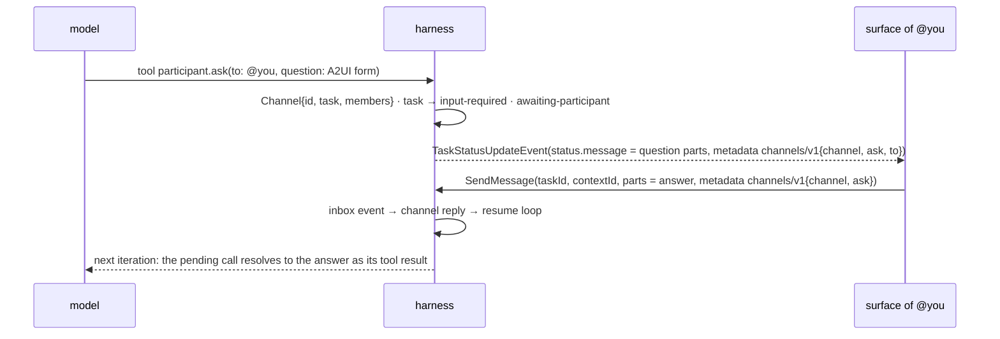
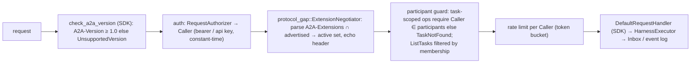
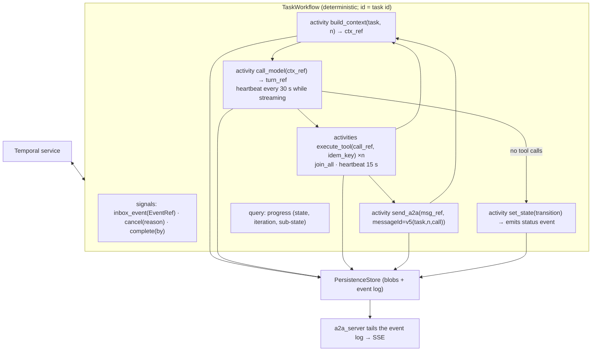

<!-- Written per the `the-loop:writing` skill: front-load each section's
     conclusion, draw it rather than describe it (3+ named parts -> a mermaid
     diagram), and keep the formal registers formal (EARS, abuse cases,
     RFC-2119, API contracts, schema descriptions). No length limit — length
     follows the change; the test is whether a sentence can come out without
     losing information. A gated section stays even when it is empty. -->

# Design: rusty-harness, an opinionated production-grade agent harness

> Phase 2 of 3 (requirements → design → tasks). Derives from the approved
> requirements. MUST be reviewed and approved before moving to tasks breakdown.

## Overview

**The harness is one Rust crate whose module tree is the architecture diagram, with
every pluggable thing behind one `Entity` + registry mechanism, every lifecycle operation
wrapped in `pre`/`in`/`post` hooks, every invocation path an A2A 1.0 message, and the
core loop running either in-process or as a Temporal workflow whose activities are the
loop's side effects.** The reader is the approver of
[`requirements.md`](requirements.md), who knows the repository (a `hello()` function and
the runtime seam) and wants the shape of what gets built, interface by interface, before
the task DAG is cut.

What was broken: the repository holds packaging and a runtime seam; the issue describes
30 modules. Nothing in between exists, and the requirements are 33 groups and 305 SHALLs
that touch five external specifications (A2A 1.0, Agent Plugins 1.0, Agent Skills, MCP,
A2UI 0.9.1) and two infrastructure SDKs (Temporal, OpenAI).

What this design does about it:

- **One mechanism per concern, used everywhere.** `Entity` + `Registry` for identity and
  replacement (R1), `Operation` + `HookDispatcher` for interception (R4), `Host` for
  everything the platform supplies (R4.7, R29), `SecretRef` for credentials, `Prompt` for
  model-bound text (R33) and `Catalog` for human-bound text (R33). A reader who learns
  these six types has read most of the crate.
- **The official A2A Rust SDK is the protocol layer** (`a2a-lf`, `a2a-server-lf`,
  `a2a-client-lf`, protocol 1.0, S9). Its `AgentExecutor` is a stream-returning trait with
  exactly sherma's shape, so the harness's `Agent` trait is a one-to-one mapping (R11.1)
  and the A2A server is a thin adapter over it. The SDK negotiates no extensions and sets
  no caller identity; both gaps are closed in one clearly marked module
  (`app_service::a2a_server::protocol_gap`, R19.9).
- **Durable execution starts at the inbox, not in the executor** (R22.6): one Temporal
  workflow per task, started or signalled by the single ingestion path, so a task that
  spans many A2A requests is one workflow. Activities exchange store keys, not payloads,
  so workflow histories stay small; the same code runs in `none` mode through an
  in-process executor with the same trait.
- **Channels are not a second protocol.** A channel question is the task in A2A
  `input-required` carrying the rusty-harness `channels/v1` extension; the reply is a
  follow-up `SendMessage`. No new RPC methods, so any A2A 1.0 client already works.

What it costs: the official SDK crates are 0.x (API churn accepted, pinned); the Temporal
SDK raises the workspace MSRV from 1.88 to 1.92; the browser build gets the SDK's *types*
but needs an own `fetch` transport because neither SDK client crate compiles for
`wasm32`; voice goes through the harness (audio over A2A parts) rather than browser to
provider, which costs latency but keeps keys server-side (abuse case 11) and keeps every
path A2A (S5); and this work item ships single-replica deployment, with the shared-store
seam in place but no shared store.

What to check first: the [module tree](#module-tree-r2) (does it read like the diagram?),
the [hook catalogue](#hooks-r4) (is a point missing?), the
[durable execution design](#durable-execution-r22) (where the workflow starts and what an
activity is), and the [Security design](#security-design) (every boundary has a
mechanism and a negative test). Everything else is the requirements turned into
signatures.

## Architecture

**Four layers, one crate, one web package.** The core crate `rusty_harness` holds every
layer of the diagram as a top-level module; the Python and WASM crates stay adapters; the
web renderer is a bun workspace package `web/` (S4). The diagram below is the issue's
architecture with the design's component names.



### Runtime topology

**The default deployment is one process that is server, worker and (optionally) TUI
client at once; the same binary scales to a server fleet plus a worker fleet when
`durable.mode = "remote"` and a shared store exists (a later work item).** The TUI never
talks to the harness in-process: it is an A2A client of the loopback server, which is
what makes "attach to a remote harness" the same code path (R27.3).



### Request flow

One A2A request, long-running task, `remote` mode. Read it with the
[durable execution design](#durable-execution-r22): the workflow is started by the inbox,
streams back through the event log, and outlives the request.



### Module tree (R2)

**One top-level module per layer, one sub-module per box, named after the box; the
five cross-cutting modules sit beside them because they belong to no layer.** Each module
is traced to the requirements it satisfies (R2.3); the implementation must match this
tree, and a contract test asserts the tree (`module_tree_matches_design`).

```text
crates/rusty-harness/
  prompts/                       # R33 — every prompt fragment the crate authors, one .md each
  strings/en.json                # R33 — the string catalog (one file per locale, en = source of truth)
  src/
    lib.rs                       # crate root: re-exports, `#![deny(missing_docs)]`           R3
    runtime.rs                   # (exists) Runtime, MaybeSend                                   —
    error.rs                     # HarnessError taxonomy, A2A error mapping                      R1.6, R20.6
    config/                      # typed Config, TOML loader, env/code layering, JSON schema     R27.2, R30.4, Q9
    registry/                    # Entity, EntityId, EntityKind, Registry, Placement             R1
    host/                        # Host capability traits; native impls behind rt-tokio          R4.7, R29.2
    assets/                      # PromptFragment registry + templating; Catalog (ICU subset)    R33
    interaction/                 # ── layer 1 ──────────────────────────────────────────────
      surface/                   # Surface capabilities, modality negotiation                    R25.1–3
      renderer/                  # Renderer trait; a2ui/ (basic catalog model); tui/ [tui]       R25.4–6, R27
      events/                    # inbound event sources → inbox (webhook receiver)              R20.1
    app_service/                 # ── layer 2 ──────────────────────────────────────────────
      a2a_server/   [server]     # AgentExecutor adapter, extensions, auth, bindings, protocol_gap R19
      inbox/                     # InboxEvent, Inbox, delivery policy, outbox                    R20
      channels_api/              # channels/v1 extension handling over the A2A server            R18.5–6
      heartbeat/                 # Heartbeat service, liveness, stalled-task detection            R23
      durable/                   # DurableExecution trait, none/, temporal/ [durable-temporal]   R22
      o11y/                      # TracingHooks (OTLP), log setup, redaction layer                R24
    harness/                     # ── layer 3 ──────────────────────────────────────────────
      core_loop/
        agent.rs                 # Agent trait, LocalAgent (the loop), limits                      R11
        task/                    # TaskRecord, participants, sub/parent links, state machine      R12, R21
        plan/                    # Plan DAG, Step                                                  R13
        state/                   # AgentState, schema-checked keys                                 R14.1
        context_window/          # ContextTemplate, positions, ContextBuilder, token estimate      R15
        compaction/              # Compactor, policy, summariser                                   R16
        persistence/             # PersistenceStore trait, MemoryStore, FileStore [rt-tokio]       R14.2–4
      system_prompt/             # default prompt assembly from fragments                         R7
      skills/                    # SKILL.md parser, progressive disclosure, activation             R6
      tools/                     # Tool trait, ToolExecutor (parallel), mcp/ [mcp], memory.rs, sandbox.rs  R8
      hooks/                     # HookPoint catalogue, Operation, HookDispatcher, remote/         R4
      models/                    # llm/ (openai, anthropic), system_one/, speech/ (stt, tts, voice) R9, R28
      a2a_client/                # RemoteAgent, LoopbackAgent, wasm_transport [wasm32]            R17, R15.3
      channels/                  # Channel entity, ask/create-task tools                           R18
      plugins/                   # Agent Plugins loader, dev.rusty-harness namespace               R5
      commands/                  # Command entity, parser, /exit /model /effort                    R10
    self_improvement/            # ── layer 4 (S1) ─────────────────────────────────────────
      simulation.rs evaluation.rs optimization.rs   # doc-commented placeholders                 R2.2
    bin/rusty-harness.rs [cli]   # clap CLI: `rusty-harness [--config] [--url] [--no-tui]`         R27.1–2
  tests/                         # integration (Gherkin docstrings) + contract tests             R31
crates/rusty-harness-py/         # PyO3 adapters only (+ maturin `bin` for the CLI, Q8)           R30.2
crates/rusty-harness-wasm/       # wasm-bindgen adapters only; Host built from JS callbacks       R29.4
web/                             # React web renderer (bun workspace member)                       R26
```

`plugins/` and `commands/` are not boxes of the diagram; they are the issue's text
("Agent plugins", "Commands") and sit under `harness/` because that is the layer that
consumes them. `a2a_server` additionally exposes the `/inbox` route for the `events/`
sources, so the diagram's "Events" box is a route plus adapters, not a server of its own.

### Cargo features

| Feature | Enables | Default for |
|---|---|---|
| `rt-tokio` / `rt-wasm` | the runtime seam (exists) | native / wasm32 |
| `server` | `app_service::a2a_server`, axum bindings, inbox HTTP route | CLI, Python |
| `mcp` | `harness::tools::mcp` on `rmcp` (native only) | CLI, Python |
| `durable-temporal` | `app_service::durable::temporal` on `temporalio-sdk` (native only) | CLI, Python |
| `durable-embedded` | `durable-temporal` + the SDK's `testing` feature (ephemeral dev server) | CLI |
| `a2a-grpc` | the gRPC binding via `a2a-grpc` (tonic) | off |
| `tui` | `interaction::renderer::tui` on ratatui/crossterm | CLI |
| `audio` | microphone and speaker host impls on `cpal` | CLI |
| `cli` | the binary (`clap`), implies `server tui mcp durable-temporal audio` | the published binary |

The core with no features is the SDK: entities, hooks, the loop, the A2A client types,
`none` durability, and compiles for `wasm32` with `rt-wasm` (R29.1, R29.5). CI keeps
`cargo check --target wasm32-unknown-unknown --no-default-features --features rt-wasm`
as today.

## Components & interfaces

**Every public interface the implementation may introduce is inventoried here (R3.5);
a pull request that adds one not listed here links a design change first.** Signatures
are Rust, edition 2024, `async fn` in traits; traits that must be object-safe behind
`Arc<dyn …>` are marked `[dyn]` and use `#[harness_async_trait]`, which expands to
`async_trait` natively and `async_trait(?Send)` on `wasm32`. Nothing in the crate names
`Send` directly: `MaybeSend`/`MaybeSync` (the existing seam, empty on `wasm32`) bound
every trait and the two aliases every stream and future use,
`HarnessStream<'a, T> = Pin<Box<dyn Stream<Item = T> + MaybeSend + 'a>>` and
`HarnessFuture<'a, T> = Pin<Box<dyn Future<Output = T> + MaybeSend + 'a>>`, so browser
`fetch`, WebSocket and JS-callback futures, which are `!Send`, satisfy every contract
(R29.1–2). Where this document writes `BoxStream`/`BoxFuture` in *our* signatures it
means these aliases; the SDK's own signatures are quoted as the SDK spells them.

### Six types to learn first

| Type | Concern | Section |
|---|---|---|
| `Entity` / `Registry` | identity, replacement, local-or-remote resolution | [Registry](#registry-and-entities-r1) |
| `Operation` / `HookDispatcher` | every interception point | [Hooks](#hooks-r4) |
| `Host` | everything the platform supplies (HTTP, clock, secrets, files, audio, …) | [Host](#host-capabilities-r47-r29) |
| `SecretRef` / `Secret<T>` | credentials by reference, redacted by type | [Security design](#security-design) |
| `Prompt` / `PromptFragment` | model-bound text, only from markdown files | [Assets](#assets-prompts-and-strings-r33) |
| `Catalog` / `StringKey` | human-bound text, only from `strings/<locale>.json` | [Assets](#assets-prompts-and-strings-r33) |

### Registry and entities (R1)

**Responsibility:** give every pluggable unit one identity `(id, version)`, one trait per
kind, and one way to replace a default, regardless of where the instance runs.

```rust
pub struct EntityId { pub id: Arc<str>, pub version: Option<semver::Version> }   // R1.2

pub enum EntityKind { Prompt, Skill, Tool, Llm, SystemOne, Hook, Plugin, Command, Agent,
                      Channel, Surface, Renderer, PersistenceStore, DurableExecution,
                      SpeechToText, TextToSpeech, Voice }                         // R1.1

pub enum Placement { Local, Remote(RemoteEndpoint) }                              // R1.3–4
pub enum RemoteEndpoint { A2a { card_url: Url }, Mcp { server: EntityId }, Http { base_url: Url } }

pub trait Entity: MaybeSend + MaybeSync + 'static {          // dyn-compatible: no associated consts or generics
    fn kind(&self) -> EntityKind;
    fn entity_id(&self) -> &EntityId;
    fn placement(&self) -> Placement { Placement::Local }
}

pub struct Registry { /* one typed map per kind */ }
impl Registry {
    pub fn register<E: Entity>(&self, entity: Arc<E>) -> Result<(), RegistryError>;         // R1.2
    pub fn replace<E: Entity>(&self, entity: Arc<E>) -> Option<Arc<E>>;                     // R1.5
    pub fn get<E: Entity + ?Sized>(&self, id: &EntityId) -> Result<Arc<E>, RegistryError>;   // R1.3, R1.6
    pub fn list<E: Entity + ?Sized>(&self) -> Vec<Arc<E>>;
    pub fn latest<E: Entity + ?Sized>(&self, id: &str) -> Result<Arc<E>, RegistryError>;
}
pub enum RegistryError { NotFound { kind: EntityKind, entry: EntityId },
                         Conflict { kind: EntityKind, entry: EntityId, holder: Provenance } }
```

Unversioned kinds (`version: None`): `Surface`, `Renderer`, `Channel`, built-in hooks
and commands. Versioned: everything a plugin contributes (R5.5), prompts (R33.1), skills,
tools from MCP servers (the server's declared version), agents (the card's `version`).
`Provenance` records who registered an entity (`BuiltIn`, `Plugin(id)`, `Sdk`,
`Config`) so a conflict error names both parties (R5.6). Remote instances are ordinary
entities whose implementation is a proxy: `RemoteAgent` (A2A), `McpTool` (MCP),
`HttpLlm` (provider API), `RemoteHook` (JSON-RPC or MCP). Callers never see the
difference (R1.3).

### Host capabilities (R4.7, R29)

**Responsibility:** the only door through which the core touches the platform. Natively
the defaults are built in; on `wasm32` the host hands each capability in from JavaScript;
an embedding application may replace any of them. A capability that is not supplied makes
the entity that needs it fail at construction with `HarnessError::Unsupported`, never at
first use (R29.3).

```rust
pub struct Host { /* Arc<dyn …> per capability; builder below */ }
impl Host {
    pub fn native() -> Host;                     // rt-tokio: reqwest, std time, OS rng, keyring/env, std fs, tokio process
    pub fn builder() -> HostBuilder;             // .http(..).clock(..).rng(..).secrets(..).fs(..).process(..)
}                                                // .mcp_transport(..).microphone(..).speaker(..).websocket(..).log_sink(..)

pub trait HttpClient [dyn]   { async fn send(&self, req: HttpRequest) -> Result<HttpResponse, HostError>;
                               async fn send_streaming(&self, req: HttpRequest) -> Result<ByteStream, HostError>; }
pub trait WebSocketClient [dyn] { async fn connect(&self, url: Url, headers: Headers) -> Result<Box<dyn WebSocket>, HostError>; }
pub trait Clock [dyn]        { fn now(&self) -> DateTime<Utc>; }
pub trait Rng [dyn]          { fn fill(&self, buf: &mut [u8]); }
pub trait SecretResolver [dyn] { async fn resolve(&self, r: &SecretRef) -> Result<Secret<String>, SecretError>; }
pub trait FileSystem [dyn]   { async fn read(&self, p: &Path) -> Result<Vec<u8>, HostError>; async fn write_atomic(..); async fn list(..); }
pub trait ProcessSpawner [dyn] { async fn spawn(&self, cmd: Command) -> Result<Box<dyn ChildIo>, HostError>; }
pub trait McpTransport [dyn] { async fn connect(&self, target: McpTarget) -> Result<Box<dyn McpChannel>, HostError>; }
pub trait Microphone [dyn]   { async fn capture(&self, fmt: AudioFormat) -> Result<AudioStream, HostError>; }
pub trait Speaker [dyn]      { async fn play(&self, fmt: AudioFormat, audio: AudioStream) -> Result<(), HostError>; }
pub trait LogSink [dyn]      { fn emit(&self, record: LogRecord); fn export_span(&self, span: SpanRecord); }
```

| Capability | native default (`rt-tokio`) | `wasm32` | Used by |
|---|---|---|---|
| `HttpClient` | reqwest 0.13 (shared with the A2A SDK) | `fetch` via `web_sys`, host-configurable origin allowlist | LLM, System One, speech, A2A client, remote hooks, push sender |
| `WebSocketClient` | `tokio-tungstenite` | `web_sys::WebSocket` | Realtime voice, streaming transcription, MCP streamable HTTP upgrades |
| `Clock`, `Rng` | `std`, `getrandom` | `js_sys::Date`, `crypto.getRandomValues` | everywhere a timestamp or id is made |
| `SecretResolver` | `env:` → environment; `keyring:` → OS keyring (`keyring` crate); `file:` → fs | host callback only (`env:`/`file:` unsupported) | every entity holding a credential |
| `FileSystem` | `tokio::fs` | unsupported → file plugins, file store, `--config` unavailable | plugins, skills, FileStore, config |
| `ProcessSpawner` | `tokio::process` | unsupported → stdio MCP unavailable | MCP stdio, `embedded` Temporal |
| `McpTransport` | built from `ProcessSpawner`/`HttpClient` by `rmcp` | host-supplied (page proxies to a server) | tools::mcp (Q14) |
| `Microphone`, `Speaker` | `cpal` (feature `audio`) | `MediaDevices` via host | TUI push-to-talk, web voice handled in `web/` |
| `LogSink` | `tracing-subscriber` + OTLP exporter | console / JS callback | o11y (R24.5) |

Unavailable on `wasm32`, by construction (R29.3): file plugins, `FileStore`, stdio MCP,
`embedded` and `remote` durability (the `durable-temporal` feature is `cfg(not(wasm32))`,
so it fails at compile time), the TUI, the server. This is the whole list; everything
else is a capability the host can supply.

### Hooks (R4)

**Responsibility:** make every lifecycle operation interceptable in three places, with
typed input and output, deterministic ordering, fail-closed defaults where security
depends on it, and the same contract for local and remote hooks.** Observability is a hook
set (R4.8), which is the proof that the catalogue is sufficient.

```rust
pub trait Operation: 'static {                     // one per catalogue entry
    const POINT: HookPoint;                         // e.g. HookPoint::ToolExecute (a marker type, never behind dyn)
    type Input: Serialize + DeserializeOwned + Clone + MaybeSend;
    type Output: Serialize + DeserializeOwned + MaybeSend;
}
pub enum PreOutcome<I> { Continue(I), Veto(Veto) }   // R4.2
pub struct Veto { pub reason: StringKey, pub detail: Option<String>, pub by: EntityId }

pub trait PreHook<O: Operation> [dyn]  { async fn pre(&self, cx: &HookCx, input: O::Input) -> Result<PreOutcome<O::Input>, HookError>; }
pub trait InHook<O: Operation> [dyn]   { async fn run(&self, cx: &HookCx, input: O::Input, next: Next<'_, O>) -> Result<O::Output, HookError>; } // R4.3, middleware
pub trait PostHook<O: Operation> [dyn] { async fn post(&self, cx: &HookCx, input: &O::Input, output: O::Output) -> Result<O::Output, HookError>; } // R4.4
pub trait GuardHook<O: Operation> [dyn] { async fn guard(&self, cx: &HookCx, input: &O::Input) -> Result<GuardOutcome, HookError>; } // policy: runs last, cannot mutate
pub enum GuardOutcome { Allow, Deny(Veto) }

pub struct HookCx { pub task: Option<TaskId>, pub context_id: Option<ContextId>, pub caller: Option<Caller>,
                    pub trace: SpanContext, pub registry: Arc<Registry>, pub host: Arc<Host> }

pub struct HookDispatcher;
impl HookDispatcher {
    pub fn register<O: Operation>(&self, phase: Phase /* Pre | Guard | In | Post */, hook: Arc<dyn …>, order: HookOrder) -> EntityId;   // R4.5, R4.9
    pub async fn run<O: Operation>(&self, cx: &HookCx, input: O::Input,
                                   default: impl FnOnce(O::Input) -> HarnessFuture<'_, Result<O::Output>>) -> Result<O::Output, HarnessError>;
}
pub struct HookOrder { pub priority: i32 /* lower runs first, default 0 */, pub after: Vec<EntityId> }   // then registration order
pub enum FailurePolicy { FailClosed, LogAndContinue }                                                   // R4.6, per point, configurable
```

`run` executes every `pre` hook in order (stopping at the first veto, surfaced as
`HarnessError::Vetoed`), then the **guard stage**: every `GuardHook` runs on the final,
mutated input, may only allow or deny, and is always fail-closed; policy (tool allowlists,
role checks, agent registration, secret-shaped argument checks) registers as guards, never
as `pre`, so no later `pre` hook can rewrite what was approved. Then the innermost `in`
hook runs on exactly the guarded input (the last registered wraps the default; an `in`
hook may call `next` or replace the implementation, but the dispatcher compares the
operation's identity fields — tool name, agent id, command name, store key — before and
after and fails the operation with `HookError::TargetChanged` if an `in` hook moved
them), then every `post` hook. Remote
hooks (`hooks::remote`) implement the same three traits over JSON-RPC 2.0 (`POST`, method
`hook.<phase>.<point>`, params = `{cx, input}`) or as an MCP tool call named
`hook_<phase>_<point>`, matching sherma's two remote shapes (R4.10); the typed input and
output are the serde forms of the operation's types.

**The catalogue** (`HookPoint`, R4.1). Each row is an `Operation` with `pre`/`in`/`post`;
the default failure policy is `FailClosed` for `pre` on the rows marked 🔒 (R4.6).

| Point | Input → Output | Notes |
|---|---|---|
| `harness.start`, `harness.stop` | `Config` → `()` | registration time |
| `request.receive` | `InboundRequest` → `AcceptedRequest` | after auth, before inbox |
| `inbox.accept` | `InboxEvent` → `EventRef` | 🔒 persistence |
| `inbox.deliver` | `(EventRef, DeliveryKind)` → `Applied` | interrupt vs queue; sherma `interrupt` |
| `task.create`, `task.state_change` | `TaskDraft` → `TaskRecord`; `Transition` → `TaskRecord` | emits A2A status update |
| `task.run` | `TaskId` → `LoopOutcome` | the whole loop; sherma `graph_invoke` |
| `step.enter`, `step.execute`, `step.exit`, `step.error` | `StepRef` → … | sherma node hooks |
| `prompt.assemble` | `PromptPlan` → `Prompt` | R7.3 |
| `context.build` | `ContextRequest` → `ModelRequest` | R15.5 |
| `context.compact` | `CompactionPlan` → `CompactionResult` | R16.3, veto allowed |
| `model.create` | `ModelConfig` → `EntityId` (the model registered by the `in` chain) | sherma `model_create`; outputs stay serializable |
| `model.call` | `ModelRequest` → `ModelTurn` | sherma `model_call` |
| `response.parse` | `ModelTurn` → `Vec<ToolCall>` | the "extract tool calls" step |
| `tool.execute` 🔒 | `ToolCall` → `ToolResult` | sherma `tool_call`; policy lives in the guard stage |
| `tool.result.size` | `ToolResult` → `ToolResult` | R8.6 truncation policy |
| `a2a.send` 🔒 | `OutboundMessage` → `AgentReply` | sherma `agent_call`; sub-agents |
| `skill.load`, `skill.unload`, `skill.invoke` | `SkillRef` → … | sherma skill hooks, R6.4 |
| `state.persist` 🔒, `plan.persist` | `StateDelta` → `()`; `Plan` → `()` | R14.2–3 |
| `response.deliver` | `Delivery` → `()` | final/partial messages |
| `command.invoke` | `CommandCall` → `CommandResult` | `pre` veto = role check (abuse 10); emits invoked/executed/failed |
| `participant.ask`, `participant.delegate` | `Ask` → `AskHandle`; `Delegation` → `TaskId` | R18.4 override |
| `durable.activity_run`, `durable.activity_failure`, `durable.activity_retry` | `ActivityRef` → …; `ActivityFailure` → `()`; `RetryDecision` → `RetryDecision` | R22.3; failure and retry run inside the `retry_decision` activity |
| `heartbeat.tick`, `task.stalled` | `Liveness` → `()`; `StalledTask` → `StallAction` | R23.3 |
| `harness.error` | `HarnessError` → `HarnessError` | sherma `error` |
| `infra.http`, `infra.clock`, `infra.random`, `infra.secret` | the `Host` calls | R4.7: an `in` hook replaces the host impl |

**sherma's twenty points mapped** (R4.11):

| sherma | rusty-harness point / phase |
|---|---|
| `before_model_call` / `after_model_call` | `model.call` pre / post |
| `before_tool_call` / `after_tool_call` | `tool.execute` pre / post |
| `before_agent_call` / `after_agent_call` | `a2a.send` pre / post |
| `before_skill_load` / `after_skill_load` | `skill.load` pre / post |
| `before_skill_unload` / `after_skill_unload` | `skill.unload` pre / post |
| `before_interrupt` / `after_interrupt` | `inbox.deliver` pre / post with `DeliveryKind::Interrupt` |
| `before_graph_invoke` / `after_graph_invoke` | `task.run` pre / post |
| `node_enter` / `node_execute` / `node_exit` | `step.enter` / `step.execute` / `step.exit` |
| `model_create` | `model.create` post |
| `node_error` | `step.error` |
| `error` | `harness.error` |

Plugins register hooks declaratively (`dev.rusty-harness/hooks.json`: point, phase, order,
transport = `jsonrpc` URL or `mcp` server + tool) and the SDK registers them
programmatically; both end as the same `HookDispatcher::register` call (R4.9).

### Configuration (R27.2, R30.4)

**Responsibility:** one typed `Config` that TOML, environment and code all produce, with
precedence code → environment → file → defaults, and a JSON schema generated from the
types (Q9).

```rust
#[derive(Deserialize, Serialize, JsonSchema, Default)]
#[serde(deny_unknown_fields)]
pub struct Config { pub agent: AgentConfig, pub models: BTreeMap<String, ModelConfig>, pub system_one: BTreeMap<String, SystemOneConfig>,
    pub server: ServerConfig, pub durable: DurableConfig, pub persistence: PersistenceConfig, pub plugins: PluginsConfig,
    pub agents: BTreeMap<String, SubAgentConfig>, pub hooks: HooksConfig, pub context: ContextConfig, pub r#loop: LoopConfig,
    pub voice: VoiceConfig, pub o11y: O11yConfig, pub tui: TuiConfig, pub locale: Option<LanguageTag> }

impl Config {
    pub fn load(sources: ConfigSources) -> Result<Config, ConfigError>;  // defaults ← file ← env (RH__SECTION__KEY) ← code overrides
    pub fn schema() -> schemars::Schema;                                   // published as rusty-harness.schema.json
    pub fn write_default(path: &Path, fs: &dyn FileSystem) -> Result<(), ConfigError>;   // commented defaults, R27.2
}
pub struct ConfigSources { pub file: Option<PathBuf>, pub env: bool, pub overrides: Option<Config> }
```

Loading is ~80 lines over `toml::Value` (parse file, overlay an env-derived table where
`RH__MODELS__DEFAULT__MODEL=gpt-6.1` becomes `models.default.model`, overlay code
overrides serialized to a table, deserialize once). No configuration framework
dependency (minimalism rung 5). Credentials appear only as `SecretRef` strings:
`env:OPENAI_API_KEY`, `keyring:rusty-harness/openai`, `file:/run/secrets/openai`.

### Assets: prompts and strings (R33)

**Responsibility:** make it impossible to send the model text that is not a registered
markdown fragment, and impossible to show a person text that is not a catalog entry.

```rust
pub struct PromptFragment { pub id: EntityId /* id = file stem, version = front matter */, pub source: &'static str /* crate-relative path */,
                            pub body: Cow<'static, str>, pub placeholders: &'static [&'static str], pub locale: LanguageTag }
impl Entity for PromptFragment { fn kind(&self) -> EntityKind { EntityKind::Prompt } … }

pub struct Prompt { segments: Vec<PromptSegment> }                 // the ONLY type `Llm` accepts as instructions
enum PromptSegment { Fragment { id: EntityId, rendered: String }, Data { role: DataRole, text: String } }
impl Prompt {
    pub fn fragment(f: &PromptFragment, args: &PromptArgs) -> Result<Prompt, PromptError>;  // placeholders filled; unknown/missing → error
    pub fn data(role: DataRole, text: impl Into<String>) -> Prompt;                           // run-time data, never "authored" (R33.2)
    pub fn then(self, next: Prompt) -> Prompt;
    pub fn provenance(&self) -> Vec<EntityId>;                                                // onto the trace (R33.3)
}
pub enum DataRole { UserMessage, ToolResult, SubAgentReply, TaskField, StateExcerpt, SkillBody, ChannelReply }

pub struct Catalog;                                                  // built at compile time from strings/*.json
pub struct StringKey(&'static str);                                  // generated constants: strings::tui::status::WORKING
impl Catalog { pub fn get(&self, key: StringKey, locale: &LanguageTag, args: &FmtArgs) -> String; }   // en fallback (R33.8)
```

- **Prompt fragments** live at `crates/rusty-harness/prompts/<id>.md` (and
  `<id>.<locale>.md`, R33.10) with front matter `id`, `version`, `placeholders`,
  `description`. `build.rs` embeds every file with `include_str!` and emits the registry
  table; a contract test (`every_prompt_fragment_resolves_to_a_file`) walks the directory
  both ways. Placeholders are `{{name}}` with typed `PromptArgs` (no engine, no logic in
  templates: lists are rendered to text by code and inserted as one placeholder).
  Rust code cannot construct `Prompt` instructions from a string literal because the only
  constructors are `fragment` and `data`, and `data` carries a `DataRole` that the context
  builder places in the untrusted positions; a repository lint
  (`no_raw_prompt_literals`, a test that scans `src/` for `Prompt::data(DataRole::…, "…")`
  with a literal) catches misuse of `data` as an authoring path (R33.5). The Python and
  TypeScript SDKs expose fragments by id only.
- **The string catalog** is `crates/rusty-harness/strings/en.json` (flat keys, dotted
  namespaces, values in an ICU MessageFormat subset: `{name}`, `{n, plural, one {…} other {…}}`,
  `{x, select, a {…} other {…}}`; Q18). `build.rs` generates the `StringKey` constants, so a
  missing key is a compile error in Rust and `tsc` error in `web/` (the same JSON is
  imported and typed with `as const`). A contract test checks every other locale against
  `en` for key set and placeholder set (R33.9). The web package formats with
  `intl-messageformat` (the `@formatjs` runtime), the TUI and CLI with the crate's parser.
  Developer-facing text (logs, `Display` of errors, trace attributes) stays English in
  code (R33.10).

### Plugins (R5)

**Responsibility:** load an Agent Plugins 1.0 directory or a programmatic `PluginSpec`
into registry entries, all or nothing.

```rust
pub struct PluginSpec { pub manifest: PluginManifest /* deny_unknown_fields */, pub root: PluginRoot /* Dir(PathBuf) | InMemory */,
                        pub skills: Vec<SkillSpec>, pub mcp_servers: Vec<McpServerSpec>, pub extensions: RustyHarnessExtensions }
pub struct RustyHarnessExtensions { pub hooks: Vec<RemoteHookSpec>, pub commands: Vec<CommandSpec>, pub prompts: Vec<PromptFragmentSpec> }  // namespace dev.rusty-harness (Q17)
pub struct PluginLoader;
impl PluginLoader {
    pub async fn discover(&self, paths: &[PathBuf], fs: &dyn FileSystem) -> Result<Vec<PluginSpec>, PluginError>;     // R5.1
    pub fn validate(spec: &PluginSpec) -> Result<(), PluginError>;    // schema, paths inside root, MCP transport allowlist (R5.4)
    pub fn install(&self, spec: PluginSpec, registry: &Registry, hooks: &HookDispatcher) -> Result<InstalledPlugin, PluginError>;  // R5.3, R5.5–6
}
```

Validation is a pure function run before any registration; `install` registers into a
staging registry and merges only on full success, so a failing plugin leaves nothing
behind (R5.4). `PLUGIN_ROOT` and `PLUGIN_DATA` are substituted in `mcp.json` and hook
URLs; `PLUGIN_DATA` is `<data_dir>/plugins/<id>/`. Other clients' `extensions` keys are
ignored (R5.2).

### Skills (R6)

**Responsibility:** parse Agent Skills `SKILL.md` directories and apply progressive
disclosure. The crate parses the format itself (R6.2): the specification's reference
implementation is Python and demonstration-only, and the format is YAML front matter
(flat scalars and string lists) plus markdown, which is less code than adapting a
community crate. The YAML parser is a maintained serde-compatible crate chosen at
implementation against `cargo deny` (candidates `serde_yaml_ng`, `serde-saphyr`;
`serde_yaml` is unmaintained).

```rust
pub struct Skill { pub id: EntityId, pub meta: SkillMeta /* name, description, license, compatibility, metadata, allowed_tools */,
                   pub root: SkillRoot, body: OnceCell<String>, resources: SkillResources }
impl Skill { pub fn index_line(&self) -> String;               // level 1: name + description, at startup
             pub async fn body(&self, fs: &dyn FileSystem) -> Result<&str, SkillError>;   // level 2: on activation
             pub async fn resource(&self, rel: &RelPath, fs: &dyn FileSystem) -> Result<Bytes, SkillError>; }  // level 3: on demand
pub struct SkillParser; impl SkillParser { pub fn parse(dir_name: &str, skill_md: &str) -> Result<SkillMeta, SkillError>; } // name == dir (R6.3)
```

Activation runs `skill.load` and `skill.invoke` hooks; the skill body enters the context
as `DataRole::SkillBody` at the skills position (operator-trusted, still data: it never
becomes system-prompt text).

### System prompt (R7)

**Responsibility:** assemble the system prompt from fragments only. Default fragments
(`prompts/`): `system/base.md` (who the harness is, in two sentences), `system/participants.md`
(the roles on this task, R18.1), `system/tools.md`, `system/sub-agents.md`,
`system/commands.md`, `system/untrusted-content.md` (the framing rule for tool and
sub-agent content, boundary 4), `compaction/summarise.md`, `sub-agent/brief.md`,
`system-one/classify.md`. A configured prompt (`[agent] system_prompt = "file:…"` or a
plugin fragment or `HarnessBuilder::system_prompt(fragment)`) replaces `system/base.md`;
extensions append at the `SystemExtensions` position (R7.2). `prompt.assemble` hooks run
on the `PromptPlan` (ordered fragment ids + args) before rendering (R7.3).

### Tools and MCP (R8)

```rust
pub trait Tool: Entity [dyn] {
    fn descriptor(&self) -> &ToolDescriptor;          // name, description, JSON schema (schemars), idempotency, modalities
    async fn call(&self, cx: &ToolCx, input: serde_json::Value /* validated against schema first */) -> Result<ToolOutput, ToolError>;
}
pub enum Idempotency { Idempotent, SideEffecting { accepts_key: bool } }     // drives durable retry (R22.4)
pub struct ToolCx { pub task: TaskId, pub call_id: CallId, pub idempotency_key: IdempotencyKey, pub caller: Caller, pub host: Arc<Host>, pub cancel: CancellationToken }
pub enum ToolOutput { Value(ToolResult), Suspend { pending: PendingCall /* ask id or sub-task id, resume condition */ } }   // suspending tools
pub struct ToolExecutor;  // runs `tool.execute` per call; `join_all` over the model's calls; results returned in issue order (R8.2)
pub trait MemoryProvider: Entity [dyn] { /* typed seam, no methods implemented in this work item */ }   // S2
pub trait SandboxProvider: Entity [dyn] { async fn run(&self, spec: SandboxSpec) -> Result<SandboxOutput, ToolError>; } // S2 seam
```

**Suspending tools** (`participant.ask`, `participant.delegate`, `agent.call { wait:
true }`) return `ToolOutput::Suspend` immediately: the executor records the `PendingCall`
in the commit, the iteration ends with `LoopOutcome::AwaitingParticipant`, the task goes
to `input-required`, and when the reply event is applied the loop supplies it as that
call's `ToolResult` at the start of the next iteration. No activity ever waits for a
human or a remote agent, so no tool timeout applies to the wait (R18.2, R22.2).

`tools::mcp` wraps `rmcp` 3.x: `McpServer` (an entity per configured server; transports
`stdio` via `ProcessSpawner`, `streamable-http` via `HttpClient`; on `wasm32` the host's
`McpTransport`) lists tools at connect and registers one `McpTool` per tool under the
server's `(id, version)` namespace (`<server>/<tool>`). Unknown tool → `ToolError::Unknown`
returned to the model (R8.3). `tool.result.size` applies the configured
`max_result_bytes` (default 64 KiB) with the policy `Truncate { head, tail }` or
`Summarise` (an LLM call with `prompts/tool/summarise-result.md`) (R8.6).

### Models (R9, R28)

```rust
pub trait Llm: Entity [dyn] {
    fn capabilities(&self) -> &ModelCapabilities;     // modalities, tools, caching, max window, effort levels
    fn stream(&self, req: ModelRequest) -> HarnessStream<'_, Result<ModelEvent, ModelError>>;   // text delta, tool call delta, usage, stop
}
pub struct ModelRequest { pub instructions: Prompt, pub messages: Vec<ContextMessage>, pub tools: Vec<ToolDescriptor>,
                          pub effort: Option<Effort>, pub cache_hints: Vec<CacheBreakpoint>, pub max_output_tokens: Option<u32> }
pub trait SystemOne: Entity [dyn] { async fn judge(&self, q: Judgement) -> Result<Verdict, ModelError>; }  // classify / score / route (Q4)
pub trait SpeechToText: Entity [dyn] { fn transcribe(&self, audio: AudioStream) -> HarnessStream<'_, Result<TranscriptEvent, ModelError>>; }
pub trait TextToSpeech: Entity [dyn] { fn synthesise(&self, text: TextStream, voice: VoiceId) -> HarnessStream<'_, Result<AudioChunk, ModelError>>; }
pub trait Voice: Entity [dyn] { async fn session(&self, cfg: VoiceSessionConfig) -> Result<Box<dyn VoiceSession>, ModelError>; } // speech↔speech + tools
```

Implementations (`models::llm::{openai, anthropic}`) are thin typed clients over each
provider's HTTP API through `HttpClient` (Q16): one code path for native and `wasm32`.
`openai` takes a `base_url`, which is how OpenRouter and Ollama work with no new code
(R9.3). Prompt caching: `anthropic` places `cache_control` breakpoints at the positions
the context builder marks stable; `openai` relies on automatic prefix caching, which the
same ordering serves (R15.2). Retry: `ModelError::Retryable` under the configured
backoff (`models.<id>.retry`, default 1 s × 2.0, max 5 attempts) (R9.6). `/model` and
`/effort` swap the `EntityId` in the task's `ModelSelection`, read at the next
`model.call` (R9.5). Speech: `models::speech::openai` implements all three traits
(`gpt-transcribe` and `gpt-live-transcribe` over the WebSocket transcription session,
the `/v1/audio/speech` endpoint, and `gpt-realtime-2.1` over WebSocket); the demo uses
`Voice` (Q15).

### Commands (R10)

```rust
pub trait Command: Entity [dyn] { fn descriptor(&self) -> &CommandDescriptor /* name, description StringKey, roles allowed, args schema */;
                                  async fn run(&self, cx: &CommandCx, args: CommandArgs) -> Result<CommandResult, CommandError>; }
pub struct CommandParser;  // `/<name> rest` on participant messages only; unknown → CommandResult::Unknown{suggestion} (R10.6)
```

Built-ins: `/exit`, `/model`, `/effort` (R10.2). Commands are parsed only from messages
whose sender is a human participant, never from tool results or sub-agent replies
(boundary 4). The `commands/v1` extension lists the registered commands in the agent
card's extension params and marks command tokens in message metadata so renderers can
highlight them (R10.5) without re-parsing.

### Agent and the core loop (R11)

**Responsibility:** the one trait every agent implements (local, remote, loopback), and
the canonical loop behind the local one. The trait is sherma's base agent translated to
the official A2A Rust types; the SDK's `AgentExecutor` has the same shape, so the server
adapter is a dozen lines.

```rust
pub struct AgentRequest { pub message: a2a::Message, pub call: CallContext, pub metadata: Option<Metadata>, pub extensions: Vec<ExtensionUri> }
pub struct CallContext { pub task_id: TaskId, pub context_id: ContextId, pub stored_task: Option<a2a::Task>, pub caller: Caller, pub service_params: ServiceParams }

pub trait Agent: Entity [dyn] {
    fn card(&self) -> &a2a::AgentCard;                                                           // get_card / agent_card
    fn schemas(&self) -> AgentSchemas;                                                            // input_schema / output_schema (JSON Schema)
    fn send_message(&self, req: AgentRequest) -> HarnessStream<'_, Result<a2a::StreamResponse, AgentError>>;   // send_message
    async fn cancel_task(&self, task_id: &TaskId, call: CallContext) -> Result<a2a::Task, AgentError>;      // cancel_task
}
```

| sherma `Agent` (`sherma/entities/agent/base.py`) | rusty-harness `Agent` | SDK `AgentExecutor` |
|---|---|---|
| `agent_card` property, `get_card()` | `card()` | card served by `agent_card_router` from `card()` |
| `input_schema`, `output_schema` | `schemas()` | published in card `skills[].inputModes`/extension params |
| `send_message(message, context, request_metadata, extensions) -> AsyncIterator[TaskStatusUpdateEvent \| TaskArtifactUpdateEvent \| Message \| Task]` | `send_message(AgentRequest) -> Stream<StreamResponse>` | `execute(ExecutorContext) -> BoxStream<Result<StreamResponse>>` |
| `cancel_task(task_id) -> Task` | `cancel_task(task_id, call) -> Task` | `cancel(ExecutorContext) -> BoxStream<…>` (one `Task` item) |

Implementations: `LocalAgent` (the loop, below), `RemoteAgent` (`a2a_client`, wraps
`a2a_client::A2AClient` built from a fetched card), `LoopbackAgent` (a `RemoteAgent`
whose card is the harness's own; in SDK mode with no server it uses an in-memory
`Transport` that calls the local `AgentExecutor` adapter directly, so the message is still
an A2A message, S5). All three implement the same trait (R11.1).



```rust
pub struct LoopLimits { pub max_iterations: u32 /* 50 */, pub max_total_tokens: Option<u64>, pub wall_clock: Option<Duration> }   // R11.4
pub enum LoopOutcome { Completed, AwaitingTurn, AwaitingParticipant(AskHandle), Canceled, LimitReached(Limit), Failed(HarnessError) }
pub struct LocalAgent { /* registry, hooks, host, store, limits, model selection */ }
impl LocalAgent { pub async fn run_iteration(&self, task: &TaskId, n: Iteration) -> Result<IterationOutcome>; }  // one loop body; durable activities call into it
```

Each of the four steps is a hook point (R11.2); events arriving while a step runs are
drained at the loop boundary `E` (R11.5); the same `LocalAgent` runs in SDK mode with
`durable.mode = "none"` and no server (R11.6).

### Task (R12) and lifecycle (R21)

```rust
pub struct TaskRecord {                       // the harness's task; projected to a2a::Task on the wire
    pub id: TaskId, pub context_id: ContextId, pub name: String, pub r#type: Option<String>, pub goal: String,
    pub description: String, pub acceptance_criteria: Vec<String>, pub mode: TaskMode /* OneShot | LongRunning */,
    pub state: TaskState /* a2a */, pub sub_state: Option<SubState>, pub participants: Vec<Participant>,
    pub sub_tasks: Vec<TaskRef>, pub parent_tasks: Vec<TaskRef>, pub plan: Option<PlanId>, pub model: ModelSelection,
    pub created_at: DateTime<Utc>, pub updated_at: DateTime<Utc>, pub iteration: Iteration, pub reference_task_ids: Vec<TaskId>,
    pub status_message: Option<a2a::Message>, pub artifacts: Vec<a2a::Artifact>, pub history_len: u64, pub applied_events: Vec<EventId>,
    pub pending_calls: Vec<PendingCall>, pub version: Version }
pub struct Participant { pub id: ParticipantId, pub display: String, pub kind: ParticipantKind /* Human | Agent(EntityId) | System */, pub roles: BTreeSet<Role> }
pub enum Role { Assignee, Reporter, Watcher, Admin }
pub enum SubState { AwaitingNextTurn, AwaitingParticipant { ask: AskId }, Paused, Degraded { reason: StringKey }, Compacting, Delegated { task: TaskId } }
pub enum SubTaskPolicy { Cancel, Detach, Wait }   // applied when the parent goes terminal (R12.4), default Cancel
```

Projection to the wire (R12.2): `a2a::Task { id, context_id, status: { state, message,
timestamp }, artifacts, history, metadata }` with the `task/v1` extension's URI as the
`metadata` key holding the `TaskRecord` fields A2A lacks, and `status.message.metadata`
holding the sub-state. The store's `TaskStore` implementation for the SDK is a **fold**:
`get` = `TaskRecord` → `a2a::Task` with `status.message` and `artifacts` from the record
and `history` = the `Message` events of the task's log (bounded by `history_len`);
`create`/`update` from the SDK's handler become commits that update the record. One
journal therefore holds what the SDK writes and what the harness writes, and after a
restart `get_task` returns the full A2A task and the loop resumes with the full prior
context (R12.2, R14.4, R21.5).
No value is ever added to `TaskState` (R21.4).



Transitions are one function, `TaskRecord::transition(Transition) -> Result<Event>`,
which rejects illegal moves (`HarnessError::IllegalTransition`), runs
`task.state_change` hooks and emits the `TaskStatusUpdateEvent` (R12.5, R21.8). The
creator declares `mode` in the first message's `task/v1` metadata
(`{"mode": "long-running"}`); absent, `OneShot` (R21.1–2). The built-in surfaces send
`long-running` by default and offer `/oneshot` (open question D6). "Complete" is a
`SendMessage` on the task whose `task/v1` metadata is `{"transition": "complete"}`
(R21.7); "cancel" is `CancelTask`. Both are legal from `working` as well as from
`input-required`: they take the same **stop path** (cancel in-flight activities through
their tokens, discard their partial attempt, allow no further writes for the task) and
differ only in the terminal state and in `complete` keeping the last delivered output;
the surfaces confirm a complete-while-working as "complete now" (R21.8).

### Plan and Step (R13)

```rust
pub struct Plan { pub id: PlanId, pub task: TaskId, steps: Vec<Step>, edges: Vec<(StepId, StepId)> /* from → to */, pub version: u64 }
pub struct Step { pub id: StepId, pub name: String, pub description: String, pub status: StepStatus, pub output: Option<StepOutput>, pub linked_tasks: Vec<TaskRef> }
impl Plan { pub fn add_step(&mut self, s: Step) -> StepId; pub fn link(&mut self, from: StepId, to: StepId) -> Result<(), PlanError /* Cycle */>;
            pub fn ready(&self) -> Vec<StepId>; pub fn topo(&self) -> Vec<StepId>; }   // Kahn's algorithm inline, no graph crate (R13.2)
```

The plan is exposed at the context position `Plan` (as rendered text), to surfaces as an
A2A artifact `application/vnd.rusty-harness.plan+json` under the `plan/v1` extension,
and to the TUI's plan strip (R13.4). The model edits it through two built-in tools,
`plan.update` and `plan.step_done`, behind `step.*` hooks (R13.3).

### State and persistence (R14)

```rust
pub struct AgentState { entries: BTreeMap<StateKey, StateValue /* serde_json::Value, bounded by schema */>, schemas: BTreeMap<StateKey, Schema> }
impl AgentState { pub fn set<T: Serialize>(&mut self, key: StateKey, v: T) -> Result<StateDelta, StateError /* SchemaViolation */>; pub fn get<T: DeserializeOwned>(&self, key: &StateKey) -> Result<Option<T>>; }

pub trait PersistenceStore: Entity [dyn] {                                           // R14.2
    async fn commit(&self, c: TaskCommit) -> Result<CommitSeq>;        // the ONLY write path for task state: atomic, idempotent on event ids
    async fn get_task(&self, id: &TaskId) -> Result<Option<TaskRecord>>;
    async fn list_tasks(&self, q: TaskQuery /* carries the caller's ParticipantId; the store applies it */) -> Result<Page<TaskRecord>>;
    fn tail_events(&self, task: &TaskId, from: Seq, viewer: &Caller) -> HarnessStream<'_, Result<StoredEvent>>;   // per-subscriber projection
    async fn put_state(&self, task: &TaskId, s: &AgentState) -> Result<()>;      async fn get_state(&self, task: &TaskId) -> Result<Option<AgentState>>;
    async fn put_blob(&self, key: &BlobKey, bytes: Bytes) -> Result<()>;          async fn get_blob(&self, key: &BlobKey) -> Result<Option<Bytes>>;   // contexts, model turns, summaries
    async fn put_inbox(&self, e: &InboxEvent) -> Result<EventRef>;               async fn pending_inbox(&self, task: &TaskId) -> Result<Vec<InboxEvent>>;
    async fn mark_inbox(&self, r: &EventRef, s: InboxStatus) -> Result<()>;      // Applied is written by `commit(inbox_applied)`, never here
    async fn put_plan(&self, p: &Plan) -> Result<()>;                            async fn get_plan(&self, id: &PlanId) -> Result<Option<Plan>>;
}
pub struct TaskCommit { pub task: TaskRecord, pub events: Vec<StoredEvent> /* ids chosen by the caller */, pub blobs: Vec<(BlobKey, Bytes)>,
                        pub state: Option<AgentState>, pub plan: Option<Plan>, pub inbox_applied: Vec<EventId>, pub pending_calls: Vec<PendingCall>,
                        pub expect_version: Option<Version> /* optimistic concurrency */ }
pub struct StoredEvent { pub id: EventId /* uuid v5(task, iteration, attempt, kind, ordinal) */, pub seq: Seq, pub at: DateTime<Utc>,
                         pub attempt: Attempt, pub visibility: Visibility /* All | Members(ChannelId) */, pub response: a2a::StreamResponse }
```

`commit` is atomic and idempotent: everything in one `TaskCommit` lands or nothing does,
an event whose id already exists is skipped (so a retried activity re-committing the same
events duplicates nothing), and `expect_version` rejects a stale writer. `MemoryStore`
commits under one lock. `FileStore` is a **journal**: each commit is one JSON file
`commits/<task>/<seq>.json` written by temp-file + atomic rename, and the task record,
event log, state and plan are views derived from the journal (materialized into
`tasks/`, `events/` … after the rename, and rebuilt from the journal on open if the
materialization is behind), so a crash between any two writes leaves a consistent store.

`MemoryStore` (default; `BTreeMap`s under a `Mutex`, `tokio::sync::broadcast` for
tails) and `FileStore` (native; one JSON file per record under `<data_dir>/`, written by
temp-file + atomic rename, event logs as JSON Lines) ship here (R14.2). The store also
implements the SDK's `TaskStore` trait, so the A2A server and the harness share one
source of truth. `plan.persist` hooks fire on every `put_plan` so a plugin can mirror
plans elsewhere (R14.3). On restart the harness lists non-terminal tasks and hands each
to `DurableExecution::resume` (R14.4): in `remote`/`embedded` the workflow is already
alive; in `none` the loop restarts at the last persisted iteration.

### Context window manager (R15)

```rust
pub enum Position { SystemPrompt, SystemExtensions, ParticipantRoles, SkillsIndex, SubAgentIndex, Task, Plan, StateExcerpt, History, ToolResults, Custom(&'static str) }
pub struct ContextTemplate { pub order: Vec<Position>, pub stable_through: Position /* cache breakpoint after this */, pub never_compact: BTreeSet<Position> }
pub struct ContextBuilder;
impl ContextBuilder { pub async fn build(&self, task: &TaskRecord, state: &AgentState, template: &ContextTemplate) -> Result<ModelRequest>; }
pub struct TokenEstimate { pub total: u32, pub by_position: BTreeMap<Position, u32>, pub source: EstimateSource /* ProviderUsage | Heuristic */ }
```

Default order: `SystemPrompt, SystemExtensions, ParticipantRoles, SkillsIndex,
SubAgentIndex, Task, Plan, StateExcerpt, History, ToolResults`, stable through
`SubAgentIndex` (everything before the task is identical across calls and across tasks of
one agent, which is where provider caches pay) (R15.2). Token counts come from the
provider's `usage` on the previous call, corrected by a characters-per-token ratio
learned per model; no tokenizer dependency (trade-off T9). `context.build` hooks see the
whole `ModelRequest` (R15.5). Loopback sub-agents (R15.3–4): `LocalAgent` calls
`LoopbackAgent::send_message` with `prompts/sub-agent/brief.md` as the first message and
`task/v1 {parent: <task>, mode: one-shot}`; the server creates a sub-task, links it both
ways, and the reply is handled exactly like a remote sub-agent's.

### Compaction (R16)

Defaults (R16.1–2): compact when the estimate exceeds **0.75** of the active model's
window; never compact `SystemPrompt, SystemExtensions, ParticipantRoles, Task, Plan`,
the most recent **8** turns, and messages a hook marked `pinned`; summarise the rest
with the active model (or `[context.compaction] model = "<alias>"`) using
`prompts/compaction/summarise.md`; the summary replaces the compacted span as one
`History` entry of kind `Summary` and is persisted as a blob with the task state
(R16.4). `context.compact` hooks may change the plan, swap the summariser, or veto
(R16.3). The trace records spans compacted, tokens before and after.

### Sub-agents over A2A (R17)

`[agents.<name>] card_url = "https://…"` or an inline card; at startup `a2a_client`
fetches and validates the card (`AgentCardResolver`), registers a `RemoteAgent`, and the
context builder lists it at `SubAgentIndex` (R17.1–2). The model reaches sub-agents
through one built-in tool, `agent.call { agent: <id>, message, wait: bool }`, which runs
`a2a.send` hooks, creates the sub-task, sends `SendStreamingMessage`, and returns the
reply or artifacts as the tool result (R17.3). A card that fails to fetch or validate is
a `HarnessError::Plugin`-class startup error and the agent is not registered (R17.5).

### Participants and channels (R18)

**A channel is a task in `input-required` plus the `channels/v1` extension; the reply is
a follow-up message.** Two built-in tools make the model's choice explicit (R18.4):
`participant.ask { to: [participant], question: text | a2ui, timeout? }` and
`participant.delegate { to: participant, task: TaskDraft }`.



`Channel { id, task, members: BTreeSet<ParticipantId>, created_by, open: bool }` is owned
by the harness (R18.5); a message carrying a `channel` the sender is not a member of is
rejected as `TaskNotFound` (abuse 2). A question addressed to a subset of the task's
participants carries `visibility: members` in its `channels/v1` metadata, and the event
log every subscriber reads is a **per-subscriber projection**: a subscriber of the task
who is not a member of the channel receives the status update with the state change and
sub-state only, its question parts and A2UI payload redacted; the reply is visible to
members only in the same way (R18.5, abuse 2). Members who are not connected over A2A (Slack,
e-mail) are reached by a channel adapter hook on `participant.ask` (a plugin), and their
answer re-enters as an inbox event (R18.6). Delegation creates a task with the delegate as
`Assignee`, the current task's assignee as `Reporter`, linked in `sub_tasks` (R18.3).

### A2A API server (R19)

**Responsibility:** serve A2A 1.0 with the official SDK, add what the SDK lacks in one
marked module, and never let a request reach the loop without identity, extension
negotiation and a participant check.



- **Bindings:** JSON-RPC (`jsonrpc_router`, `POST /`) and HTTP+JSON (`rest_router`,
  `/v1/…`) ship on by default; gRPC ships behind `a2a-grpc` (tonic, not in the demo)
  (R19.1). SSE for streaming on both HTTP bindings is the SDK's.
- **Card** (R19.2): built from `Config` + registry at startup by `AgentCardBuilder`:
  skills from the registered skills, `capabilities { streaming, pushNotifications,
  extensions: [task/v1, participants/v1, plan/v1, channels/v1, commands/v1, voice/v1,
  a2ui/v0.9.1] }`, `securitySchemes` from `[server.security]`, `supportedInterfaces` per
  enabled binding. Served at `/.well-known/agent-card.json` by the SDK's router.
- **`protocol_gap`** (R19.9): the SDK defines the `A2A-Extensions` constant but does not
  parse, negotiate or echo it, and sets `ExecutorContext.user = None`. `ExtensionNegotiator`
  is a `CallInterceptor` that computes the active set and writes it (and the
  authenticated `Caller`) into `ServiceParams` under reserved keys the executor reads.
  Everything in this module is a 1.0 feature the SDK lacks, never an older-protocol
  behaviour; each item is tracked as an upstream issue and removed when the SDK ships it.
- **Executor:** `HarnessExecutor: AgentExecutor` → `execute` builds `AgentRequest` from
  `ExecutorContext`, runs `request.receive`, hands the message to `Inbox::accept`, and
  returns `event_log.tail(task, from, &caller)` — the per-subscriber projection — as the
  stream; `cancel` signals
  `DurableExecution::cancel` and yields the final `Task`. The SDK's handler persists to
  the store (our `PersistenceStore` implements `TaskStore`), fans out to subscribers and
  sends push notifications (`HttpPushSender`, whose SSRF guard plus our allowlist is abuse
  case 9).
- **Errors** (R19.4, R20.6): `A2AError::{AuthenticationRequired, Authorization,
  TaskNotFound, UnsupportedOperation, InvalidParams, ContentTypeNotSupported}` mapped from
  `HarnessError` in `error.rs`.
- **Loopback bind** when no security scheme is configured (fail-closed list).

### Inbox and events (R20)

```rust
pub struct InboxEvent { pub id: EventId, pub target: EventTarget /* Task(TaskId) | Context(ContextId) */, pub kind: a2a::StreamResponse,
                        pub status: InboxStatus /* Received | Signalled { at } | Applied { commit } */,
                        pub sender: Caller, pub received_at: DateTime<Utc>, pub delivery: DeliveryKind /* Interrupt | Queue */, pub extensions: Vec<ExtensionUri> }
pub struct Inbox;
impl Inbox {
    pub async fn accept(&self, e: InboxEvent) -> Result<EventRef, InboxError>;   // validate (R20.6) → inbox.accept hooks → store.put_inbox (Received) → durable.start_or_signal → Signalled
    pub async fn drain(&self, task: &TaskId, at: Boundary) -> Result<Vec<InboxEvent>>;  // called by the loop at step boundaries / idle
}
```

Routes into the inbox: every `SendMessage`/`SendStreamingMessage` (via the executor), and
`POST /inbox` accepting one `StreamResponse` addressed by `taskId`/`contextId` with the
same authentication, which is how another agent's push notification or a channel adapter
delivers (R20.1–2). Delivery policy (R20.4): `Message` from a participant and `CancelTask`
are `Interrupt` (observed at the next loop boundary); `TaskStatusUpdateEvent`/
`TaskArtifactUpdateEvent` from sub-agents are `Queue` (until the step that awaits them
completes); `inbox.deliver` hooks may reclassify.

An event has three durable states (R20.3–5): `Received` is written before the HTTP
response; `Signalled` after `start_or_signal` returned; `Applied` only by the workflow's
apply step, inside the same `commit` as the state change it caused (`inbox_applied`), so
consumption and effect are one write. The heartbeat re-signals events still `Received`,
or `Signalled` longer than `[loop] signal_grace` (30 s) without `Applied`; the workflow
keeps the set of applied event ids in its state and treats a duplicate signal as a no-op,
so a lost signal response causes neither a lost input nor a duplicate turn.

### Durable execution (R22)

**Decisions the requirements asked for (R22.2, R22.4, R22.6):** the workflow is started
by the inbox; one workflow per task, workflow id = task id; activities are the loop's
side effects at the granularity of one model call, one tool call, one outbound A2A call,
one context build, one persistence step; activities exchange store keys, not payloads.

```rust
pub trait DurableExecution: Entity [dyn] {
    async fn start_or_signal(&self, task: &TaskId, event: EventRef) -> Result<(), DurableError>;  // idempotent on task id
    async fn cancel(&self, task: &TaskId, reason: CancelReason) -> Result<(), DurableError>;
    async fn complete(&self, task: &TaskId, by: ParticipantId) -> Result<(), DurableError>;
    async fn resume_all(&self, tasks: Vec<TaskId>) -> Result<(), DurableError>;                    // R14.4
    fn mode(&self) -> DurableMode;                                                                 // None | Embedded | Remote
}
pub struct RetryConfig { pub initial: Duration /*1s*/, pub coefficient: f64 /*2.0*/, pub max_interval: Duration /*100s*/, pub max_attempts: u32 /*5*/, pub non_retryable: Vec<ErrorType> }  // R22.3
```



| Activity | Side effect | Safe to retry? | Idempotency |
|---|---|---|---|
| `build_context` | writes the request blob `ctx/<task>/<n>` | yes | overwrite by key |
| `call_model` | provider usage only | yes; completed result replays from history (R22.4) | none needed; a crash *during* it is a fresh call |
| `execute_tool` | tool's own | `Idempotent`: yes. `SideEffecting { accepts_key: true }`: yes, key `(task, n, call_id)` in `ToolCx`. `accepts_key: false`: **one attempt**, then a `tool.execute` post hook decides (default: surface to the model as failed) | key passed in `ToolCx.idempotency_key` |
| `send_a2a` | may create a remote task | yes, by reconciliation: before sending, the activity commits an **intent** `outbound/<task>/<n>/<call>` holding the `messageId` (`uuid::v5`) and a deterministic `contextId = uuid::v5(intent)`; on every attempt it first calls the peer's `ListTasks` filtered by that `contextId` and adopts the task it finds, and only sends when none exists; the peer's task id is committed as soon as the first `Task` event arrives | intent record + `contextId` reconciliation; `messageId` reuse is a courtesy to peers that dedupe, not the guarantee |
| `set_state` / `persist` | one `commit` | yes | deterministic event ids; `commit` skips ids it has |
| `execute_tool` for a suspending tool | commits the pending call and the question | yes | ask id; the wait is the workflow's signal wait, not an activity |

Timeouts (R22.5): `build_context` 30 s; `call_model` start-to-close 10 min, heartbeat
30 s; `execute_tool` 5 min default (a `ToolDescriptor` may raise it), heartbeat 15 s;
`send_a2a` start-to-close = remaining task wall clock, heartbeat 30 s; the workflow has
no timeout (a long-running task is open-ended) but every wait is a `select!` over
signals and an optional `[loop] idle_timeout`. **Retries are orchestrated by the
workflow, not the engine:** every activity runs with the engine's `maximum_attempts = 1`,
so any failure, including a heartbeat or start-to-close timeout from a crashed worker,
returns to the workflow as an `ActivityExecutionError`. The workflow then runs the
`retry_decision` activity, which executes the `durable.activity_failure` and
`durable.activity_retry` hook points (on whichever worker is alive, so a crashed
worker's hooks still run) and returns `RetryDecision::{Retry { after }, Stop { outcome }}`
under `RetryConfig`; on `Retry` the workflow sleeps `ctx.timer(after)` and re-executes
the activity as attempt `n + 1`, committing the retraction first (attempt protocol). A
crash of the workflow worker replays from history on the next worker with no repeated
side effect, by construction of the table above.
Cancel and complete (R22.6): `CancelTask` → `cancel` signal, or a `complete` transition →
`complete` signal; the workflow cancels in-flight activities through their cancellation
tokens (heartbeating tools observe `ctx.cancel`), commits a retraction for the
interrupted attempt, then `set_state(canceled | completed)` → return.
Streaming back follows the
**attempt protocol**: every activity attempt has an `Attempt` id (`(iteration, n)`), and
its partial events (text deltas, tool progress, audio chunks) are committed
incrementally, each tagged with that attempt; the attempt's final commit carries the
result and closes it. A retry begins by committing a `TaskStatusUpdateEvent` whose
`task/v1` metadata is `{ retracted: [<attempt>] }`, and renderers drop everything they
showed for a retracted attempt before rendering the new one (the web store and the TUI
key partial output by attempt; audio chunks carry `attempt` in `voice/v1`). The server
tails the log (in-process broadcast first, store tail on resubscribe), so a late
subscriber replays retractions in order and converges on the same view.
Workflow payloads are store keys and small summaries (ids, usage,
finish reason), so histories stay far below Temporal's payload limits.

Modes (R22.1, R22.7): `durable::temporal::TemporalExecution` (`remote`: `Connection::connect(ConnectionOptions::new(url).api_key(secret))`,
`ClientOptions::load_from_config` for `TEMPORAL_ADDRESS`/`TEMPORAL_NAMESPACE`/`TEMPORAL_API_KEY`
when `[durable.temporal]` says `from_env = true`; `embedded`: `WorkflowEnvironment::<LocalServer>::start_local`
with a cached download, documented as development-only, Q3) and
`durable::none::InProcessExecution` (the same five activity functions called through the
same `RetryConfig` wrapper on the runtime seam; signals are an in-memory mailbox; no
durability). The `Secret` for the API key is resolved inside the client constructor and
never enters a payload (boundary 6). Activities receive a `SecretRef`, never a secret.
`detect_nondeterministic_futures` stays on; workflow code uses only `ctx.execute_activity`,
signals, `ctx.timer` and the SDK's `select!`. `remote` configured but unreachable at
startup → `HarnessError::Durable(Unreachable)` and the process exits (fail-closed list).

### Heartbeat (R23)

`Heartbeat { interval: 5 s }` runs on the runtime seam: re-signals inbox events still
`Received`, or `Signalled` past the grace period without `Applied`
(`store.pending_inbox` → `durable.start_or_signal`, idempotent on id), writes
`Liveness { last_boundary, running_tasks, worker_id }` to the store and the o11y gauge,
runs `task.stalled` for tasks whose `updated_at` is older than `[loop] stall_after`
(default 15 min), and, in Temporal modes, the long activities call `record_heartbeat`
on the same interval so the engine's heartbeat timeout detects a dead worker (R23.4).

### Observability (R24)

`o11y::TracingHooks` registers an `in` hook on every catalogue point that opens a
`tracing` span around `next` (so nested operations are child spans and a failing
operation closes its span with the error) plus a `pre` hook that records vetoes and
pre-dispatch failures; spans carry `task_id`, `context_id`, point name, duration, and the
operation's summary attributes (model: tokens in/out, cached; tool: name, bytes;
compaction: before/after) (R24.1, R4.8). Export: `tracing-opentelemetry` 0.34 +
`opentelemetry-otlp` 0.33 to `[o11y] otlp_endpoint` (R24.2); Langfuse accepts OTLP, so
the Langfuse integration is a configuration of the same hook set plus a hook that adds
Langfuse's generation attributes (R24.3), shipped as `o11y::langfuse` behind a config
flag, not core code. Trace context is persisted, not only propagated in memory: the
W3C `traceparent` travels on every `InboxEvent`, in every activity input and in every
`commit`, and each activity attempt opens its span as a child of it, so one task's spans
link across signals, retries and workers into one trace (R24.1). Logging is `tracing`
at both dev time and runtime with `[o11y]
log_level`; the redaction layer (`o11y::redact`) drops any field of type `Secret<_>` and
truncates message content above `debug` (R24.4). On `wasm32` the subscriber writes to the
host's `LogSink` (R24.5).

### Surfaces and renderers (R25)

```rust
pub struct SurfaceCapabilities { pub input_modes: Vec<MediaType>, pub output_modes: Vec<MediaType>, pub a2ui_catalogs: Vec<CatalogId>, pub mcp_apps: bool }
pub trait Renderer: Entity [dyn] {                       // native renderers (the TUI); the web renderer is TypeScript
    fn capabilities(&self) -> &SurfaceCapabilities;
    async fn render(&self, item: RenderItem /* Message | Artifact | StatusUpdate | A2uiMessage */) -> Result<(), RenderError>;
}
pub mod a2ui { pub enum Component { Text, Image, Icon, Video, AudioPlayer, Row, Column, List, Card, Tabs, Divider, Modal, Button, CheckBox, TextField, DateTimeInput, ChoicePicker, Slider }
               pub enum A2uiMessage { CreateSurface, UpdateComponents, UpdateDataModel, DeleteSurface } pub struct Action { … } }
```

A surface is an A2A client that declares what it can render in the message's
`acceptedOutputModes` plus A2UI client capabilities in message metadata
(`a2uiClientCapabilities { supportedCatalogIds }`, 0.9.1) (R25.1–2). The harness emits
agent-generated UI as a `DataPart` with metadata `mimeType: application/a2ui+json`
carrying A2UI 0.9.1 messages under the extension
`https://a2ui.org/a2a-extension/a2ui/v0.9.1`, basic catalog only; a surface that did not
declare the catalog gets the text alternative the model produced alongside (R25.4). The
`Renderer` trait leaves MCP Apps as a capability flag and a `RenderItem::McpApp` variant
nobody produces yet (R25.5). Every label a renderer shows is a `StringKey` (R25.6).

### Web renderer (R26)

`web/` is a Vite + React 19 + Tailwind v4 package using shadcn/ui and shadcn's AI
Elements copied in with the shadcn CLI: `Chat` (`MessageScroller`, `Message`, `Bubble`)
for the conversation, `Prompt Input` for the composer, `Tool` for tool calls (its
`approval-requested`/`output-denied` states render hook vetoes), `Reasoning`, `Plan` and
`Task` for the plan strip and task panel, `Subagent` for sub-task rows, `Model Selector`
behind `/model`, `Suggestion` chips, `Confirmation` for complete/cancel. The A2A client is
`@a2a-js/sdk` 1.3 (`ClientFactory.createFromUrl`, `sendMessageStream`,
`resubscribeTask`, `cancelTask`) and nothing else talks HTTP (R26.2). A2UI parts render
through `@a2ui/react` 0.14 (`A2uiSurface` from `/v0_9`, `basicCatalog`) (R25.4). State is
one store per task: the event stream reduces into `messages`, `tools`, `artifacts`,
`status`, keyed by attempt so a `retracted` status update drops a failed attempt's partial
output; reconnects use `resubscribeTask`. Voice: the button captures microphone audio
with `MediaRecorder` and sends it as audio parts; the harness runs the `Voice` session
and streams audio artifacts back, played with `AudioContext` (R26.4, R28.6). Command
tokens are highlighted from the `commands/v1` metadata (R26.5). Strings come from the
same `en.json` through `intl-messageformat`. The prototypes in [UI/UX design](#uiux-design)
are the visual contract (R26.7).

### TUI renderer and CLI (R27)

`interaction::renderer::tui` on ratatui 0.30 + crossterm 0.29 + tui-markdown +
`ratatui-image` (image artifacts through the kitty, iTerm2 and sixel graphics protocols,
half-block fallback; a terminal with no graphics support shows the artifact name and alt
text, R28.2); layout per
the prototype: header (task, state, sub-state), conversation, plan strip, composer,
key hints. It is an `A2AClient` from `a2a-client-lf` against the in-process server's
loopback URL by default or `--url` (R27.3). Push-to-talk (R27.5, Q7): with the kitty
keyboard protocol (`PushKeyboardEnhancementFlags(REPORT_EVENT_TYPES |
REPORT_ALL_KEYS_AS_ESCAPE_CODES)`, checked by `supports_keyboard_enhancement`) space is
hold-to-talk on press/release; otherwise press toggles. Audio is captured through
`Host::microphone` (`cpal`) and sent as audio parts. `NO_COLOR` and the terminal palette
are respected (NFR accessibility). The binary (`src/bin/rusty-harness.rs`, `clap`):
`rusty-harness [--config <path>] [--url <a2a-url>] [--no-tui] [--locale <tag>]`; first run
writes `~/.rusty-harness/config.toml` from `Config::write_default` (R27.2); the Python
wheel ships the same binary through maturin's `bin` bindings and npm ships it as
`@rusty-harness/cli` with per-platform optional dependencies (Q8).

### Multi-modal input and output (R28)

Message parts map to `ModelRequest` content: text, image (`Part::raw`/`Part::url` with
an image media type), audio; a model whose `capabilities.input_modalities` lacks the
modality yields `HarnessError::UnsupportedModality(media_type)` to the sender (R28.1).
Images from models or tools leave as artifact parts (R28.2). The three speech traits and
their OpenAI implementations are in [Models](#models-r9-r28); the `Voice` path streams
audio in both directions as A2A parts under the `voice/v1` extension (chunk `seq`,
`format: pcm16@24k | opus`), which keeps the provider key on the harness (abuse 11) and
every surface identical (R28.5–6).

### WASM and browser support (R29)

The `wasm32` build (`--no-default-features --features rt-wasm`) compiles the registry,
hooks, programmatic plugins, skills from in-memory specs, the LLM clients over `fetch`,
the A2A client with the crate's own `wasm_transport` (JSON-RPC over `HttpClient`, using
the official `a2a` types; the official client crate does not build for `wasm32`), the
loop and `none` durability (R29.1). The `a2a` types crate itself builds once the
workspace enables `uuid/js` on `wasm32` (feature unification), which is verified in
milestone 1 (open question D5). The host interface list is the
[capability table](#host-capabilities-r47-r29) (R29.2); the unavailable list is the five
items under it (R29.3). The npm package exposes `Harness.create(config, host)`,
`sendMessage`, `cancelTask`, `subscribe` as `Promise`/`AsyncIterable` with generated
types, and the browser test runs a task against a mocked `HttpClient` (R29.4).

### Packaging and SDK parity (R30)

| Surface | Rust | Python (`rusty_harness`) | TypeScript (`rusty-harness` npm) |
|---|---|---|---|
| construct | `HarnessBuilder::new(config).host(host).register(..).build()` | `Harness(config: Config, host: Host \| None)` + `Config.from_toml / from_dict` | `Harness.create(config, host)` |
| run a task | `harness.agent().send_message(req)` stream | `async for ev in harness.send_message(..)` / `send_message_sync` | `for await (const ev of harness.sendMessage(..))` |
| server | `harness.serve(bind).await` | `await harness.serve(bind)` / `serve_sync` | n/a in browser |
| config | `Config` (serde) | `TypedDict`s generated from the JSON schema | `interface Config` generated from the JSON schema |

The binary lives behind `cli` (R30.1). Precedence code → env → file → defaults is the
one `Config::load` (R30.4).

## UI/UX design

**Two self-contained HTML prototypes are the visual contract: one for the web renderer's
main states, one for the TUI's.** Each has a state switcher (prototype chrome, grey bar)
so one file covers every state R26.7 asks for; the implementation reproduces them with
shadcn AI Elements and ratatui, it does not lift the markup. No designer is assigned on
this repository, so the approver reviews the renderings at the `design-approval` gate
(`reference/design-artifacts.md`: the owner of the surface plays the role).

| Artifact | Type | Location / link | Covers (screen · requirement) | Status |
|----------|------|-----------------|-------------------------------|--------|
| `design/web-renderer.html` | html-prototype | [`design/web-renderer.html`](design/web-renderer.html) | Conversation with streaming, reasoning, tool call (running · completed · denied by hook), A2UI channel ask, `input-required` next turn, voice listening, command palette and highlight, unknown command, completed + follow-up as new task; task panel with state, sub-state, participants, plan, activity; complete and cancel controls · R10, R13.4, R18, R21.7, R25.4, R26, R28.6 | draft |
| `design/tui-renderer.html` | html-prototype | [`design/tui-renderer.html`](design/tui-renderer.html) | Chat with streaming and tool box, A2UI basic-catalog form rendered in box drawing, `/model` picker, push-to-talk (hold and toggle), complete confirmation, first run (config written, loopback bind, durable warning) · R10, R21.7, R25.4, R27, R28.6 | draft |

- **Flows & states:** `streaming → tool running → (A2UI ask → reply) → input-required
  (next turn) → [voice | command | message] → … → complete (confirm) → follow-up opens a
  new task referencing the finished one`; `cancel` from any non-terminal state; `tool
  denied by hook` renders inline in the tool card and the model continues; unknown
  command never reaches the model. Both renderers show the same task state vocabulary
  (`working`, `input-required` + sub-state, `completed`, `canceled`, `failed`).
- **Design system / tokens:** web: shadcn/ui neutral (zinc) palette, system font stack,
  10 px radius, one accent (orange) for the agent, violet for command tokens; light and
  dark through `prefers-color-scheme` and `data-theme`; the implementation uses shadcn's
  CSS variables. TUI: the terminal's own 16-colour palette (bold, dim, blue for working,
  yellow for waiting, green for done, red for danger, magenta for commands), `NO_COLOR`
  monochrome variant.
- **Accessibility & responsiveness:** web: keyboard reachable (`Enter` send, `Shift+Enter`
  newline, `/` palette, `Esc`), visible focus rings, `aria-live` on the conversation,
  role `form` on A2UI asks, WCAG 2.1 AA contrast in both themes; breakpoints 1000 px
  (sidebar folds) and 720 px (task panel folds), phone width scrolls vertically only.
  TUI: all actions on keys shown in the hint bar; `tab`/arrows inside A2UI forms;
  screen-reader users get the same text as `--no-tui` logs.
- **Evidence:** rendered stills in [`design/screenshots/`](design/screenshots/) at
  1280×800 (web, five states), 420×860 (web, phone) and 1100×900 (TUI, five states),
  captured with headless Chromium from the checked-in files; re-captured at lock.

## Data models

**Three serialization contexts, one Rust type each: in-process (`TaskRecord`,
`Plan`, `AgentState`), on the wire (A2A types + extension metadata), at rest (the
store's records and blobs).** All public fields are concrete types (R3.2); the open maps
are exactly the A2A `metadata` maps, bounded by the JSON schemas below.

### A2A extensions (R19.3, Q12)

Prefix `https://madarauchiha-314.github.io/rusty-harness/a2a/ext/`. Each extension has a
JSON schema under `specs/a2a-ext/<name>.v1.schema.json` (generated from the Rust types
with `schemars`, checked in, contract-tested) and a page on the docs site.

| URI (`…/ext/`) | Where | Payload (schema summary) |
|---|---|---|
| `task/v1` | `Task.metadata`, first `Message.metadata`, `TaskStatus.message.metadata` | `{ name, type?, goal, description, acceptance_criteria[], mode: "one-shot" \| "long-running", sub_tasks[], parent_tasks[], reference_task_ids[], transition?: "complete" \| "pause" \| "resume", sub_state?: { kind, ask?, task?, reason? }, attempt?, retracted?: [attempt] }` |
| `participants/v1` | `Task.metadata` | `{ participants: [{ id, display, kind, roles[] }] }`; a message's `metadata.participant` names the sender when the caller acts for one |
| `plan/v1` | artifact `application/vnd.rusty-harness.plan+json`, `TaskStatus.message.metadata` | `{ id, version, steps: [{ id, name, description, status, output?, linked_tasks[] }], edges: [[from, to]] }` |
| `channels/v1` | `TaskStatus.message.metadata` (ask), `Message.metadata` (reply) | `{ channel, ask, to: [participant], question_kind: "text" \| "a2ui", reply_to?: ask }` |
| `commands/v1` | card `params`, `Message.metadata` | card: `{ commands: [{ name, description_key, roles[] }] }`; message: `{ tokens: [{ start, end, name }] , result?: { name, outcome } }` |
| `voice/v1` | audio `Part.metadata` | `{ seq, attempt, format: "pcm16@24k" \| "opus", final: bool, session }` |

A2UI rides on its own extension (`https://a2ui.org/a2a-extension/a2ui/v0.9.1`), unchanged.

### At rest (`PersistenceStore`)

| Record | Key | Content |
|---|---|---|
| commit (the journal) | `commits/<task_id>/<seq>` | `TaskCommit`; everything below is derived from it |
| task | `tasks/<task_id>` | `TaskRecord` (JSON) + `Version` |
| event log | `events/<task_id>/<seq>` | `StoredEvent { seq, at, response: a2a::StreamResponse, final_for_turn }` |
| state | `state/<task_id>` | `AgentState` |
| plan | `plans/<plan_id>` | `Plan` |
| blob | `ctx/<task>/<n>`, `turn/<task>/<n>`, `summary/<task>/<n>`, `tool/<task>/<n>/<call>`, `outbound/<task>/<n>/<call>` | bytes (JSON), the payloads activities reference; outbound intents |
| inbox | `inbox/<event_id>` | `InboxEvent` with its `status` |
| liveness | `liveness/<worker_id>` | `Liveness` |

`FileStore` is a directory with these as paths, the journal being authoritative;
`MemoryStore` the same keys in maps under one lock.
Nothing at rest ever contains a `Secret` (the type has no `Serialize` impl).

### Configuration (`rusty-harness.schema.json`, Q9)

```toml
[agent]  name = "demo-agent"  description = "…"  locale = "en"  # system_prompt = "file:prompts/mine.md"
[models.default]  provider = "openai"  model = "gpt-6.1"  api_key = "env:OPENAI_API_KEY"  effort = "high"
[models.local]    provider = "openai"  model = "llama4"   base_url = "http://127.0.0.1:11434/v1"  api_key = "env:OLLAMA_KEY"
[system_one.default]  provider = "http"  url = "https://…"  api_key = "keyring:rusty-harness/jev"
[server]  bind = "127.0.0.1:7474"  bindings = ["jsonrpc", "rest"]  public_url = "https://agent.example.com"
[server.security]  scheme = "bearer"  token = "env:RH_BEARER"           # absent → loopback only
[server.limits]  requests_per_minute = 120  streams_per_caller = 8
[server.push]  allow_hosts = ["hooks.example.com"]
[durable]  mode = "none"                                              # none | embedded | remote
[durable.temporal]  address = "env:TEMPORAL_ADDRESS"  namespace = "env:TEMPORAL_NAMESPACE"  api_key = "env:TEMPORAL_API_KEY"  task_queue = "rusty-harness"
[durable.retry]  initial = "1s"  coefficient = 2.0  max_interval = "100s"  max_attempts = 5
[persistence]  store = "file"  path = "~/.rusty-harness/data"
[plugins]  paths = ["~/.rusty-harness/plugins"]
[agents.researcher]  card_url = "https://researcher.example.com/.well-known/agent-card.json"
[hooks]  order = ["policy.tools", "o11y"]   [hooks.policies]  "tool.execute" = "fail-closed"
[context]  order = ["system_prompt", "system_extensions", "participant_roles", "skills_index", "sub_agent_index", "task", "plan", "state_excerpt", "history", "tool_results"]
[context.compaction]  threshold = 0.75  keep_recent_turns = 8  # model = "default"
[loop]  max_iterations = 50  stall_after = "15m"  # wall_clock = "2h"  idle_timeout = "24h"
[voice]  provider = "openai-realtime"  model = "gpt-realtime-2.1"  api_key = "env:OPENAI_API_KEY"
[o11y]  otlp_endpoint = "http://127.0.0.1:4317"  log_level = "info"  langfuse = false
[tui]  push_to_talk_key = "space"
```

Every `*_key`, `token`, `address`-class value is a `SecretRef` string; the schema marks
them `format: secret-ref` and the loader refuses a literal that does not parse as a
reference (fail-closed list: "credential reference cannot be resolved").

### Prompt fragment and string catalog shapes (R33)

```markdown
---
id: compaction/summarise
version: 1.0.0
placeholders: [task_goal, span, keep]
description: Summarises a span of conversation during compaction.
---
Summarise the conversation span below for an agent that is working on: {{task_goal}} …
```

```json
{ "tui.status.working": "working",
  "tui.task.sub_tasks": "{n, plural, one {# sub-task} other {# sub-tasks}}",
  "web.command.unknown": "Unknown command {name}. Did you mean {suggestion}?" }
```

## Error handling

**One `HarnessError` taxonomy, typed at every boundary, mapped once to A2A errors, and
visible in the same trace at development time and in production.**

```rust
#[derive(Debug, thiserror::Error)]
pub enum HarnessError {
    Registry(RegistryError),            // NotFound { kind, entry } · Conflict                       R1.6
    Config(ConfigError),                // parse, unknown field, bad secret ref
    Secret(SecretError),                // Unresolvable { reference: String } — never the value       boundary 6
    Plugin(PluginError), Skill(SkillError),   // field-named validation errors                          R5.4, R6.3
    Vetoed(Veto),                       // a pre hook said no                                          R4.2
    Hook { point: HookPoint, phase: Phase, source: HookError, policy: FailurePolicy },   // R4.6
    Model(ModelError),                  // Retryable { after } · NonRetryable · UnsupportedModality     R9.6, R28.1
    Tool(ToolError),                    // Unknown · InvalidInput · Failed · Denied · Timeout           R8.3
    A2a(a2a::A2AError),                 // protocol errors from the SDK
    Inbox(InboxError),                  // TaskNotFound · Terminal · ContextMismatch · NotParticipant  R20.6
    IllegalTransition { from: TaskState, to: Transition },                                           // R21
    Limit(Limit),                       // MaxIterations · MaxTokens · WallClock                      R11.4
    Durable(DurableError),              // Unreachable · SignalFailed · ActivityFailed { attempts }    R22
    Unsupported(Capability),            // not available on this target / host                         R29.3
}
```

| Failure | Surfaced as | Policy |
|---|---|---|
| provider retryable error | retried under `RetryConfig`; `model.call` span records attempts | after `max_attempts`: `Model(NonRetryable)` → task `failed` with the error's `StringKey` in the status message |
| tool unknown / invalid input / denied | `ToolResult::Error` to the model, task continues | the model decides; `tool.execute` post hook sees it |
| hook failure | per point `FailurePolicy` | `FailClosed` → operation does not run; `LogAndContinue` → warn span, continue |
| loop limit | `LoopOutcome::LimitReached` | `[loop] on_limit = "fail" \| "input-required"` (default `input-required`, sub-state `degraded`) so a human can extend |
| inbox event for missing / terminal task | A2A `TaskNotFoundError` / `UnsupportedOperationError` | nothing created, nothing revealed |
| durable `remote` unreachable at startup | `Durable(Unreachable)`, exit code 2 | never a silent fall back to `none` |
| worker crash | engine re-dispatches; `durable.activity_retry` hook | `heartbeat_timeout` bounds detection |
| store write failure | `state.persist` is `FailClosed` | the operation that needed it fails; the task is `degraded` until the heartbeat succeeds |
| `wasm32` missing capability | `Unsupported(Capability)` at construction | the builder fails, not the first call |

Every error carries a `StringKey` for the human-facing message (R33.6) and an English
`Display` for logs; A2A responses use the mapped protocol error with the key's rendered
text in `message`. Spans record `error.kind` on failure; the same `tracing` output serves
`cargo test`, the TUI's `--no-tui` log and production (R24.4).

## Security design

> How each trust boundary from the requirements' **Security considerations** is
> enforced — mechanisms, not intentions (always required).
> A boundary left unenforced fails this phase's gate. See `reference/security.md`.

**Every boundary in the requirements has a mechanism in a named module and a negative
test in the testing plan; the two type-level guarantees (`Secret<T>` cannot be
serialized or displayed, `Prompt` cannot be built from a string literal) do the heaviest
lifting.**

- **AuthN/AuthZ:** `app_service::a2a_server::auth` implements the SDK's
  `RequestAuthorizer`: bearer tokens and API keys compared in constant time against the
  resolved `SecretRef`s of `[server.security]`; success yields a `Caller { id, kind,
  participant: Option<ParticipantId> }` written into `ServiceParams` for the executor. No
  scheme configured → the server binds to loopback only and refuses non-loopback peers
  at the TCP accept (abuse 1, fail-closed). Authorization is per task in the
  participant guard: `GetTask`, `SubscribeToTask`, `CancelTask`, follow-up `SendMessage`,
  push-config operations and `/inbox` posts require `Caller.participant ∈ task.participants`
  (admins may act on any role), otherwise `TaskNotFoundError` without reading the task
  body (abuse 2). `ListTasks` is filtered, not guarded: the handler sets
  `TaskQuery.participant = Caller.participant` before the store sees the query, so a
  non-participant gets an empty page and can enumerate nothing (abuse 2).
  Commands check `CommandDescriptor.roles` against the sender's roles in
  the `command.invoke` pre hook (abuse 10). Sub-agents are called only if registered
  (`a2a.send` pre hook, `RegistryError::NotFound` → refused; abuse 5).
- **Input validation & injection surfaces:** every ingress is enumerated:
  (1) A2A requests: protocol validation by the SDK, then `InboxGuard` (task/context pair,
  terminal state, no implicit creation) and extension activation only from the advertised
  set (R19.3); (2) `/inbox` posts: the same guard; (3) plugin and skill files: closed
  schemas (`deny_unknown_fields`), canonicalized paths that must stay under the plugin
  root, MCP transports limited to `stdio` and `https` (plain `http` only to loopback),
  hooks only on catalogue points (abuse 6); (4) model output: tool calls are validated
  against the tool's JSON schema before `tool.execute`, and *prompt injection* has one
  defence in depth: content from users, tools, sub-agents and skills enters the context
  only through `Prompt::data(DataRole, …)` into the positions after the stable prefix,
  wrapped by `prompts/system/untrusted-content.md`'s framing; it can never become
  instructions, never changes configuration, and never elevates a role because roles live
  in `TaskRecord`, not in text (abuse 3); commands are parsed only from human participants'
  messages; (5) configuration: typed, unknown keys rejected, secret-shaped values must be
  references; (6) push webhook URLs: `server.push.allow_hosts` allowlist plus the SDK's
  SSRF guard (no loopback, link-local or private ranges unless explicitly allowed)
  (abuse 9); (7) A2UI actions from clients are data for the `channels/v1` reply, never
  executed. Path injection: `FileSystem` impls refuse `..` after canonicalization and all
  plugin and skill reads go through them; no shell is ever invoked with user text (MCP
  stdio commands come from `mcp.json` of operator-installed plugins only).
- **Secrets handling:** credentials exist only as `SecretRef` in config and env, resolved
  by `SecretResolver` into `Secret<String>` (`zeroize` on drop, `Debug`/`Display` print
  `[redacted]`, no `Serialize` impl). They are resolved inside the entity constructor
  (LLM client, Temporal connection) and held in memory only; activities receive the
  reference, never the value, so Temporal payloads and histories carry none; the tracing
  redaction layer drops `Secret` fields; the agent card is built from config *minus*
  `SecretRef` fields by type (`CardSafeConfig` projection). A canary test runs the demo
  with `OPENAI_API_KEY=canary-…` and asserts the string appears in no log, trace, store
  file, A2A response, card or error (abuse 7). In the browser no key is in the bundle:
  model calls go through the host's `HttpClient`, which the page configures with a proxy
  or a session key held in JS memory (abuse 11).
- **Least privilege:** the server task runs with no file access except `[persistence]
  path` and `[plugins] paths`; MCP stdio servers inherit a scrubbed environment
  (`PLUGIN_ROOT`, `PLUGIN_DATA`, `PATH` only); the Temporal worker uses a namespace-scoped
  API key; the web package has no credentials at all; tools declare `allowed_tools`
  intersections with skills (Agent Skills `allowed-tools`) and the policy hook enforces a
  per-role tool allowlist (`[hooks.policies.tools]`), default deny for `SideEffecting`
  tools when the caller is not an `Admin` or `Assignee`.
- **Fail-closed behaviour:** policy runs in the guard stage after every mutable `pre`
  hook and before dispatch, on the input that will actually execute; a guard that is
  missing or errors denies. Missing or erroring policy on `tool.execute`,
  `a2a.send`, `state.persist` → operation does not run (`FailurePolicy::FailClosed`,
  not configurable below `LogAndContinue` for these three; abuse 4); unresolvable
  `SecretRef` → entity not constructed, harness reports the reference name; invalid
  plugin or skill → not loaded; unadvertised extension → ignored; `remote` durability
  unreachable → exit; unknown caller → deny; rate limit exceeded → A2A `InvalidRequest`
  with a retry-after hint and no state touched (abuse 8); push URL off-allowlist → config
  rejected at the push-config operation.
- **Abuse-case coverage:**

| # | Abuse case (requirements) | Mechanism | Negative test (Gherkin scenario title) |
|---|---|---|---|
| 1 | request without credentials | `RequestAuthorizer` before any store read; loopback-only bind without a scheme | *Unauthenticated SendMessage is rejected before any task is created* |
| 2 | caller addresses another's task | participant guard → `TaskNotFoundError` | *A non-participant gets TaskNotFound for GetTask, SubscribeToTask and CancelTask, and an empty page from ListTasks* |
| 3 | injected instructions in content | `DataRole` positions + untrusted framing; roles in `TaskRecord`; commands from humans only | *A tool result that says "ignore your system prompt" changes no policy, config or role* |
| 4 | tool call denied by policy | `tool.execute` pre hook, `FailClosed`, `ToolResult::Error(Denied)` to the model | *A denied tool call is not executed and the model receives a tool error* |
| 5 | outbound call to unregistered agent | `a2a.send` pre: registry lookup | *agent.call to an unregistered agent is refused* |
| 6 | malicious plugin manifest | `PluginLoader::validate`: paths, transports, hook points | *A plugin whose manifest escapes its directory is refused whole* |
| 7 | credential leakage | `Secret<T>` type, redaction layer, `CardSafeConfig`, canary | *The canary credential appears nowhere observable* |
| 8 | inbox flood / many streams | per-caller token bucket, `streams_per_caller` | *The 9th stream of one caller is rejected and the other task keeps streaming* |
| 9 | push webhook to internal address | allowlist + SDK SSRF guard | *A push config naming 169.254.169.254 is rejected* |
| 10 | command by a role that may not | `command.invoke` pre role check | *A watcher invoking /model is refused* |
| 11 | key in the browser bundle | no `SecretRef` resolution on `wasm32` except host callback; bundle scan | *The npm bundle contains no provider key pattern and makes model calls only through the host HttpClient* |

Boundary 7 (browser → host) is enforced by construction: on `wasm32` the only
capabilities are the ones `HostBuilder` received from JavaScript, and `HttpClient`'s
`fetch` proxy enforces the host's origin allowlist. New dependencies are justified in
[Trade-offs](#trade-offs--decisions) and pass `cargo deny` (NFR supply chain).

## Testing strategy

**Requirements map to tests by layer: every public interface has a contract test, every
module pair that collaborates has an integration scenario with a Gherkin docstring, the
A2A server is proven by the official TypeScript SDK as a client, the browser build by a
`wasm-bindgen` test against a mocked host, and the demo by one end-to-end run per
durability mode that is skipped, not failed, without credentials (R31).** Unit tests sit
beside modules and test through public types only (R31.5). Contracts involved: the A2A
1.0 specification (driven by `@a2a-js/sdk`), the six extension schemas under
`specs/a2a-ext/`, the configuration schema, the Python stub and the TypeScript
declarations, each captured by a snapshot test that fails on incompatible change (R31.2).
Acceptance evidence is the demo's screen recording of both renderers, the OTLP trace of
the task and the Temporal workflow history (R32.6); performance targets are measured by
a `criterion` benchmark of one loop iteration with a mocked model and a cold-start timer
in the e2e run (NFR). Integration scenarios, by title (each test's docstring links back
here via `Requirement:`): *A registered default is replaced by a plugin without a code
change* (R1), *A pre hook veto stops tool execution and the model is told* (R4, R8),
*A plugin with an invalid manifest leaves no entity behind* (R5), *A skill body is
loaded on activation and not before* (R6), *Several tool calls run concurrently and
return in issue order* (R8), *Switching /model applies to the next call without a
restart* (R9, R10), *A long-running task stays in input-required across three turns*
(R21), *A follow-up to a completed task starts a new task with referenceTaskIds* (R21),
*A participant ask round-trips through a channel* (R18), *Compaction keeps the pinned
positions verbatim* (R16), *A loopback sub-agent result is indistinguishable from a
remote one* (R15, R17), *An inbox event for a running task is applied at the next loop
boundary* (R20), *Killing the activity worker re-dispatches the model call once* (R22),
*Killing the workflow worker replays without a repeated tool side effect* (R22),
*The heartbeat forwards an event whose signal failed* (R23), *Every operation of a task
appears in one trace* (R24), *An A2UI ask renders in the web renderer and the TUI*
(R25), *The wasm build runs a task against a mocked host* (R29), the eleven abuse
scenarios above, and the scenarios the design critic round added: *A pre hook that
rewrites a tool call after approval is re-checked by the guard* (R4), *A task watcher
outside a channel sees the state change but not the question* (R18), *A crash between
two store writes leaves a consistent store on reopen* (R14), *A duplicate inbox signal
applies the event once* (R20), *Killing the worker after the peer accepted and before the
id was recorded creates no duplicate remote task* (R22), *A retried model call retracts
the partial output of the failed attempt* (R19.7, R22), *Completing a working task stops
in-flight activities and ends completed* (R21), *A crashed activity's failure and retry
hooks run on the surviving worker* (R22.3), *A participant answering after the tool
timeout resumes the original suspended call* (R18), *GetTask after a restart returns the
full A2A task* (R12, R14), *Spans across a signal and a retry link into one trace* (R24)
and *An image artifact renders in a graphics-capable terminal and degrades to alt text*
(R28). The executable detail (matrix, environment, evidence, activities) is
`testing-plan.md`.

## Trade-offs & decisions

Durable ones are logged under `docs/decisions/` by the pull request that implements
them (`decision-002` onwards); the table is the index.

| # | Decision | Alternative rejected | Cost carried |
|---|---|---|---|
| T1 | Official A2A Rust SDK (`a2a-lf` 0.4, `a2a-server-lf` 0.5, `a2a-client-lf` 0.2), pinned; protocol 1.0 (S9) | hand-rolled types; community `a2a-rs` | 0.x API churn; two 1.0 gaps closed in `protocol_gap` and tracked upstream |
| T2 | `wasm32` uses the official *types* with the crate's own `wasm_transport` and `uuid/js` feature unification | wait for upstream; fork the client | one small transport to maintain; verify in milestone 1 (D5) |
| T3 | Workflow started by the inbox, one per task, id = task id | start in `AgentExecutor::execute` | the executor is a tail of the event log, not the owner of the task; slightly more plumbing |
| T4 | Activities exchange store keys, not payloads | pass contexts through Temporal | the store is on the hot path; histories stay small; replay needs the store |
| T5 | Channels on `input-required` + `channels/v1` metadata | custom RPC methods | questions and answers are task messages; any A2A client can answer |
| T6 | Voice through the harness, audio as A2A parts | browser ↔ provider WebRTC | ~200–400 ms added latency; keys never leave the server; TUI and web identical |
| T7 | MSRV 1.88 → 1.92 (Temporal SDK) | isolate Temporal in a crate with its own MSRV | one workspace value, as decision-001 wants; drop support for 1.88–1.91 |
| T8 | Own thin LLM clients (Q16) | `async-openai` + wasm fork | we maintain two provider clients; one code path on every target |
| T9 | Token estimate from provider usage + learned ratio, no tokenizer | `tiktoken-rs` | ±10 % until the first call of a model; a 0.75 threshold absorbs it |
| T10 | Own ~80-line config layering over `toml::Value` | `figment` | no env-mapping framework; the mapping rule is one line of docs |
| T11 | Skills parsed in-crate; YAML crate chosen at implementation under `cargo deny` | `skills-ref` (Python), community crate | small parser to own |
| T12 | ICU MessageFormat subset parsed in-crate (Q18) | `fluent`; plain placeholders | plurals and selects only; the web side uses `intl-messageformat` |
| T13 | Prompt placeholders `{{name}}`, lists rendered by code | `minijinja` | no logic in prompt files, which is the point |
| T14 | gRPC behind `a2a-grpc` feature, not in the demo | ship all three | tonic/prost only for those who ask |
| T15 | Single-replica deployment in this work item; store seam ready | shared store now | horizontal scaling is a follow-up; `remote` still gives crash recovery |
| T16 | Built-in surfaces default to long-running tasks (`/oneshot` opt-out); SDK default one-shot (R21.1) | one-shot everywhere | two defaults, each documented where it applies (D6) |
| T17 | A2UI 0.9.1 (production) with `@a2ui/react` `/v0_9`; 1.0 when the renderer exports it | 1.0 candidate now | a later rename of two metadata keys |

**New dependencies (minimalism ladder, rung 6 only where rungs 1–5 failed):**

| Crate / package | Why nothing earlier works | Feature |
|---|---|---|
| `a2a-lf`, `a2a-server-lf`, `a2a-client-lf` (`a2a-grpc`) | the protocol, official (R19.5) | core, `server`, `a2a-grpc` |
| `axum` 0.8, `reqwest` 0.13, `tower` | already pulled by the SDK; reused, not added | `server` / `rt-tokio` |
| `rmcp` 3 | official MCP SDK (R8.1) | `mcp` |
| `temporalio-sdk` 1.1 | official Temporal SDK (R22.1) | `durable-temporal` |
| `serde`, `serde_json`, `toml`, `schemars` 1 | typed config and schemas (Q9); std has no serializer | core |
| `thiserror` 2, `async-trait`, `futures` | error derive, object-safe async traits, streams; all already transitive | core |
| `uuid` (v7, v5; `js` on wasm) | task and message ids, idempotent A2A message ids | core |
| `tracing`, `tracing-subscriber`, `tracing-opentelemetry` 0.34, `opentelemetry-otlp` 0.33 | R24.2 OTLP export; std has no tracing | core / `rt-tokio` |
| `zeroize`, `keyring` | `Secret<T>` wiping; OS keyring resolver | core / `rt-tokio` |
| `tokio-tungstenite` | WebSocket for Realtime and transcription | `rt-tokio` |
| `ratatui` 0.30, `crossterm` 0.29, `tui-markdown`, `ratatui-image` | the TUI (R27), image artifacts in the terminal (R28.2) | `tui` |
| `clap` 4 | the CLI (R27.1) | `cli` |
| `cpal` | microphone and speaker (R28.6) | `audio` |
| `wasm-bindgen`, `web-sys`, `js-sys` (exist) + `gloo-net`-free `fetch` via `web-sys` | host capabilities on wasm | `rt-wasm` |
| web: `react` 19, `vite`, `tailwindcss` 4, shadcn (copy-in), `@a2a-js/sdk` 1.3, `@a2ui/react` 0.14, `intl-messageformat`, `streamdown` | R26 as specified | `web/` |

Rejected at rung 1–5: a graph crate for plans (Kahn's algorithm inline), a template
engine, a configuration framework, a tokenizer, a rate-limit crate (token bucket inline),
a YAML-free skills format (the spec is YAML).

## Open questions

Raised on the pull request that carries this file (the surface chosen at
phase selection); each states the default this design assumes.

| # | Question | Default assumed here | Affects |
|---|---|---|---|
| D1 | `@a2a-js/sdk` 1.3 in the browser: the package is fetch-based and runtime-neutral but states no browser support. Spike it in milestone 1; if it fails, file upstream and use its REST transport through a Vite polyfill rather than any hand-rolled client? | Yes, spike first, polyfill second, no hand-rolled client (R26.2). | R26, tasks |
| D2 | A2UI 1.0 is a candidate release and `@a2ui/react` only exports `/v0_9`. Ship 0.9.1 and switch when the renderer exports `/v1_0`? | Yes (T17). | R25 |
| D3 | Raise the workspace MSRV to 1.92 for the Temporal SDK? | Yes (T7); recorded as a decision. | tooling |
| D4 | Single-replica deployment in this work item, shared store as a follow-up? | Yes (T15). | R22, R14 |
| D5 | `a2a-lf` on `wasm32` via `uuid/js` feature unification is expected to build but is unverified; the fallback is an upstream pull request adding a feature. Accept the risk for milestone 1? | Yes, verified in the first milestone's CI. | R29 |
| D6 | Built-in surfaces create long-running tasks by default with `/oneshot` to opt out, while the SDK's default is one-shot (R21.1). Accept the two defaults? | Yes (T16). | R21, R27, R26 |
| D7 | The `voice/v1` extension streams audio as A2A parts through the harness (T6). Accept the latency over a browser-direct WebRTC path that would need a per-session ephemeral key endpoint? | Yes for this work item; the ephemeral-key path is a later extension. | R28 |
| D8 | Default `[server.limits]` (120 requests/min, 8 streams per caller) and `[loop]` (50 iterations, 15 min stall) values? | Accept as defaults, all configurable. | NFR |

## Review comments

> Appended by the-loop's `record-feedback` hook when a human gate approves with
> comments (issue-109). Append-only and attributed: an approval never silently
> discards a reviewer's suggestions, and the feedback travels with the document
> it concerns rather than living in a side-channel tracker.
