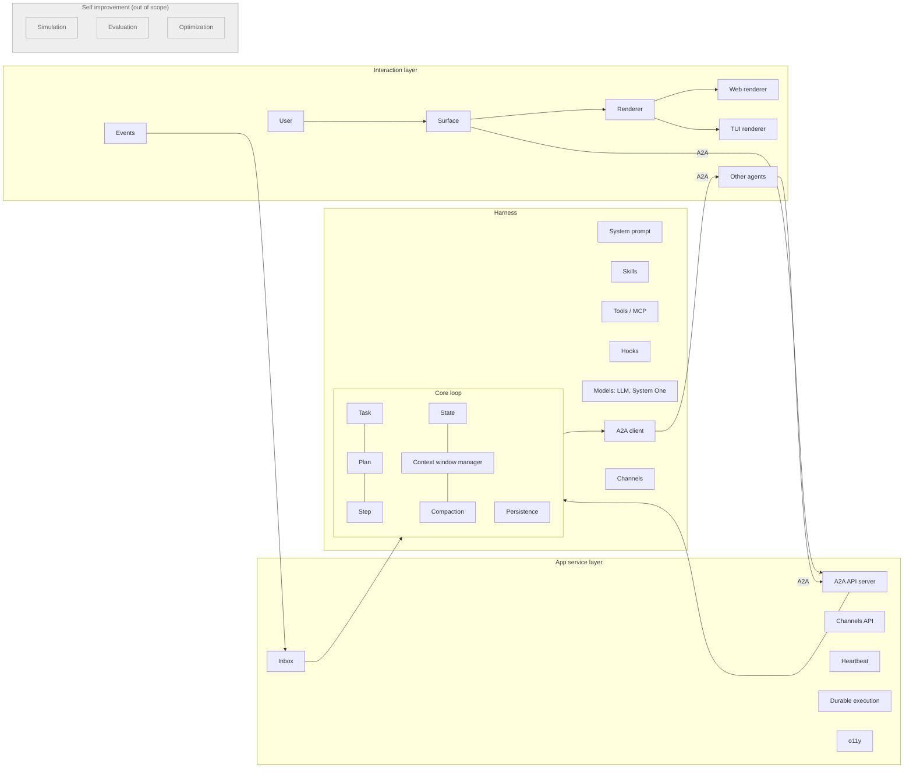

<!-- Written per the `the-loop:writing` skill: front-load each section's
     conclusion, draw it rather than describe it (3+ named parts -> a mermaid
     diagram), and keep the formal registers formal (EARS, abuse cases,
     RFC-2119, API contracts, schema descriptions). No length limit — length
     follows the change; the test is whether a sentence can come out without
     losing information. A gated section stays even when it is empty. -->

# Requirements: rusty-harness, an opinionated production-grade agent harness

> Phase 1 of 3 (requirements → design → tasks). Following the Kiro spec approach
> (<https://kiro.dev/docs/specs/>). This phase MUST be reviewed and approved by the
> required collaborators before moving to design.

## Introduction

**This document turns [issue #3](https://github.com/MadaraUchiha-314/rusty-harness/issues/3)
into testable requirements for the first complete version of rusty-harness.** The reader is
the issue's author, who is also the product manager, architect and approver on this
repository. The repository today holds a `hello()` function, the runtime seam
(`Runtime`, `MaybeSend`) and the packaging for three ecosystems; the issue describes the
whole product. Nothing in between exists.

The issue is an epic. Its body is the architecture (four layers, 30 modules), its first
comment is the engineering contract (reuse sherma's interfaces, official SDKs only,
strictest typing, state-of-the-art tests), and its second comment is the definition of
done (a demo that works end to end on TUI and web, multi-turn, against Temporal Cloud and
OpenAI). This document keeps that shape: one requirement group per module of the diagram,
in the diagram's order, so that `design.md` and the code tree can mirror it
([R2](#requirement-2--module-structure-mirrors-the-architecture)).

What it costs: this is the largest work item the repository will ever carry, and the
spec chain treats it as one. Delivery is expected to span several pull requests, so the
testing plan and task DAG MUST be sliceable into milestones that each leave `main`
shippable ([R32](#requirement-32--definition-of-done-demo) names the final one). Where
the issue asks a question rather than stating a wish, this document records the question,
the research done so far and the default this spec adopts, so that approving the
document also answers the question ([Open questions](#open-questions)).

What to check first: the [Scope decisions](#scope-decisions) table and the
[Open questions](#open-questions). Everything else is the issue restated as EARS.



The diagram is the issue's architecture image redrawn. The grey column is declared out
of scope by the issue itself ("whole section is TBD, not for now").

### Vocabulary

| Term | Meaning in this document |
|---|---|
| **Harness** | One running instance of rusty-harness serving one agent: its core loop, entities and app service layer. |
| **Core entity** | A prompt, skill, tool, model, hook, plugin, command, agent, channel or any other pluggable unit the harness registers. |
| **Registry entry** | The `(id, version)` pair that identifies an instance of a core entity; `version` is `null` when versioning does not apply. |
| **Surface** | A client that a person or agent uses to reach a harness: the web UI, the TUI, another agent, an event source. |
| **Renderer** | The part of a surface that turns the harness's messages and artifacts into something a person perceives. |
| **Task** | The unit of work a harness works on, aligned with the A2A `Task`. |
| **Participant** | A person, agent or system attached to a task in a role (assignee, reporter, watcher, admin). |
| **Channel** | A harness-managed conversation with one or more participants, used for inputs that are smaller than a task. |
| **Hook** | A registered function the harness calls at a named lifecycle point, before, during or after an operation, that may observe or change the operation's outcome. |
| **Prompt fragment** | A piece of text the harness itself authors for a model request (the default system prompt, a compaction instruction, a sub-agent brief, a tool-use preamble), kept as one markdown file and registered as a core entity. Run-time data that fills a fragment's placeholders is not a fragment. |
| **String catalog** | The one JSON file per locale that holds every user-facing string of every package; code refers to strings by key. |
| **A2A** | The Agent2Agent protocol (<https://a2a-protocol.org>), the harness's only wire protocol for agent invocation. |
| **MCP** | The Model Context Protocol, the harness's protocol for tools. |
| **SDK mode / CLI mode** | Using rusty-harness as a library from Rust, Python or TypeScript, versus running the installed binary. |

### Scope decisions

Interpretations this document makes of the issue. Each is reversible at the
requirements gate at the cost of an edit; after it, at the cost of a design change.

| # | Decision | Why |
|---|---|---|
| S1 | The **Self improvement** column (simulation, evaluation, optimization) is out of scope. Module placeholders MAY exist so the tree mirrors the diagram. | The issue says "TBD, not for now". |
| S2 | **Memory** and **Sandbox** appear in the diagram but not in the text. They are out of scope as features; the tool layer MUST leave a typed extension point for each ([R8](#requirement-8--tools-and-mcp)). | No requirement can be written for an unnamed behaviour; the hook/plugin system is where they will plug in. |
| S3 | **One spec chain, a stack of pull requests.** Requirements, design and testing plan cover the whole epic; `tasks.md` groups tasks into ordered milestones, and each milestone ships as one PR stacked on the previous milestone's branch, reviewed on its own diff and merged bottom-up. | the-loop's model: one work item, one origin repo, *n* PRs. The issue is one ticket. Stacking was the approver's choice at the requirements gate (Q6). |
| S4 | The **web renderer is a TypeScript workspace package in this repository**, not a separate repository. | "The folder structure of the code-base [should be] similar to the architecture diagram", and the repo already runs one bun workspace. Open question Q1 confirms. |
| S5 | **A2A is the only invocation protocol.** Every path into the harness (web, TUI, other agents, local sub-agents) is an A2A message; nothing bypasses it. | "We want to go ALL IN on A2A protocol throughout the harness." |
| S6 | The **definition-of-done demo** is a requirement ([R32](#requirement-32--definition-of-done-demo)) with its own acceptance criteria, not a note. | It is the author's stated acceptance test for the issue. |
| S7 | **Risk tier 4.** The work item adds an authenticated network API, holds provider credentials and executes model-chosen tool calls. | Tier 4 means a named human security sign-off before completion, which an enterprise-facing harness warrants on its first release. |
| S8 | The issue's **"Harness API Server" heading** is read as the app service layer: durable execution, heartbeat, A2A server, inbox, o11y. | The diagram labels that column "App Service Layer"; the module names follow the diagram. |
| S9 | **A2A protocol version 1.0 or later is a hard constraint**, not a preference: no SDK, client library, renderer or peer that speaks an older A2A is acceptable, and a gap in an SDK is filled from the 1.0 specification, never by downgrading. | The approver's answer at the requirements gate: no compromise on protocol ≥ 1.0. The SDK crates' own version numbers (e.g. `a2a-lf` 0.4.x) say nothing about the protocol they implement. |

## Requirements

Grouped by layer, in the diagram's order: foundations and the harness layer first (what
everything else is built from), then the core loop, then the app service layer, then the
interaction layer, then packaging, quality and the demo. One cross-cutting requirement
closes the list ([R33](#requirement-33--prompts-and-strings-as-assets)), added at the
requirements gate on the approver's review.

### Foundations

### Requirement 1 — Core entities, interfaces and the registry

**User story:** As an SDK developer, I want every core entity to share one shape (a
standard interface, a registry identity, local or remote placement) so that I can
replace any default with my own implementation without learning a new mechanism each
time.

#### Acceptance criteria (EARS)

1. WHEN the design names a core entity kind (at minimum: prompt, skill, tool, LLM, System
   One model, hook, plugin, command, agent, channel, surface, renderer, persistence store,
   durable-execution backend) THEN the system SHALL define one public interface (a Rust
   trait) for that kind, and every built-in and user-supplied instance SHALL implement it.
2. WHEN an instance of a core entity is registered THEN the system SHALL identify it by a
   registry entry `(id, version)`, where `version` is `null` for kinds the design declares
   unversioned, and SHALL reject a second registration with the same `(id, version)`
   unless the caller asks to replace it.
3. WHEN a core entity is resolved by `(id, version)` THEN the system SHALL return the
   same instance regardless of whether it is local (in-process) or remote, and callers
   SHALL NOT need to know which it is.
4. WHEN an entity is remote THEN the system SHALL reach it through a declared application
   protocol (A2A for agents, MCP for tools, the provider's HTTP API for models) and never
   through an ad-hoc transport.
5. WHEN the harness starts with no configuration THEN the system SHALL run with
   opinionated defaults for every entity kind, and WHEN a plugin or program supplies a
   replacement for any default THEN the system SHALL use the replacement without a change
   to the harness's own code.
6. IF a registry lookup finds no entity for `(id, version)` THEN the system SHALL fail
   the operation with a typed error naming the kind and the entry, never fall back to a
   different entity silently.

### Requirement 2 — Module structure mirrors the architecture

**User story:** As a maintainer, I want the code tree and the module names to follow the
architecture diagram so that a reader can go from the picture to the code without a map.

#### Acceptance criteria (EARS)

1. WHEN the core crate is laid out THEN the system SHALL have one top-level module per
   layer of the diagram (interaction surfaces, app service layer, harness, self
   improvement) and one sub-module per box the diagram draws inside it, named after the
   box.
2. WHEN a box of the diagram is out of scope for this work item (S1, S2) THEN the module
   MAY be an empty placeholder with a doc comment stating that, and SHALL NOT be omitted.
3. WHEN `design.md` is written THEN it SHALL contain the module tree with each module
   traced to the requirement(s) it satisfies, and the implementation SHALL match it.
4. WHILE the Python and WASM crates exist they SHALL remain thin adapters: no module
   there SHALL implement behaviour the core crate does not expose.

### Requirement 3 — Typing, documentation and interface review

**User story:** As an enterprise adopter, I want every public type to be precise and
documented so that I can rely on the SDK from Rust, Python and TypeScript without reading
the implementation.

#### Acceptance criteria (EARS)

1. WHEN a public type, trait or function is added to the core crate THEN it SHALL carry a
   doc comment describing its contract, and the crate SHALL build with `missing_docs`
   denied.
2. WHEN a core entity (task, plan, step, state, message, participant, channel, hook
   event, registry entry, configuration) is modelled THEN its fields SHALL be concrete
   types; untyped containers (`serde_json::Value`, `HashMap<String, String>` standing in
   for a record, `Box<dyn Any>`) SHALL NOT appear in a public field unless the design
   records why the content is genuinely open (e.g. the A2A `metadata` map) and bounds it
   with a schema.
3. WHEN the Python bindings are built THEN the generated stub SHALL type every exported
   name, `pyright` in strict mode SHALL pass on the package and its tests, and no
   exported signature SHALL use `Any`.
4. WHEN the TypeScript packages are built THEN `tsc` SHALL pass under the repository's
   strict base config, and no exported declaration SHALL use `any`.
5. WHEN a public interface is introduced or changed THEN `design.md` (or a later spec's
   design) SHALL inventory it before implementation, and the pull request introducing it
   SHALL link that inventory.
6. WHEN a public interface exists THEN the system SHALL have a contract test for it
   ([R31](#requirement-31--testing)) that fails when the interface changes incompatibly.

### Harness layer

### Requirement 4 — Hooks on the whole lifecycle

**User story:** As a platform engineer, I want a hook at every point where the harness
does something, with the power to change the outcome, so that I can make the harness
enterprise-ready (policy, audit, telemetry, custom infrastructure) without forking it.

Hooks are the key feature of the harness. The core is kept minimal and most features are
expressible as hooks; sherma's hooks (<https://madarauchiha-314.github.io/sherma/hooks.html>)
are the reference for breadth.

#### Acceptance criteria (EARS)

1. WHEN the harness performs any lifecycle operation (at minimum: receive request, create
   task, build context, call model, parse tool calls, execute tool, send A2A message to a
   sub-agent, receive event, compact context, persist state, deliver response, change task
   state, invoke command, run durable activity, retry activity, start/stop) THEN the
   system SHALL expose a `pre`, `in` and `post` hook point for it, named in a public
   catalogue.
2. WHEN a `pre` hook returns a modified input THEN the system SHALL perform the operation
   with the modified input; WHEN a `pre` hook returns a veto THEN the system SHALL NOT
   perform the operation and SHALL surface the veto as a typed outcome.
3. WHEN an `in` hook is registered THEN the system SHALL let it replace the operation's
   implementation (e.g. supply the HTTP client, the model call, the persistence write).
4. WHEN a `post` hook returns a modified output THEN the system SHALL continue with the
   modified output.
5. WHEN several hooks are registered on one point THEN the system SHALL run them in a
   deterministic, documented order and SHALL make the order configurable.
6. WHEN a hook fails THEN the system SHALL apply a per-hook-point policy (fail the
   operation, or log and continue) that defaults to fail-closed for `pre` hooks on
   security-relevant points (tool execution, outbound A2A, persistence) and is
   configurable elsewhere.
7. WHEN a hook needs infrastructure (an async HTTP client, a clock, a random source, a
   secret resolver) THEN the system SHALL provide a programmatic hook through which the
   embedding application supplies it, so the core never constructs one itself.
8. WHEN observability is implemented ([R24](#requirement-24--observability)) THEN it
   SHALL be implemented as hooks on the public catalogue, proving the catalogue is
   sufficient.
9. WHEN hooks are registered THEN the system SHALL accept them from a plugin
   ([R5](#requirement-5--agent-plugins)) and programmatically from the SDK, and both
   routes SHALL produce the same registration.
10. WHEN a hook is declared as remote (sherma supports JSON-RPC and MCP-hosted hooks)
    THEN the system SHALL call it over that protocol with the same typed context and
    result as a local hook, so hooks obey the local-or-remote rule of
    [R1](#requirement-1--core-entities-interfaces-and-the-registry).
11. WHEN the hook catalogue is designed THEN it SHALL cover at least sherma's twenty
    points (before/after model call, tool call, agent call, skill load and unload,
    interrupt, graph invoke; node enter, execute, exit; model create; node error; error)
    mapped onto the harness's operations, and `design.md` SHALL show the mapping.

### Requirement 5 — Agent plugins

**User story:** As an operator, I want to add skills, MCP servers, hooks and commands to a
harness with plugins that follow the Agent Plugins specification
(<https://agent-plugins.org/>) so that one packaging format works across harnesses.

The specification (1.0.0, governed by a steering committee with members from Amazon,
Cursor, Microsoft, OpenAI and Vercel) defines a `plugin.json` manifest, skills under
`skills/<name>/SKILL.md` and MCP servers in `mcp.json`. Hooks, commands and agents are
not part of the portable specification; a client carries them in its own namespace
(the manifest's `extensions` map and a reverse-domain directory).

#### Acceptance criteria (EARS)

1. WHEN a plugin directory conforming to the Agent Plugins specification is placed in a
   configured plugin path THEN the system SHALL discover it, validate `plugin.json`
   against the specification's closed schema, register the skills under `skills/` and
   the MCP servers in `mcp.json`, and provide the `PLUGIN_ROOT` and `PLUGIN_DATA`
   variables the specification requires.
2. WHEN a plugin carries hooks or commands THEN the system SHALL read them from
   rusty-harness's own client namespace in the plugin (its `extensions` entry and
   directory), documented as the harness's plugin extension, and SHALL ignore other
   clients' namespaces.
3. WHEN a plugin is supplied programmatically (as a typed value from the SDK) THEN the
   system SHALL register it identically to one loaded from the file system.
4. IF a plugin manifest is invalid, a path escapes the plugin directory, or an MCP entry
   uses a transport the specification does not allow (non-HTTPS streamable HTTP off
   loopback) THEN the system SHALL refuse the whole plugin with a typed error naming the
   field, and SHALL NOT load it partially.
5. WHEN a plugin declares a version THEN the system SHALL expose it as the registry
   version of every entity it contributes.
6. WHEN two plugins contribute the same `(id, version)` THEN the system SHALL refuse the
   later one unless configuration declares an override order.

### Requirement 6 — Skills

**User story:** As an agent author, I want to give the harness skills written to the
Agent Skills specification (<https://agentskills.io/>) so that skills written for other
harnesses load unchanged.

#### Acceptance criteria (EARS)

1. WHEN a skill directory conforming to the Agent Skills specification (a `SKILL.md`
   whose front matter carries `name`, `description` and the optional `license`,
   `compatibility`, `metadata` and `allowed-tools`, plus optional `scripts/`,
   `references/` and `assets/`) is registered THEN the system SHALL parse it and apply
   the specification's three levels of progressive disclosure: name and description at
   startup, the body on activation, resources on demand.
2. WHEN the skill is implemented THEN `design.md` SHALL record whether the
   specification's reference implementation (`skills-ref`, Python, marked
   demonstration-only by its authors) or a community Rust crate is used, or why the
   harness parses the format itself.
3. IF a skill's front matter is missing a required field, or its `name` does not match
   its directory name as the specification requires THEN the system SHALL refuse the
   skill with a typed error naming the field.
4. WHEN a skill is invoked THEN the system SHALL run the skill-invocation hook points
   ([R4](#requirement-4--hooks-on-the-whole-lifecycle)).

### Requirement 7 — System prompt

**User story:** As an agent author, I want a minimal default system prompt that I can
override, extend or template so that the harness's voice is mine, not the harness's.

#### Acceptance criteria (EARS)

1. WHEN no system prompt is configured THEN the system SHALL use a minimal built-in
   prompt that states the participant roles of a task
   ([R18](#requirement-18--participants-and-channels)) and nothing product-specific.
2. WHEN a system prompt is configured (file, plugin or SDK) THEN the system SHALL replace
   the default, and WHEN a prompt fragment is configured as an extension THEN the system
   SHALL append it at the templated position the context window manager defines
   ([R15](#requirement-15--context-window-manager)).
3. WHEN the system prompt is assembled THEN the system SHALL run the prompt-assembly hook
   points so a hook can rewrite it.
4. WHEN the default system prompt, or any fragment the harness appends to it, is
   defined THEN it SHALL be a markdown file registered as a prompt fragment
   ([R33](#requirement-33--prompts-and-strings-as-assets)), never a string literal in
   code.

### Requirement 8 — Tools and MCP

**User story:** As an agent author, I want to register tools, including MCP servers, and
have the harness execute the model's tool calls, in parallel when the model asks for
several, so that the agent can act.

#### Acceptance criteria (EARS)

1. WHEN an MCP server is configured (by a plugin or the SDK) THEN the system SHALL
   connect to it over stdio or streamable HTTP using the official MCP Rust SDK (`rmcp`)
   on native targets, list its tools and register each as a tool entity with the
   server's `(id, version)` namespace. On `wasm32`, where `rmcp` does not build, MCP
   SHALL be reached through a host-supplied transport
   ([R29](#requirement-29--wasm-and-browser-support), [Open questions](#open-questions) Q14).
2. WHEN the model's response contains several tool calls THEN the system SHALL execute
   them concurrently and return every result to the next model call in the order the
   model issued them.
3. WHEN a tool call names a tool that is not registered THEN the system SHALL return a
   typed tool error to the model instead of failing the task.
4. WHEN a tool is executed THEN the system SHALL run the tool-execution hook points
   before, around and after it, and a `pre` veto SHALL prevent execution.
5. WHEN the tool layer is designed THEN it SHALL define a typed extension point for a
   memory provider and a sandbox provider (S2) without implementing either.
6. WHEN a tool result exceeds a configured size THEN the system SHALL truncate or
   summarise it according to a hookable policy before adding it to the context.

### Requirement 9 — Models: LLM and System One

**User story:** As an operator, I want to point the harness at any LLM provider (Anthropic,
OpenAI, anything OpenAI-compatible such as OpenRouter or Ollama) and at fast "System One"
models for quick judgements, so that model choice is configuration, not code.

#### Acceptance criteria (EARS)

1. WHEN an LLM is configured by provider, model id and credential reference THEN the
   system SHALL call it through one provider-agnostic `LLM` interface that supports
   streaming, tool calling, multi-modal input ([R28](#requirement-28--multi-modal-input-and-output))
   and provider-specific prompt caching.
2. WHEN the provider is Anthropic or OpenAI THEN the system SHALL use that provider's
   official SDK where one exists for Rust (today neither provider publishes one), and
   otherwise the provider's documented HTTP API through a client the design justifies,
   choosing between a maintained community crate and a thin client of the harness's own
   ([Open questions](#open-questions) Q16).
3. WHEN the provider is OpenAI-compatible (a base URL plus a key) THEN the system SHALL
   support it with the OpenAI implementation and a configurable base URL, so OpenRouter
   and a local Ollama both work with no new code.
4. WHEN a System One model is configured THEN the system SHALL call it through a typed
   `SystemOne` interface for fast decisions (classification, confidence, routing) that is
   distinct from the `LLM` interface and provider-agnostic.
5. WHEN the `/model` or `/effort` command changes the active model or effort
   ([R10](#requirement-10--commands)) THEN the system SHALL apply the change to the next
   model call of the task without restarting it.
6. IF a provider call fails with a retryable error THEN the system SHALL retry with
   exponential backoff under a configurable policy, and IF it fails with a non-retryable
   error THEN the system SHALL surface a typed error on the task.
7. WHEN a model call is made THEN the system SHALL record token usage and latency on the
   task's trace ([R24](#requirement-24--observability)).

### Requirement 10 — Commands

**User story:** As a user of the TUI or web UI, I want slash commands such as `/exit`,
`/model` and `/effort`, and as a developer I want to register my own, so that control of
the session stays in the conversation.

#### Acceptance criteria (EARS)

1. WHEN a user message begins with `/<name>` and `<name>` is a registered command THEN
   the system SHALL invoke the command instead of sending the message to the model.
2. WHEN the harness starts THEN the system SHALL have `/exit`, `/model` and `/effort`
   registered by default, with `/model` and `/effort` listing and selecting among the
   configured models and effort levels.
3. WHEN a command is registered through a hook or the SDK as a pair of `/<name>` and a
   function THEN the system SHALL invoke that function with the typed command context.
4. WHEN a command is invoked THEN the system SHALL emit `command invoked`, `command
   executed` and `command failed` hook events, and a `pre` hook SHALL be able to veto it.
5. WHEN a message that matches a registered command is displayed in the TUI or web UI
   THEN the renderer SHALL highlight the command token in a colour distinct from ordinary
   text.
6. IF a message begins with `/` and matches no command THEN the system SHALL tell the user
   the command is unknown and SHALL NOT send it to the model.

### Core loop

### Requirement 11 — The core loop

**User story:** As an SDK developer, I want the agent to expose the same interface as
sherma's base agent and to run the canonical loop (build context, call the model, extract
tool calls, execute, repeat) so that the behaviour is predictable and hookable at every
turn.

The reference interface is
<https://github.com/MadaraUchiha-314/sherma/blob/main/sherma/entities/agent/base.py#L20>:
an `Agent` with an `agent_card`, optional input and output schemas, a streaming
`send_message(message, context, request_metadata, extensions)` that yields A2A
update events, messages or tasks, a `cancel_task(task_id)` returning the task, and a
`get_card()`. Every one of its types is an A2A type. The loop is:

```text
loop:
  ctx       = ContextWindowManager.create_context(state)
  response  = llm.invoke(ctx)
  tool_calls = extract_tool_calls(response)
  if no tool_calls: break
  execute_tools(tool_calls)
```

#### Acceptance criteria (EARS)

1. WHEN the agent interface is designed THEN it SHALL carry the same operations as
   sherma's base agent (`send_message` as a stream of A2A events, `cancel_task`,
   `get_card`), typed with the official A2A Rust types, and `design.md` SHALL show the
   mapping method by method; local agents, remote agents and loopback sub-agents SHALL
   all implement it.
2. WHEN a task is executed THEN the system SHALL run the loop above, and each of its four
   steps SHALL be a hookable lifecycle operation
   ([R4](#requirement-4--hooks-on-the-whole-lifecycle)).
3. WHEN the model responds with no tool calls THEN the system SHALL deliver the response
   to the task and apply the task's close-or-keep-open policy
   ([R21](#requirement-21--task-lifecycle-and-multi-turn)).
4. WHILE the loop runs the system SHALL enforce configurable limits (maximum iterations,
   maximum tokens, wall-clock budget) and WHEN a limit is reached THEN the system SHALL
   stop the loop with a typed outcome rather than run on.
5. WHEN an external event or a cancel arrives for a running task
   ([R20](#requirement-20--inbox-and-events)) THEN the system SHALL observe it at the
   next loop boundary at the latest and apply it.
6. WHEN the harness is embedded as an SDK THEN the same loop SHALL be runnable in-process
   without the app service layer.

### Requirement 12 — Task

**User story:** As a harness, I want one central Task entity, aligned with A2A tasks, that
records what is being done, for whom, and which sub-tasks it spawned, so that everything
else can hang off it.

#### Acceptance criteria (EARS)

1. WHEN a task is modelled THEN the system SHALL give it at minimum: `name`, optional
   `type`, `goal`, `description`, `acceptance_criteria`, `sub_tasks` (references to
   tasks spawned for it), `parent_tasks` (references; a list that normally holds one
   entry), and `participants` each with a role (`assignee`, `reporter`, `watcher`,
   `admin`).
2. WHEN a task is exposed over A2A THEN the system SHALL map it to an A2A `Task`, with
   the fields A2A does not model carried in the task's metadata under a namespaced key
   that an advertised A2A extension defines ([R19](#requirement-19--a2a-api-server)).
3. WHEN the harness breaks work down THEN the system SHALL create a plan
   ([R13](#requirement-13--plan-and-step)) for the task, and WHEN a step needs
   context-isolated work THEN the system SHALL create a sub-task for that step and record
   it in `sub_tasks` and in the step's `linked_tasks`.
4. WHILE a task runs the system SHALL track every sub-task it spawned, and WHEN the task
   reaches a terminal state THEN the system SHALL apply a configurable policy to its
   non-terminal sub-tasks (cancel by default).
5. WHEN a task changes state THEN the system SHALL run the task-state hook points and
   emit the corresponding A2A status update.

### Requirement 13 — Plan and Step

**User story:** As a harness, I want to express how a task will be delivered as a DAG of
steps so that progress is inspectable and steps can be executed in isolation.

#### Acceptance criteria (EARS)

1. WHEN a plan is modelled THEN the system SHALL make it a directed acyclic graph of
   steps, each with `name`, `description`, optional `output` and `linked_tasks`
   (references to tasks spawned while executing the step).
2. IF a plan edit would introduce a cycle THEN the system SHALL reject the edit with a
   typed error.
3. WHEN a step is executed THEN the system SHALL run the step hook points and record the
   step's output on the plan.
4. WHEN a plan exists for a task THEN the system SHALL expose it to the context window
   manager and to surfaces (as an A2A artifact or extension payload) so a person can see
   it.

### Requirement 14 — State and persistence

**User story:** As an agent author, I want the agent to hold arbitrary, optionally
schema-checked state and to persist its state and plans through pluggable stores so
that a harness survives restarts and I can store what my agent needs.

#### Acceptance criteria (EARS)

1. WHEN an agent stores data in its state THEN the system SHALL accept typed values under
   named keys, and WHEN a schema is configured for a subset of keys THEN the system SHALL
   validate writes to those keys against it and reject violations with a typed error.
2. WHEN state changes THEN the system SHALL persist it through the configured
   persistence store entity, with an in-memory store as the default and a file-backed
   store available natively.
3. WHEN a plan changes THEN the system SHALL run the plan-persistence hook points so a
   hook can save it to custom storage; the harness itself SHALL keep plans internal.
4. WHEN a harness restarts with a persistent store THEN the system SHALL restore every
   non-terminal task's state and continue or resume it according to the durable
   execution mode ([R22](#requirement-22--durable-execution)).

### Requirement 15 — Context window manager

**User story:** As an agent author, I want the context sent to the model on every call to
be assembled from templated positions (system prompt, skills, task, plan, history,
tools) with caching in mind, and I want the harness to spawn local sub-agents with a
fresh context through the same agent interface, so that context is managed, not
accumulated.

#### Acceptance criteria (EARS)

1. WHEN a context is created for a model call THEN the system SHALL assemble it from
   named, ordered positions (at minimum: system prompt, participant roles, skills index,
   sub-agent index, task, plan, state excerpt, conversation history, tool results) and
   SHALL expose the template so configuration and hooks can reorder or replace positions.
2. WHEN consecutive model calls share a prefix THEN the system SHALL order the positions
   so that the stable content comes first and SHALL use the provider's prompt-caching
   mechanism where the provider has one, and the testing plan SHALL measure the cache hit
   rate on the demo flow.
3. WHEN the harness needs isolated work for a step THEN the system SHALL spawn a local
   sub-agent with a fresh context by sending an A2A message to its own A2A endpoint (a
   loopback invocation) through the same agent interface used for remote sub-agents.
4. WHEN a local sub-agent is spawned THEN the system SHALL create a task for it, link it
   as a sub-task of the current task, and treat its result exactly as a remote
   sub-agent's result.
5. WHEN the context is assembled THEN the system SHALL run the context-assembly hook
   points and report the resulting token count on the trace.

### Requirement 16 — Compaction

**User story:** As an operator, I want the harness to compact a long conversation before
it overflows the model's window, keeping what matters and never dropping what must stay,
so that long-running tasks do not degrade or fail.

The issue asks four questions: when to compact, what to keep, what never to compact, and
at what threshold. The requirements below make the answers configurable with defaults;
the defaults are design decisions.

#### Acceptance criteria (EARS)

1. WHEN the estimated context size exceeds a configurable fraction of the active model's
   window (default set in `design.md`) THEN the system SHALL compact before the next
   model call.
2. WHEN compaction runs THEN the system SHALL preserve verbatim the positions configured
   as never-compacted (default: system prompt, task goal and acceptance criteria, the
   plan, the most recent turns up to a configured count, and any message a hook marks as
   pinned) and SHALL summarise the rest.
3. WHEN compaction runs THEN the system SHALL run the compaction hook points so a hook
   can change the policy, the summariser or veto the compaction.
4. WHEN compaction has run THEN the system SHALL record on the trace what was summarised,
   the token counts before and after, and SHALL persist the summary with the task's
   state.

### Requirement 17 — Sub-agents over A2A

**User story:** As an agent author, I want to declare sub-agents (built with rusty-harness
or not), have the model know about them and call them with a tool, and have every call
go over A2A, so that composition of agents is uniform.

#### Acceptance criteria (EARS)

1. WHEN a sub-agent is declared (by agent-card URL or inline card, in configuration, a
   plugin or the SDK) THEN the system SHALL fetch and validate its A2A agent card and
   register it as an agent entity.
2. WHEN a context is built THEN the system SHALL include the registered sub-agents (name,
   description, skills from the card) at the sub-agent position
   ([R15](#requirement-15--context-window-manager)).
3. WHEN the model calls the sub-agent tool THEN the system SHALL send an A2A message to
   that agent through the agent interface, create a sub-task linked to the current task,
   and return the sub-agent's response or artifacts as the tool result.
4. WHEN the sub-agent is another rusty-harness or any other A2A-compliant agent THEN the
   system SHALL behave identically; nothing in the call path SHALL depend on the
   sub-agent's implementation.
5. IF a sub-agent's card cannot be fetched or fails validation THEN the system SHALL
   refuse the registration with a typed error and SHALL NOT present the sub-agent to the
   model.

### Requirement 18 — Participants and channels

**User story:** As a harness, I want to understand who is on a task and in what role, to
ask a participant for a small input through a channel, and to create a task for a
participant when the work is theirs, so that I can ask for help the way a colleague
would.

#### Acceptance criteria (EARS)

1. WHEN a task is created THEN the system SHALL record its participants with roles, and
   the system prompt SHALL describe those roles to the model by default
   ([R7](#requirement-7--system-prompt)).
2. WHEN the harness needs an input, opinion or judgement that is smaller than a task
   THEN the system SHALL send a message to the relevant participant(s) through a channel
   and move the task to the waiting state
   ([R21](#requirement-21--task-lifecycle-and-multi-turn)) until the reply arrives.
3. WHEN the harness needs work done by another participant for the task to complete THEN
   the system SHALL create a task for that participant (as reporter), linked to the
   current task, instead of a channel message.
4. WHEN the model decides between the two THEN the system SHALL give it two distinct
   tools (ask a participant; create a task for a participant) so the distinction is
   explicit, and a hook SHALL be able to override the decision.
5. WHEN a channel is created THEN the system SHALL own its membership, and a participant
   SHALL send and receive messages on it only through the channels API
   ([R19](#requirement-19--a2a-api-server) exposes it); the harness SHALL use the same
   API in the other direction.
6. WHEN a channel receives a message THEN the system SHALL deliver it to the task as an
   inbox event ([R20](#requirement-20--inbox-and-events)).

### App service layer

### Requirement 19 — A2A API server

**User story:** As a surface or another agent, I want to reach the harness through a
standards-compliant A2A server that advertises everything rusty-harness adds as
extensions, so that any A2A client works without custom code.

sherma's A2A executor (<https://github.com/MadaraUchiha-314/sherma/tree/main/sherma/a2a>),
which maps the agent's event stream onto the SDK's task updater (`start_work`,
`add_artifact`, `update_status`, `complete`, `failed`, `cancel`), is the reference for
structure. The protocol's current release is 1.0.1 (1.0.0 shipped 2026-03-12); 1.0
renamed every operation, so the names below are the 1.0 names.

#### Acceptance criteria (EARS)

1. WHEN the harness runs in server mode THEN the system SHALL serve an A2A-compliant API
   at protocol version 1.0 or later supporting every operation the specification
   defines (`SendMessage`, `SendStreamingMessage`, `GetTask`, `ListTasks`, `CancelTask`,
   `SubscribeToTask`, the four `TaskPushNotificationConfig` operations and
   `GetExtendedAgentCard`), over at least the JSON-RPC binding, honouring the
   `A2A-Version` and `A2A-Extensions` service parameters, and `design.md` SHALL state
   which other bindings (gRPC, HTTP+JSON) ship.
2. WHEN a client requests the agent card at `/.well-known/agent-card.json` THEN the
   system SHALL return a card that lists the harness's skills, capabilities, security
   schemes and every rusty-harness extension with its URI, description, `required` flag
   and parameters.
3. WHEN rusty-harness needs behaviour A2A does not define (task sub-states, participants,
   plans, channels, commands) THEN the system SHALL define it as an A2A extension with a
   stable URI under the project's namespace, advertise it in the card, carry its data in
   the `metadata` maps the specification reserves for extensions, and activate it only
   for a request whose `A2A-Extensions` names it, echoing the activated set as the
   specification requires.
4. WHEN a request arrives without the credentials the card's security schemes require
   THEN the system SHALL reject it with the protocol's authentication error, and WHEN
   credentials are present but insufficient for the operation THEN with its authorization
   error.
5. WHEN the server and client are implemented THEN the system SHALL use the official A2A
   Rust SDK (`a2aproject/a2a-rs`, crates `a2a-lf`, `a2a-server-lf`, `a2a-client-lf`),
   pinned to a release that implements protocol 1.0 or later (the crate version is no
   proxy for the protocol version), and SHALL NOT hand-roll protocol types;
   conformance SHALL be proven by contract tests
   driven by the official TypeScript or Python SDK
   ([R31](#requirement-31--testing), [Open questions](#open-questions) Q2).
6. WHEN a surface (web, TUI) invokes the harness THEN it SHALL do so as an A2A client;
   the web renderer SHALL use the official A2A TypeScript SDK (`@a2a-js/sdk`) and no
   hand-rolled client.
7. WHEN the server receives a streaming request THEN the system SHALL stream the
   specification's `StreamResponse` kinds (`Task`, `Message`, `TaskStatusUpdateEvent`,
   `TaskArtifactUpdateEvent`), starting with the `Task`, as the task progresses,
   including tool-call progress and partial model output.
8. WHEN a client subscribes to a task it did not create THEN the system SHALL apply the
   same participant check as `GetTask` before streaming anything.
9. IF a candidate dependency (an A2A SDK, a client library, a renderer such as the A2UI
   renderer, a sub-agent or peer) speaks only an A2A protocol version below 1.0 THEN
   the system SHALL NOT use it (S9); WHEN a request names an `A2A-Version` below 1.0
   THEN the server SHALL reject it with the protocol's unsupported-version error; and
   WHEN the official Rust SDK lags the protocol THEN the gap SHALL be closed with
   types generated from the 1.0 specification in a clearly marked module, never by
   speaking an older version.

### Requirement 20 — Inbox and events

**User story:** As an operator, I want a durable inbox that receives A2A events for a
harness, so that new information or interruptions reach a running task without being
lost, and so that sending a message and posting to the inbox are the same thing.

#### Acceptance criteria (EARS)

1. WHEN the harness runs in server mode THEN the system SHALL expose an inbox that
   accepts the four A2A event kinds (`Task`, `Message`, `TaskStatusUpdateEvent`,
   `TaskArtifactUpdateEvent`, the same `StreamResponse` shape A2A uses for streams and
   push-notification webhooks) addressed to a task or context, so the harness can
   receive from another agent exactly what it emits.
2. WHEN an A2A `SendMessage` or `SendStreamingMessage` arrives THEN the system SHALL
   treat it as an inbox event; there SHALL be one ingestion path, not two.
3. WHEN an event is accepted THEN the system SHALL store it durably (through the
   persistence store, and through durable execution when enabled) before acknowledging
   it, so a crash after acknowledgement loses nothing.
4. WHEN an event arrives for a task that is running THEN the system SHALL either deliver
   it at the next loop boundary (interrupt) or queue it until the current step completes,
   according to the event's kind and a hookable policy, and SHALL never drop it.
5. WHEN an event arrives for a task in a waiting state THEN the system SHALL resume the
   task with the event.
6. IF an event addresses a task that does not exist THEN the system SHALL reject it with
   the protocol's `TaskNotFoundError`; IF it addresses a terminal task THEN with
   `UnsupportedOperationError`; IF its `taskId` and `contextId` do not belong together
   THEN the system SHALL reject it as the specification requires. The system SHALL NOT
   create a task implicitly, except for a `Message` with no task id, which creates one as
   A2A defines.

### Requirement 21 — Task lifecycle and multi-turn

**User story:** As a user, I want to keep talking to the harness about the same task after
it answers, and to decide explicitly when the task is done, so that a task is a
conversation, not a single request.

The issue's two questions are answered by the 1.0 specification. *What does A2A
recommend for a long-running task?* A task stays non-terminal across turns: `agents MAY
accept additional messages for tasks in non-terminal states`, a follow-up is a
`SendMessage` with the same `taskId` and `contextId`, and `input-required` is the state
prescribed while the agent waits on the user; a terminal task can never restart, so a
refinement after completion is a new task in the same `contextId` with
`referenceTaskIds`. *Can an extension add custom task states?* Extensions may define
state-machine extensions, but must not change core data structures: sub-states go in
the `metadata` map on the task status, not in new `TaskState` values. The criteria below
follow both answers ([Open questions](#open-questions) Q5 asks the approver to confirm).

#### Acceptance criteria (EARS)

1. WHEN a task is created THEN the creator SHALL be able to mark it as long-running
   (keep open after each response); IF nothing is specified THEN the system SHALL close
   the task once a response is delivered.
2. WHEN the surface that creates the root task sends the first message THEN it SHALL
   indicate whether the task is long-running, and the system SHALL honour that
   indication for the root task.
3. WHEN a long-running task delivers a response THEN the system SHALL NOT move it to a
   terminal state; it SHALL move it to the A2A `input-required` state with metadata,
   defined by a rusty-harness A2A extension, stating that the harness is waiting for the
   next interaction.
4. WHEN the harness needs to express a task condition A2A's state enum does not have
   (waiting for next turn, waiting on a participant, degraded, paused, and others the
   design adds) THEN the system SHALL keep the A2A `state` at the nearest standard value
   and carry the sub-state in extension-defined metadata on the task status; the system
   SHALL NOT invent values for the A2A `state` field.
5. WHEN a follow-up message arrives for a task in `input-required` THEN the system SHALL
   continue the same task (same task id and context id) with the full prior context.
6. WHEN a follow-up message arrives for a terminal task THEN the system SHALL reject it
   with `UnsupportedOperationError`, and the built-in surfaces SHALL instead start a new
   task in the same `contextId` with `referenceTaskIds` naming the finished one, so the
   conversation continues without violating the protocol.
7. WHEN the TUI or web UI shows a task THEN it SHALL offer explicit controls to complete
   and to cancel the task (and MAY offer other transitions the design defines); cancel
   SHALL send `CancelTask`, and complete SHALL send the message the rusty-harness task
   extension defines for closing a long-running task.
8. WHEN a task is completed or cancelled by a participant THEN the system SHALL move it
   to the terminal state, run the task-state hooks and stop any running loop for it.

### Requirement 22 — Durable execution

**User story:** As an operator, I want every long-running task to survive crashes and
failing activities with retries and recovery, using Temporal when I have it and a
degraded in-process mode when I do not, so that a production harness is resilient.

The issue asks how the harness and Temporal fit together. The facts that frame the
design, verified against Temporal's documentation and the official Rust SDK
(`temporalio-sdk` 1.1.0, released 2026-10-06):

- Workflow code must be deterministic; non-deterministic work (model calls, tool calls,
  I/O) belongs in activities. An activity's result is recorded in the event history, and
  on replay the recorded result is returned without re-running the activity. So a
  non-deterministic model call is safe inside an activity: a crash **after** the
  activity completed replays the stored result, and only a crash **during** it causes a
  re-execution, which is a fresh call, not a replay.
- The service does not detect a crashed worker by itself; the start-to-close timeout
  (and a heartbeat timeout, when the activity heartbeats) is what triggers the retry of
  an activity whose worker died. A workflow whose worker died is picked up by another
  worker and replayed from history; no side effect is repeated.
- The default activity retry policy is: initial interval 1 s, backoff coefficient 2.0,
  maximum interval 100 times the initial, unlimited attempts, no non-retryable errors.
  Workflows have no retry policy by default.
- The Rust SDK ships an ephemeral-server module that downloads and supervises
  `temporal server start-dev` (or the test server); that is the `embedded` mode.
- Temporal Cloud is reached at `<namespace>.<account>.tmprl.cloud:7233` over TLS with an
  API key as a bearer credential; the SDK reads `TEMPORAL_ADDRESS`, `TEMPORAL_NAMESPACE`
  and `TEMPORAL_API_KEY` from the environment.

Where Temporal sits relative to the A2A request lifecycle (inside the executor's
`execute`, or behind the inbox) and the exact activity granularity are design
decisions; criterion 6 requires the design to state them.

#### Acceptance criteria (EARS)

1. WHEN durable execution is configured THEN the system SHALL support three modes behind
   one `DurableExecution` interface: `remote` (a Temporal service, Temporal Cloud
   included), `embedded` (the SDK's ephemeral local development server, supervised by
   the harness) and `none` (an in-process executor with the same interface and no
   durability guarantees), using the official Temporal Rust SDK for the first two.
2. WHEN mode is `remote` or `embedded` THEN the system SHALL model a task's core loop as
   a workflow and each side-effecting operation (create context, model call, tool
   execution, outbound A2A call, persistence write) as an activity, and `design.md` SHALL
   state the granularity and why.
3. WHEN an activity fails THEN the system SHALL retry it under a configurable retry
   policy with exponential backoff (initial interval, backoff coefficient, maximum
   interval, maximum attempts, non-retryable error types), defaulting to Temporal's
   defaults except that maximum attempts SHALL be finite, and SHALL run the
   activity-failure and activity-retry hook points so a hook can change or stop the
   retry.
4. WHEN an activity is non-deterministic (a model call, a tool call) THEN the system
   SHALL rely on the workflow engine's recorded result on replay and SHALL NOT re-execute
   it, and `design.md` SHALL state which activities are safe to retry on failure (a
   model call, an idempotent tool) and which require idempotency keys or a confirm
   step (a side-effecting tool, an outbound A2A call that creates a task).
5. WHEN the process hosting a running activity crashes THEN the system SHALL set
   start-to-close and heartbeat timeouts so the engine re-dispatches the activity within
   a configured bound, and WHEN the process hosting a workflow crashes THEN the system
   SHALL have the workflow replayed from history on another worker with no repeated side
   effects; the testing plan SHALL include a kill-the-worker test for both.
6. WHEN an A2A request starts a task THEN `design.md` SHALL state where the workflow is
   started (in the A2A executor's `execute`, or by the inbox), how `cancel` reaches it,
   and how streaming events flow back from the workflow to the A2A client.
7. WHEN mode is `none` THEN the system SHALL behave identically from the caller's point of
   view except for the durability guarantees, and SHALL be the only mode available on
   `wasm32` ([R29](#requirement-29--wasm-and-browser-support)).
8. WHEN Temporal Cloud is used THEN the system SHALL take the address, namespace and API
   key from configuration and environment by reference ([Security considerations](#security-considerations)).

### Requirement 23 — Heartbeat

**User story:** As an operator, I want a heartbeat that wakes the harness to check for
events it must forward to the agent, and that lets the service layer monitor the agent,
so that nothing waits forever.

#### Acceptance criteria (EARS)

1. WHEN the harness runs in server mode THEN the system SHALL run a heartbeat at a
   configurable interval that checks the inbox for undelivered events and forwards them.
2. WHEN the heartbeat runs THEN the system SHALL record the agent's liveness (last loop
   boundary, running tasks) so the service layer and o11y can monitor it.
3. WHEN the heartbeat detects a task that has not progressed within a configured bound
   THEN the system SHALL run the stalled-task hook point (default: emit a warning event;
   a hook may cancel or escalate).
4. WHEN durable execution is `remote` or `embedded` THEN the heartbeat SHALL also serve
   as the engine's activity heartbeat for long activities, so a crashed worker is
   detected within the configured timeout.

### Requirement 24 — Observability

**User story:** As an operator, I want to see exactly what happened to a request from the
moment the harness received it to the task's terminal state, in my tracing backend and
in agent-specific tools such as Langfuse, so that I can debug and audit production.

#### Acceptance criteria (EARS)

1. WHEN a request is received THEN the system SHALL open a trace that spans every
   operation of the task (context build, model calls with token counts, tool calls,
   sub-agent calls, events, compactions, state transitions) until the task is terminal,
   and every span SHALL carry the task id and context id.
2. WHEN tracing is configured THEN the system SHALL export spans through OpenTelemetry
   (the successor of OpenTracing) to any OTLP endpoint.
3. WHEN a Langfuse (or similar agent o11y) integration is enabled THEN the system SHALL
   implement it as a hook set on the public hook catalogue
   ([R4](#requirement-4--hooks-on-the-whole-lifecycle)), not as core code.
4. WHEN the harness logs THEN the system SHALL use the same structured logging at
   development time and at runtime, with configurable levels, and SHALL never log a
   credential or the full content of a message at a level above `debug`.
5. WHEN the harness runs on `wasm32` THEN the system SHALL route logs and spans to the
   host (console or a JS callback) through the same interfaces.

### Interaction layer

### Requirement 25 — Surfaces and renderers

**User story:** As a user, I want to interact with one harness from several surfaces (web,
terminal, other agents), each rendering what it can, so that the harness is not tied to
one UI.

#### Acceptance criteria (EARS)

1. WHEN a surface connects THEN the system SHALL treat it as an A2A client; several
   surfaces MAY be connected to one harness instance at once, and each SHALL see the same
   task state.
2. WHEN a surface declares the modalities it supports (text, voice, images, video) and
   the renderer capabilities it has THEN the system SHALL send only content the surface
   can render and SHALL offer an alternative (text) for what it cannot.
3. WHEN the harness produces a message or artifact THEN a renderer SHALL be free to
   render any subset of them according to its capabilities.
4. WHEN the harness emits agent-generated UI THEN the system SHALL emit it as A2UI
   (<https://a2ui.org/>, 0.9.1 or the 1.0 release if it ships first) carried as A2A
   message parts, using the default (basic) catalog, with the client's catalog support
   negotiated through the A2UI client capabilities in message metadata; the web renderer
   SHALL render it with the official React renderer (`@a2ui/react`) and the TUI SHALL
   render the basic catalog natively.
5. WHEN a renderer supports MCP Apps (<https://modelcontextprotocol.io/extensions/apps/overview>)
   THEN it MAY render tool UIs through them; the design SHALL leave the renderer interface
   open to it without requiring it in this work item.
6. WHEN a renderer shows text the harness authored for a person (labels, prompts for
   input, status and error messages, command descriptions) THEN that text SHALL come
   from the string catalog in the renderer's locale
   ([R33](#requirement-33--prompts-and-strings-as-assets)).

### Requirement 26 — Web renderer

**User story:** As a user, I want a clean, minimal, elegant chat interface in the browser,
built on shadcn/ui and its AI Elements, that talks to the harness over A2A, so that the
default web experience is production quality.

#### Acceptance criteria (EARS)

1. WHEN the web renderer is built THEN it SHALL be a React application using shadcn/ui
   (<https://ui.shadcn.com/>) and its AI Elements (<https://ui.shadcn.com/docs/ai-elements>)
   for the conversation, message, prompt input, tool and reasoning views.
2. WHEN the web renderer talks to the harness THEN it SHALL use the official A2A
   TypeScript SDK for every call and SHALL contain no hand-rolled A2A client code.
3. WHEN a task is shown THEN the web renderer SHALL show its state and offer the complete
   and cancel controls ([R21](#requirement-21--task-lifecycle-and-multi-turn)).
4. WHEN voice is available THEN the web renderer SHALL offer a separate voice button
   ([R28](#requirement-28--multi-modal-input-and-output)).
5. WHEN a message contains a registered command THEN the web renderer SHALL highlight it
   ([R10](#requirement-10--commands)).
6. WHEN the harness streams THEN the web renderer SHALL render partial text, tool-call
   progress and A2UI content incrementally.
7. WHEN the design phase runs THEN it SHALL produce self-contained HTML prototypes of
   the web renderer's main states under `docs/specs/issue-3/design/` for the designer
   role to iterate before implementation.

### Requirement 27 — TUI renderer and CLI

**User story:** As a developer, I want `rusty-harness` to be a proper CLI that opens a
terminal UI as soon as I install the crate, the PyPI package or the npm package, without
compromising the SDK, so that trying the harness takes one command.

#### Acceptance criteria (EARS)

1. WHEN a user installs the Rust crate (with its binary), the PyPI package or the npm
   package THEN the system SHALL provide a `rusty-harness` command that starts the
   harness in TUI mode ([Open questions](#open-questions) Q8 for the npm/PyPI binary
   mechanism).
2. WHEN the CLI starts and `~/.rusty-harness/config.toml` does not exist THEN the system
   SHALL create it with commented defaults, and WHEN `--config <path>` is given THEN the
   system SHALL use that file instead; the precedence SHALL be `--config`, then
   `~/.rusty-harness/config.toml`, then built-in defaults.
3. WHEN the TUI runs THEN it SHALL be an A2A client of a harness it starts in-process
   (default) or of a remote harness given by URL, through the same code path.
4. WHEN the TUI shows a task THEN it SHALL show its state and offer complete and cancel
   controls ([R21](#requirement-21--task-lifecycle-and-multi-turn)).
5. WHEN voice is available THEN a long press of a configurable key (default: space) in
   the TUI SHALL start voice input and releasing it SHALL end it, or an equivalent
   push-to-talk gesture the design justifies where terminals cannot report key release
   ([Open questions](#open-questions) Q7).
6. WHEN a message contains a registered command THEN the TUI SHALL highlight it.
7. WHEN the SDK is used instead of the CLI THEN every capability the CLI exposes SHALL
   be reachable from Rust, Python and TypeScript code with the same configuration model.
8. WHEN the CLI prints help, usage, progress or an error for a person THEN the text
   SHALL come from the string catalog, and the locale SHALL be the configured one, then
   `LANG`, then `en` ([R33](#requirement-33--prompts-and-strings-as-assets)).

### Requirement 28 — Multi-modal input and output

**User story:** As a user, I want to send images and audio, receive images, and talk to the
harness by voice from both the TUI and the web, with providers I can swap, so that the
harness is not text-only.

#### Acceptance criteria (EARS)

1. WHEN a surface sends an image or audio file part in an A2A message THEN the system
   SHALL accept it, pass it to the model when the model supports the modality, and reject
   it with a typed error naming the unsupported modality otherwise.
2. WHEN the model or a tool produces an image THEN the system SHALL deliver it as an A2A
   artifact part and both built-in renderers SHALL display it.
3. WHEN voice input is used THEN the system SHALL transcribe it through a
   provider-agnostic speech-to-text interface whose first implementation is OpenAI's
   transcription API (`gpt-transcribe` family, streaming); WHERE the configured provider
   offers a direct voice modality (OpenAI's Realtime API, speech to speech with tool
   calling) the system SHALL prefer it, behind a `Voice` interface distinct from
   speech-to-text ([Open questions](#open-questions) Q15).
4. WHEN voice output is enabled THEN the system SHALL synthesise speech through a
   provider-agnostic text-to-speech interface whose first implementation is OpenAI's
   speech API, and SHALL stream the audio to the surface as it is produced. OpenAI has
   announced the shutdown of its standalone speech models for 2027-01-06 in favour of
   Realtime, so the design SHALL keep the interface stable while the provider moves
   ([Open questions](#open-questions) Q15).
5. WHEN a speech provider is added THEN it SHALL implement the same interface, and no
   surface code SHALL change.
6. WHEN the web renderer's voice button is pressed THEN it SHALL capture microphone audio
   and send it as an audio part; WHEN the TUI's push-to-talk gesture is used THEN it SHALL
   do the same from the terminal's host.

### Requirement 29 — WASM and browser support

**User story:** As a developer, I want the entire harness to run inside a web browser
through WebAssembly, with the smallest possible list of unavailable features and clean
interception points for anything that needs the host, so that a browser-only deployment
is a configuration, not a port.

#### Acceptance criteria (EARS)

1. WHEN the core crate is built for `wasm32-unknown-unknown` with `rt-wasm` THEN the
   system SHALL compile and run the core loop, the entity registry, hooks, plugins
   supplied programmatically, skills, the LLM interface over `fetch`, the A2A client and
   the in-process (`none`) durable mode.
2. WHEN a capability needs the host (file system, process spawning, raw sockets, the
   Temporal client, the microphone, and MCP transports, since the official MCP Rust SDK
   does not build for `wasm32`) THEN the system SHALL access it only through a typed
   interface that the host supplies (proxy), and `design.md` SHALL list every such
   interface ([Open questions](#open-questions) Q14).
3. WHEN a feature is unavailable on `wasm32` THEN the system SHALL fail at compile time
   where possible and otherwise with a typed error at construction, never at first use,
   and the list of unavailable features SHALL be documented and kept minimal.
4. WHEN the npm package is built THEN it SHALL expose the harness's SDK surface as
   `Promise`-returning functions with generated TypeScript types, and the browser test
   suite SHALL run a task end to end against a mocked LLM.
5. WHILE the core crate is built for `wasm32` it SHALL not depend on tokio or any
   native-only crate; CI SHALL keep checking this on every pull request.

### Requirement 30 — Packaging and SDK parity

**User story:** As a developer in Rust, Python or TypeScript, I want to import
rusty-harness and construct a harness programmatically with the same model the CLI uses,
so that SDK and CLI are two doors into one product.

#### Acceptance criteria (EARS)

1. WHEN the crate is published THEN the system SHALL expose a library (`rusty_harness`)
   and a binary (`rusty-harness`) from the workspace, with the binary behind a feature so
   SDK consumers do not pay for it.
2. WHEN the Python package is used THEN every async API SHALL be awaitable with a
   `*_sync` twin, and the harness SHALL be configurable from Python with the same typed
   configuration the TOML file expresses.
3. WHEN the TypeScript package is used THEN the same configuration SHALL be expressible
   as a typed object.
4. WHEN a configuration value can come from the file, the environment and code THEN the
   precedence SHALL be code, then environment, then file, then defaults, documented once.

### Quality and delivery

### Requirement 31 — Testing

**User story:** As the approver, I want state-of-the-art tests, unit and integration, that
assume as little as possible about the implementation, plus contract tests on every
public interface, so that the harness can be refactored and extended with confidence.

#### Acceptance criteria (EARS)

1. WHEN a behaviour is implemented THEN it SHALL have unit tests written against the
   public interface, and WHEN two or more modules collaborate THEN they SHALL have
   integration tests with Gherkin docstrings linking to the requirement they prove
   (the repository's `testing.gherkinDocstrings: required`).
2. WHEN a public interface exists (Rust trait or type, Python stub, TypeScript
   declaration, A2A extension schema, configuration schema) THEN the system SHALL have a
   contract test that captures the interface's shape and fails when it changes
   incompatibly.
3. WHEN the A2A server is tested THEN the tests SHALL drive it with an official A2A SDK
   client (TypeScript or Python) and assert protocol conformance, not internal state.
4. WHEN end-to-end tests run THEN they SHALL read Temporal and OpenAI configuration from
   environment variables and the operator's keyring by reference and SHALL be skipped,
   not failed, when those are absent.
5. WHEN tests are written THEN they SHALL NOT assert on private state or call private
   functions; a test that needs an implementation detail SHALL be a unit test inside the
   module and named as such.
6. WHEN the web renderer is tested THEN it SHALL have component tests and one browser
   end-to-end test of the demo flow against a running harness.

### Requirement 32 — Definition-of-done demo

**User story:** As the approver, I want to see one demo that proves the whole thing works
end to end so that I can accept the issue.

#### Acceptance criteria (EARS)

1. WHEN the demo runs THEN the system SHALL be one harness instance reachable from both
   the TUI and the web renderer at the same time.
2. WHEN the demo runs THEN the harness SHALL emit A2UI content from the default catalog
   and both renderers SHALL render it.
3. WHEN the demo runs THEN a root task SHALL stay open across several turns, and during
   it the harness SHALL ask the user for an input or judgement through a channel, wait in
   `input-required`, and continue when answered.
4. WHEN the demo runs THEN the harness SHALL use Temporal Cloud (namespace and address
   from configuration, API key from `TEMPORAL_API_KEY` or the operator's keyring) in
   `remote` mode, and the same demo SHALL also run in `none` mode.
5. WHEN the demo runs THEN the LLM SHALL be OpenAI's GPT 6.1 model with the key from
   `OPENAI_API_KEY` or the operator's keyring; no Anthropic credential is required.
6. WHEN the demo runs THEN the verification evidence SHALL include a screen recording of
   both renderers, the trace of the task, and the Temporal workflow history.

### Cross-cutting

### Requirement 33 — Prompts and strings as assets

**User story:** As a maintainer, I want every prompt the harness sends to a model to be a
markdown file, and every string a person reads to come from one JSON catalog per locale,
so that prompts can be reviewed, versioned and tuned without touching code, and the
product can be internationalized and localized without a rewrite.

Added at the requirements gate on the approver's review of the pull request carrying
this file.

#### Acceptance criteria (EARS)

1. WHEN the harness authors text for a model request (the default system prompt, a
   prompt extension, a compaction instruction, a sub-agent brief, a tool-use preamble,
   a System One query, any other fragment) THEN that text SHALL exist as one markdown
   file under a `prompts/` tree of the crate or package that owns it, with front matter
   carrying its id and version, and SHALL be registered as a core entity
   ([R1](#requirement-1--core-entities-interfaces-and-the-registry)).
2. WHEN a prompt fragment needs run-time values (the user's message, tool results, task
   state, participants, the date) THEN the markdown file SHALL carry named placeholders
   and the values SHALL be data filled at assembly time; such data is not a fragment and
   has no file of its own.
3. WHEN a model request is assembled ([R15](#requirement-15--context-window-manager))
   THEN the LLM interface ([R9](#requirement-9--models-llm-and-system-one)) SHALL accept
   only prompts built from registered fragments, each carrying its source path and
   version, and the trace of the request ([R24](#requirement-24--observability)) SHALL
   record the fragment ids and versions it was built from.
4. WHEN a prompt fragment comes from a skill or plugin
   ([R5](#requirement-5--agent-plugins), [R6](#requirement-6--skills)) THEN its markdown
   file in the skill or plugin SHALL be its source; WHEN a hook rewrites a prompt
   ([R4](#requirement-4--hooks-on-the-whole-lifecycle)) THEN the text it supplies SHALL
   be the hook author's responsibility, and hooks shipped in this repository SHALL obey
   criterion 1.
5. WHEN the repository's tests run THEN a contract test
   ([R31](#requirement-31--testing)) SHALL resolve every registered prompt fragment to
   an existing markdown file, and a lint SHALL fail when source code in the core crate,
   the Python package or the TypeScript packages passes a string literal where a prompt
   fragment is expected.
6. WHEN a string is shown to a person by any surface or package (TUI, CLI help and
   errors, web renderer, command descriptions, A2A status and error messages meant for
   a human) THEN it SHALL come from one JSON catalog per locale at `strings/<locale>.json`
   in the repository, with `en` as the source of truth; code SHALL refer to a string by
   key, never by its text.
7. WHEN the Rust crate, the Python package and the web package are built THEN each SHALL
   use the same catalog files (embedded in the binary, imported by the web package), so
   that one catalog serves every package.
8. WHEN a locale is selected THEN the precedence SHALL be the configured `locale`, then
   the environment (`LANG` on native, `Accept-Language` on the web), then `en`; IF a key
   is missing in the selected locale THEN the system SHALL fall back to `en`; IF a key is
   missing in `en` THEN the repository's tests SHALL fail.
9. WHEN a string needs interpolation or a plural form THEN the catalog entry SHALL use
   the placeholder format the design fixes ([Open questions](#open-questions) Q18), and
   a contract test SHALL check that every locale's entry uses the same placeholders as
   `en`.
10. WHILE the harness runs, developer-facing text (log lines, Rust error `Display`
    output, doc comments, trace attributes) SHALL NOT be localized and is outside the
    catalog; prompt fragments are not catalog strings either, and WHEN a fragment is
    localized THEN the variant SHALL be a sibling markdown file `<name>.<locale>.md`
    selected by the same locale precedence.

## Non-functional requirements

- **Performance.** The harness adds negligible overhead to what the model and tools
  cost. Targets, to be confirmed in `design.md` and measured in the testing plan: TUI
  cold start to first prompt under 200 ms on a developer laptop; harness-side overhead
  per loop iteration (context build, parse, dispatch, persist, excluding model and tool
  latency) under 5 ms at p50; release binary of the CLI under 25 MB; core crate WASM
  bundle under 3 MB gzipped. The numbers are proposals for the approver to accept or
  change.
- **Prompt caching.** Context ordering maximises provider cache hits
  ([R15](#requirement-15--context-window-manager)); the testing plan measures the hit
  rate on the demo flow.
- **Typing.** Strictest settings everywhere ([R3](#requirement-3--typing-documentation-and-interface-review)):
  `clippy::pedantic` as warnings denied in CI, `pyright` strict, `tsc` strict.
- **Observability.** Identical at development time and runtime
  ([R24](#requirement-24--observability)).
- **Accessibility.** The web renderer meets WCAG 2.1 AA for keyboard navigation, focus
  visibility and contrast; the TUI respects the terminal's colour scheme and offers a
  no-colour mode.
- **Documentation.** Every module of the diagram gets a capability doc under
  `docs/capabilities/` when it lands; the architecture index gains one section per layer;
  the VitePress guide gains "Run the TUI", "Embed the SDK" and "Write a plugin" pages.
- **Supply chain.** New dependencies pass `cargo deny` and are justified in `design.md`
  (minimalism ladder). Official SDKs are preferred over hand-rolled protocol code
  ([R19](#requirement-19--a2a-api-server), [R8](#requirement-8--tools-and-mcp), [R9](#requirement-9--models-llm-and-system-one)).

## Security considerations

> Threat-model-lite, captured with the requirements (always required). "No new attack
> surface" is a valid answer — written down and justified, never implied by omission.
> See `reference/security.md`.

This work item is almost entirely new attack surface: a network API, credentials for
third-party services, model-chosen tool execution and content from untrusted agents all
arrive at once. Risk tier 4 (S7).

- **Actors & trust:**
  - *Operator* (configures and runs the harness): trusted for configuration, plugins and
    hooks they install.
  - *End users on a surface* (web, TUI): authenticated but **untrusted** input; a user
    may try to make the agent misuse tools, exfiltrate data or reach other users' tasks.
  - *Other agents over A2A* (callers and sub-agents): **untrusted**. A caller may send
    malformed protocol, forged task ids or injection content; a sub-agent's responses
    are untrusted content.
  - *Event and channel senders* (inbox): **untrusted** until authenticated as a
    participant of the task they address.
  - *MCP servers and tools*: semi-trusted code the operator chose, returning
    **untrusted** content (tool results are an injection surface).
  - *Skills and plugins*: operator-trusted, but their content is read by the model, so
    a compromised plugin is an injection vector.
  - *LLM and System One providers*: trusted services returning **untrusted** output; a
    model's tool calls are requests, not commands.
  - *Temporal service*: trusted infrastructure holding task history (which may contain
    user content).
- **Trust boundaries & data:**
  1. Surface or agent → A2A server (authentication, authorization per task).
  2. A2A server and inbox → core loop (protocol validation, task ownership).
  3. Model output → tool execution and outbound A2A (every call passes hook policy).
  4. Tool and sub-agent results → context window (untrusted data framing).
  5. Plugin and skill files → registry (schema validation, no code execution outside
     declared hooks).
  6. Configuration and environment → credentials (API keys for OpenAI, Anthropic,
     Temporal; held in memory only, resolved by reference from env or keyring, never
     written to the config file, logs, traces, task state or Temporal history).
  7. Browser (WASM) → host proxies (only the interfaces the host hands in).
  Sensitive data moved or stored: provider API keys, user conversation content
  (including audio and images), task state, participant identities, Temporal workflow
  histories.
- **Abuse cases (EARS):**
  1. WHEN a request arrives at the A2A server without credentials that satisfy an
     advertised security scheme THEN the system SHALL reject it before any task state is
     read or created.
  2. WHEN an authenticated caller addresses a task it is not a participant of THEN the
     system SHALL reject the request as not found or unauthorized and SHALL NOT reveal the
     task's existence or content.
  3. WHEN a message, tool result, skill body or sub-agent response contains instructions
     aimed at the harness (e.g. "ignore your system prompt", "call tool X with these
     credentials") THEN the system SHALL treat it as data: it SHALL NOT bypass hook
     policy, change configuration or elevate the caller's role.
  4. WHEN the model requests a tool call that a `pre` hook policy denies THEN the system
     SHALL NOT execute it and SHALL return the denial to the model as a tool error.
  5. WHEN the model requests an outbound A2A call to an agent that is not registered THEN
     the system SHALL refuse the call.
  6. WHEN a plugin manifest references a path outside its own directory, an MCP server
     with an unexpected transport, or a hook the catalogue does not define THEN the
     system SHALL refuse the plugin.
  7. WHEN a configuration file or environment value contains a credential THEN the
     system SHALL never emit it in logs, traces, A2A responses, agent cards, error
     messages or persisted state, and a test SHALL assert this with a canary value.
  8. WHEN a caller floods the inbox or opens many streams THEN the system SHALL apply
     configurable per-caller limits and reject the excess with the protocol's error
     rather than degrade other tasks.
  9. WHEN an A2A push-notification configuration names a webhook URL THEN the system SHALL
     validate the URL against the operator's allowlist (and never a loopback or
     link-local address unless explicitly allowed) before delivering to it.
  10. WHEN a command (`/model`, `/effort`, a plugin command) is invoked by a participant
      whose role does not permit it THEN the system SHALL refuse it.
  11. WHEN the harness runs in the browser THEN the system SHALL NOT embed a provider API
      key in the bundle; model calls SHALL go through a host-supplied proxy or a
      user-supplied key held in memory for the session only.
- **Fail closed:**
  - No security scheme configured for server mode → the server binds to loopback only and
    refuses non-local connections; a remote bind requires an explicit scheme.
  - Unknown or unverifiable caller identity → deny.
  - Hook policy for tool execution, outbound A2A or persistence errors or is missing →
    the operation does not run.
  - Plugin or skill fails validation → not loaded at all.
  - Credential reference cannot be resolved → the entity that needs it is not
    constructed and the harness reports which reference failed, by name, never by value.
  - A2A extension requested by a client but not advertised → ignored, never honoured.
  - Durable execution configured as `remote` but unreachable at startup → the harness
    refuses to start rather than silently running in `none` mode.

## Out of scope

- The **Self improvement** layer: simulation (scenario generation and running),
  evaluation (benchmarks and datasets) and optimization (objectives). Placeholder modules
  only (S1).
- **Memory** and **Sandbox** providers: extension points only (S2).
- **MCP Apps** rendering in the built-in renderers: interface left open, not implemented
  ([R25](#requirement-25--surfaces-and-renderers) 5).
- **Anthropic end-to-end testing**: the provider is implemented and unit-tested, but no
  credential is available for the demo.
- **Production deployment** assets (containers, Helm charts, autoscaling) and a
  multi-tenant control plane.
- **Identity provider integrations** beyond the security schemes the A2A card can
  express with static credentials (bearer token, API key); OIDC flows are a later work
  item ([Open questions](#open-questions) Q10).
- **Video** as an input or output modality: the surface interface names it, nothing
  implements it.
- **Mobile or desktop native surfaces.**

## Open questions

Each question states the default this document assumes. Approving the document approves
the defaults; a different answer is an edit to the named requirement. Questions are
raised to the approver on the pull request that carries this file (the surface chosen
at phase selection).

| # | Question | Default assumed here | Affects |
|---|---|---|---|
| Q1 | Does the web renderer live in this repository (a bun workspace package, e.g. `web/`) or in its own? | This repository (S4). | R2, R26 |
| Q2 | Protocol version 1.0 or later is fixed (S9); the open point is the implementation. An official A2A Rust SDK exists (`a2aproject/a2a-rs`, crates `a2a-lf` 0.4.x and friends, implementing protocol 1.0.x; a same-named community crate `a2a-rs` is not official). Pin the official SDK, accepting API churn in its 0.x crate releases while it keeps speaking protocol ≥ 1.0? Its `wasm32` support is unverified. | Yes, the official SDK, pinned; the WASM build uses its types with a `fetch` transport if the SDK's client does not build there. | R19, R29, R31 |
| Q3 | The `embedded` durable mode is the Temporal Rust SDK's ephemeral dev server (it downloads the `temporal` CLI on first use). Acceptable for local development, with no claim of production durability? | Yes; `embedded` is a development mode, documented as such, native only. | R22 |
| Q4 | What is the API of the System One model ("Jev")? | A generic typed classifier/scorer interface with an HTTP provider; no concrete Jev client until its API is known. | R9 |
| Q5 | A2A long-running tasks: the protocol keeps a task open across turns via `input-required` and lets a client send follow-up messages with the same task id; it does not let an extension add values to the `TaskState` enum, but extensions may add metadata to task status. Confirm the sub-state approach in R21 (standard state + extension metadata). | Yes, as written in R21 criteria 3 and 4. | R21, R19 |
| Q6 | Should this epic be split into child issues per milestone after requirements approval, each with its own PR, all linked to #3? | Yes, as **stacked PRs** (the approver's answer at the gate): one spec chain here, ordered milestones in `tasks.md`, one PR per milestone branched from the previous milestone's branch, reviewed on its own diff, merged bottom-up, each recorded against #3 (S3). | S3 |
| Q7 | Terminals do not report key release, so "long press space" cannot be detected reliably. Accept a push-to-talk toggle (press to start, press again to stop) or a hold heuristic based on key-repeat? | Toggle, with the hold heuristic where the terminal supports the kitty keyboard protocol. | R27 |
| Q8 | How do PyPI and npm installs provide the `rusty-harness` binary: platform-specific native binaries bundled per package, a post-install download, or a WASM-based TUI? | Native binaries per platform published alongside the Python wheel and as npm optional dependencies; no download at install time. | R27, R30 |
| Q9 | Configuration format is TOML as the issue states; should a JSON schema be published for it? | Yes, generated from the Rust types, used by the contract tests. | R27, R30 |
| Q10 | Which security schemes must the A2A card support in this work item? | Bearer token and API key, configured by reference; OIDC later. | R19, Security |
| Q11 | Risk tier 4 implies a named human security sign-off before completion. Agree? | Yes (S7). | Front matter |
| Q12 | Where does rusty-harness's own A2A extension namespace live (URI prefix)? | `https://madarauchiha-314.github.io/rusty-harness/a2a/ext/<name>/v1`, documented on the site. | R19 |
| Q13 | The performance targets in Non-functional requirements are proposals. Accept, change or drop? | Accept as measured targets, not gates, for this work item. | NFR |
| Q14 | The official MCP Rust SDK (`rmcp`) does not build for `wasm32` and its maintainers closed WASM support as not planned. In the browser, should MCP tools be reached through a host-supplied transport (the page proxies to an MCP server), through a community crate that claims WASM support, or be listed as unavailable? | Host-supplied transport behind the same tool interface; no community MCP crate. | R8, R29 |
| Q15 | OpenAI's standalone speech models (`tts-1`, `gpt-4o-mini-tts`) are announced for shutdown on 2027-01-06 with Realtime as the migration path, and the issue prefers direct voice when available. Ship Realtime (speech to speech) as the primary voice path and the transcription and speech endpoints as the fallback for providers without a realtime mode? | Yes; `Voice`, `SpeechToText` and `TextToSpeech` are three interfaces, and the demo uses Realtime. | R28 |
| Q16 | Neither OpenAI nor Anthropic publishes an official Rust SDK. For OpenAI, use the maintained community crate `async-openai` (with its `wasm` fork) or a thin client of our own over the HTTP API? For Anthropic, a community crate or our own client? | Our own thin typed clients over each provider's HTTP API, behind the `LLM` interface, so one code path builds for native and `wasm32`; revisit when an official SDK appears. | R9 |
| Q17 | Hooks and commands are not part of the portable Agent Plugins specification. Carry them in rusty-harness's client namespace inside a plugin (as the specification intends for client-specific content), knowing other harnesses will ignore them? | Yes, namespace `dev.rusty-harness` (manifest `extensions` key and directory). | R5 |
| Q18 | Placeholder and plural format for the string catalog: a subset of ICU MessageFormat (`{name}`, `{count, plural, …}`), for which JavaScript support is mature (`@formatjs`) while Rust support is thinner (ICU4X's MessageFormat 2 is experimental), or plain `{name}` placeholders only? | ICU MessageFormat subset small enough to parse in the crate itself, parsed once at build time; the same parser checks the locales against `en`. | R33 |
| Q19 | Should this work item ship a second locale as proof of the mechanism, or only the `en` catalog with the fallback and the tests? | Only `en` plus the mechanism and tests; a second locale is a follow-up issue. | R33 |

## Review comments

> Appended by the-loop's `record-feedback` hook when a human gate approves with
> comments (issue-109). Append-only and attributed: an approval never silently
> discards a reviewer's suggestions, and the feedback travels with the document
> it concerns rather than living in a side-channel tracker.
