<!-- Written per the `the-loop:writing` skill: front-load each section's
     conclusion, draw it rather than describe it (3+ named parts -> a mermaid
     diagram), and keep the formal registers formal (EARS, abuse cases,
     RFC-2119, API contracts, schema descriptions). No length limit — length
     follows the change; the test is whether a sentence can come out without
     losing information. A gated section stays even when it is empty. -->

<!-- markdownlint-disable MD049 -- the-loop's task markers use underscore emphasis -->
# Tasks: rusty-harness, an opinionated production-grade agent harness

> The last spec artifact (requirements → design → testing plan → tasks). A DAG of
> implementation tasks derived from the approved design and testing plan. MUST be
> reviewed/approved before implementation begins. Once approved, the-loop executes these
> end-to-end with minimal/no intervention.

**Seven milestones, each one stacked pull request (S3, Q6), 52 tasks, every task proved
by a row of `testing-plan.md`.** The order follows the design's dependency direction:
the cross-cutting types first (M1), the harness that runs in-process with no server (M2),
the A2A service layer (M3), durability (M4), the two renderers (M5), multi-modal and
voice (M6), then packaging, docs and the demo (M7). Each milestone leaves `main`
shippable: M1 compiles on native and `wasm32` with nothing behind it, M2 is a usable SDK,
M3 a usable server, M4 a durable one, M5 a usable product, M6 a complete one, M7 the
definition of done (R32). Milestone *n+1* branches from milestone *n*'s branch; the PRs
are reviewed on their own diffs and merged bottom-up, each recorded against #3.

Conventions used below: `T<n>` is the testing-plan row; `Rust` test names follow the
plan's filters (`contract_*`, `abuse_*`, `snapshot_*`, `assets_*`, `chaos_*`,
`e2e_*`, `tui_snapshot_*`); integration tests carry Gherkin docstrings with the
`Scenario:` titles the plan lists; the TDD invariant holds for every task (the failing
test first, then the code, the red→green command in the commit message). Tasks marked
**🔒** touch a trust boundary of `design.md` §Security design and name their negative
test.

## Task list

Each task is a checkbox, references the requirement(s) it satisfies, declares its
dependencies so the-loop can build the execution DAG, and names the **test(s) that will
prove it** — a row of `testing-plan.md`'s matrix, so the DAG and the plan cannot describe
different work. Keep tasks small and verifiable. TDD invariant: **no production
code without a failing test that motivates it** — write/adjust the test first, watch it go
red, then make it green. **Security-relevant tasks** (they touch a trust boundary from
`design.md` §Security design) name the **negative test** proving the boundary holds —
abuse cases are tests like any other (`reference/security.md`).

### M1 — Foundations (PR 1: `loop/issue-3-m1-foundations`)

- [x] 1. Workspace baseline for the epic: raise MSRV to 1.92 (T7 in `design.md`, D3),
  add the Cargo features table (`server`, `mcp`, `durable-temporal`, `durable-embedded`,
  `a2a-grpc`, `tui`, `audio`, `cli`), the `[dependencies]` the design justifies for M1
  (`a2a-lf`, `serde`, `serde_json`, `toml`, `schemars`, `thiserror`, `async-trait`,
  `futures`, `uuid` with `js` on `wasm32`, `tracing`, `zeroize`), and `deny.toml`
  entries; record `decision-002` (MSRV) and `decision-003` (official A2A SDK, S9, T1/T2).
  - _Depends on:_ none
  - _Requirements:_ R2, R19.5, R29.5, NFR supply chain
  - _Test:_ T16 — `cargo check --all-targets --all-features`, `cargo deny check`; T12 —
    the wasm32 `cargo check` with `uuid/js` unification proves `a2a-lf` builds there (D5)
    (red→green: the check fails before the feature, passes after)
- [x] 2. Module tree and error taxonomy: every module of `design.md` §Module tree as a
  file with a doc comment (self-improvement placeholders included), `error.rs` with
  `HarnessError` and the A2A error mapping, `#![deny(missing_docs)]`.
  - _Depends on:_ 1
  - _Requirements:_ R2.1–2, R3.1, R1.6, R20.6
  - _Test:_ T3 — `contract_module_tree_matches_design` (parses the tree block of
    `design.md` and compares it with `src/`); T16 — `cargo doc` with `-D warnings`
- [x] 3. Registry and entities: `EntityId`, `EntityKind`, `Placement`, the
  dyn-compatible `Entity` trait, `Registry` with `register`/`replace`/`get`/`latest`,
  `Provenance`, `RegistryError::{NotFound, Conflict}`.
  - _Depends on:_ 2
  - _Requirements:_ R1.1–3, R1.5–6, R5.6
  - _Test:_ T1 — `registry::tests` (register, duplicate rejected, replace, not-found
    names kind and entry); T2 — `Scenario: A registered default is replaced by a plugin
    without a code change` (completed in task 12)
- [x] 4. Host capabilities: the `Host` builder and the capability traits (`HttpClient`,
  `WebSocketClient`, `Clock`, `Rng`, `SecretResolver`, `FileSystem`, `ProcessSpawner`,
  `McpTransport`, `Microphone`, `Speaker`, `LogSink`), the `MaybeSync` seam and the
  `HarnessStream`/`HarnessFuture` aliases and `#[harness_async_trait]`, native defaults
  behind `rt-tokio` (reqwest, std, `keyring`, `tokio::fs`, `tokio::process`), a
  `MockHost` for tests, and `Unsupported(Capability)` at construction. 🔒 boundary 6, 7.
  - _Depends on:_ 3
  - _Requirements:_ R4.7, R29.2–3, R24.5
  - _Test:_ T1 — `host::tests`; T12 — `Scenario: An unavailable capability fails at
    construction on wasm32` (`wasm-pack test --node`); T8 — `abuse_secret_resolver_never_
    displays_a_value` (the `Secret<T>` type's `Debug`/`Display` print `[redacted]`, no
    `Serialize` impl compiles: a `trybuild` compile-fail case)
- [x] 5. Hook dispatcher: `Operation`, `HookPoint` catalogue (every row of the design's
  table), `PreHook`/`GuardHook`/`InHook`/`PostHook`, `HookOrder`, `FailurePolicy`,
  `HookDispatcher::run` with the pre → guard → in → post stages, target-identity check
  for `in` hooks, `Veto`, and the per-point default policies. 🔒 boundary 3.
  - _Depends on:_ 3
  - _Requirements:_ R4.1–6
  - _Test:_ T1 — `hooks::tests` (order, priority, veto, policy); T2 — `Scenario: A pre
    hook veto stops tool execution and the model is told` (completed in task 15),
    `Scenario: A pre hook that rewrites a tool call after approval is re-checked by the
    guard`; T8 — `abuse_missing_guard_policy_denies`
- [x] 6. Remote hooks: `hooks::remote` implementing the four traits over JSON-RPC 2.0
  (`hook.<phase>.<point>`) and as an MCP tool call, with the serde forms of every
  operation's input and output; sherma's twenty points mapped in a doc table that a test
  checks against the catalogue.
  - _Depends on:_ 5
  - _Requirements:_ R4.10–11, R1.4
  - _Test:_ T2 — `Scenario: Remote hooks over JSON-RPC and MCP see the same typed
    context as local hooks` (a mock JSON-RPC server in the test); T3 —
    `contract_hook_catalogue_covers_sherma_points`
- [x] 7. Configuration: `Config` and its sections with `deny_unknown_fields`,
  `Config::load` (defaults ← file ← `RH__` env ← code), `Config::schema` published as
  `rusty-harness.schema.json`, `Config::write_default` with commented defaults,
  `SecretRef` parsing (`env:`, `keyring:`, `file:`) that refuses literals. 🔒 boundary 6.
  - _Depends on:_ 4
  - _Requirements:_ R27.2, R30.4, Q9, fail-closed list
  - _Test:_ T1 — `config::tests` (precedence, env mapping); T6 — `snapshot_config_schema`,
    `snapshot_default_config_toml`; T8 — `abuse_literal_credential_in_config_is_refused`
- [x] 8. Assets: `PromptFragment` registry generated by `build.rs` from `prompts/*.md`
  (front matter, `{{name}}` placeholders, locale variants), `Prompt` with only
  `fragment`/`data`/`then` constructors and `provenance`, the `Catalog` built from
  `strings/en.json` with generated `StringKey` constants and the ICU MessageFormat
  subset parser (`{name}`, `plural`, `select`), locale precedence with `en` fallback,
  and the `no_raw_prompt_literals` repository lint.
  - _Depends on:_ 2
  - _Requirements:_ R33.1–3, R33.5–10, R7.4, Q18, Q19
  - _Test:_ T14 — `assets_every_prompt_fragment_resolves_to_a_file`,
    `assets_locale_falls_back_per_key_and_en_missing_key_fails_build` (fixture
    `tests/fixtures/strings/xx.json`), `assets_placeholder_sets_match_en`,
    `assets_no_raw_prompt_literals`; T6 — `snapshot_rendered_default_prompts`
- [x] 9. Observability base: `o11y::TracingHooks` registering `in` (span around `next`)
  and `pre` hooks on every catalogue point, span attributes per operation, the
  `redact` layer dropping `Secret` fields and truncating content above `debug`, OTLP
  export behind `[o11y]`, `LogSink` routing on `wasm32`, persisted `traceparent` on the
  types that carry it. 🔒 boundary 6.
  - _Depends on:_ 5, 7
  - _Requirements:_ R24.1–2, R24.4–5, R4.8
  - _Test:_ T1 — `o11y::tests` (span per point, nesting); T8 —
    `abuse_canary_credential_appears_nowhere_observable` (first leg: logs and traces;
    extended in tasks 26 and 34)
- [x] 10. M1 pull request: `evidence/pull-requests.md` row, `docs/architecture/`
  section for the cross-cutting modules, `docs/capabilities/` docs for registry, hooks,
  config, assets; CI green on native, MSRV and `wasm32`.
  - _Depends on:_ 6, 8, 9
  - _Requirements:_ NFR documentation, R29.5
  - _Test:_ T16 — the CI jobs; T12 — the `wasm-check` job

### M2 — Harness core, in-process (PR 2: `loop/issue-3-m2-harness`)

- [x] 11. Models: `Llm`, `SystemOne`, `ModelRequest`/`ModelEvent`, the `openai` thin
  client (streaming, tool calls, images, `base_url` for OpenRouter and Ollama, automatic
  prefix caching) and the `anthropic` thin client (`cache_control` breakpoints), retry
  under `RetryConfig`, usage and latency on the span, the `http` System One provider, a
  `RecordedLlm` test double replaying `tests/fixtures/turns/`.
  - _Depends on:_ 10
  - _Requirements:_ R9.1–4, R9.6–7, R15.2, Q4, Q16
  - _Test:_ T1 — `models::tests` against a mock `HttpClient` (request shape per
    provider, retry classes); T6 — `snapshot_openai_request_body`,
    `snapshot_anthropic_request_body`
- [x] 12. Plugins and skills: `PluginLoader::{discover, validate, install}` (closed
  schema, paths under root, MCP transport allowlist, `dev.rusty-harness` extensions,
  `PLUGIN_ROOT`/`PLUGIN_DATA`, all-or-nothing install, version onto every entity),
  `SkillParser`/`Skill` with the three disclosure levels and the `name == dir` rule, the
  YAML crate chosen and recorded (T11 in `design.md`). 🔒 boundary 5.
  - _Depends on:_ 10
  - _Requirements:_ R5.1–6, R6.1–3, Q17
  - _Test:_ T2 — `Scenario: A plugin with an invalid manifest leaves no entity behind`,
    `Scenario: A skill body is loaded on activation and not before`, `Scenario: A
    registered default is replaced by a plugin without a code change` (fixture plugin
    `tests/fixtures/plugins/demo/`); T8 — `abuse_plugin_manifest_escaping_its_directory_
    is_refused_whole`
- [x] 13. System prompt and commands: the default fragments under `prompts/system/`,
  `PromptPlan` assembly with `prompt.assemble` hooks, replacement and extension
  positions; `Command`, `CommandParser` (human participants only), `/exit`, `/model`,
  `/effort`, the `command.invoke` events and the role check in the guard stage. 🔒
  boundary 1 (roles), boundary 4 (commands never parsed from tool output).
  - _Depends on:_ 11, 12
  - _Requirements:_ R7.1–4, R10.1–4, R10.6, R9.5
  - _Test:_ T1 — `system_prompt::tests`, `commands::tests` (unknown command, suggestion);
    T2 — `Scenario: Switching /model applies to the next call without a restart`; T8 —
    `abuse_watcher_invoking_model_command_is_refused`, `abuse_command_in_tool_result_is_
    not_parsed`
- [x] 14. Task, plan, state and the store: `TaskRecord` with the full field set,
  `Participant`/`Role`/`SubState`, `TaskRecord::transition` and the state machine
  (`complete` from `working` included), `Plan`/`Step` with inline Kahn ordering and
  cycle rejection, `AgentState` with schema-checked keys, `PersistenceStore` with the
  atomic idempotent `commit`, `tail_events` as a per-viewer projection, `MemoryStore`,
  the `FileStore` journal with repair-on-open, the `TaskStore` fold for the SDK.
  - _Depends on:_ 10
  - _Requirements:_ R12.1–2, R12.5, R13.1–2, R14.1–2, R21.1, R21.4, R21.8
  - _Test:_ T1 — `task::tests` (every legal and illegal transition), `plan::tests`
    (cycle), `state::tests` (schema violation), `persistence::tests` (idempotent
    commit, stale version); T13 — `chaos_crash_between_store_writes_leaves_a_consistent_
    store_on_reopen` (the test kills a child process mid-journal); T2 — `Scenario:
    GetTask after a restart returns the full A2A task` (completed in task 23)
- [x] 15. Tools and MCP: `Tool`, `ToolDescriptor` with `Idempotency`, `ToolCx`,
  `ToolOutput::{Value, Suspend}`, `ToolExecutor` (schema validation, parallel calls,
  issue order, unknown tool → typed error, `tool.result.size` policy), the `memory` and
  `sandbox` seams, `tools::mcp` on `rmcp` (stdio and streamable HTTP natively, host
  `McpTransport` on `wasm32`), tool policy as a guard (per-role allowlist, side-effecting
  tools default-deny for non-admin/assignee). 🔒 boundary 3.
  - _Depends on:_ 5, 12
  - _Requirements:_ R8.1–6, S2, Q14
  - _Test:_ T2 — `Scenario: Several tool calls run concurrently and return in issue
    order`, `Scenario: A tool result above the size limit is truncated by the configured
    policy`, `Scenario: A pre hook veto stops tool execution and the model is told`
    (fixture stdio MCP server, a tiny Rust test binary); T8 — `abuse_denied_tool_call_is_
    not_executed_and_model_receives_a_tool_error`
- [x] 16. Context window manager and compaction: `Position`, `ContextTemplate` with the
  default order and stable prefix, `ContextBuilder` (every `DataRole` into the untrusted
  positions, `prompts/system/untrusted-content.md` framing), `TokenEstimate` from usage +
  learned ratio, `context.build` hooks; `Compactor` with the 0.75 threshold, the
  never-compact set, pinned messages, the summariser on `prompts/compaction/summarise.md`,
  trace and persisted summary. 🔒 boundary 4.
  - _Depends on:_ 11, 13, 14
  - _Requirements:_ R15.1–2, R15.5, R16.1–4
  - _Test:_ T1 — `context_window::tests` (order, breakpoints, estimate correction),
    `compaction::tests` (threshold, pinned); T2 — `Scenario: Compaction keeps the pinned
    positions verbatim`; T8 — `abuse_injected_instructions_in_tool_result_change_no_
    policy_config_or_role`
- [x] 17. The agent and the core loop: `Agent` trait (sherma mapping), `AgentRequest`,
  `CallContext`, `LocalAgent::run_iteration` with the four hookable steps, `LoopLimits`
  and `LoopOutcome`, inbox drain at the loop boundary (in-memory mailbox for now),
  suspending tools handled through `PendingCall`, one-shot vs long-running close policy,
  `durable::none::InProcessExecution` with the `RetryConfig` wrapper and the stop path
  for cancel and complete.
  - _Depends on:_ 15, 16
  - _Requirements:_ R11.1–6, R12.3–4, R21.1, R21.3, R21.5, R21.8, R22.7, R18.2
  - _Test:_ T2 — `Scenario: A long-running task stays in input-required across three
    turns`, `Scenario: Completing a working task stops in-flight activities and ends
    completed`, `Scenario: A task whose parent completes is canceled by the default
    policy`, `Scenario: An inbox event for a running task is applied at the next loop
    boundary`; T13 — `chaos_restart_in_none_mode_resumes_from_the_last_persisted_
    iteration`; T3 — `contract_agent_trait_matches_sherma_shape` (doc-table check)
- [x] 18. Sub-agents, loopback, participants and channels: `RemoteAgent` over
  `a2a-client-lf` (card fetch and validation at startup), `LoopbackAgent` with the
  in-memory `Transport`, the `agent.call` tool, `Channel` and the `participant.ask` /
  `participant.delegate` suspending tools, `prompts/sub-agent/brief.md`, the
  `channels/v1`, `task/v1`, `participants/v1`, `plan/v1`, `commands/v1` extension types
  and their JSON schemas under `specs/a2a-ext/`. 🔒 boundary 3 (unregistered agents).
  - _Depends on:_ 17
  - _Requirements:_ R17.1–5, R15.3–4, R18.1–6, R13.4, R12.2, R19.3, Q12
  - _Test:_ T2 — `Scenario: A loopback sub-agent result is indistinguishable from a
    remote one`, `Scenario: A participant ask round-trips through a channel`, `Scenario:
    A participant answering after the tool timeout resumes the original suspended call`,
    `Scenario: A sub-agent whose card fails validation is never shown to the model`; T3 —
    `contract_a2a_extension_schemas` (snapshot of the six schemas); T8 — `abuse_agent_
    call_to_an_unregistered_agent_is_refused`
- [x] 19. M2 pull request: SDK usable from Rust in-process (`HarnessBuilder`), capability
  docs for models, plugins, skills, prompts, tools, loop, task, channels; `docs/guide/`
  "Embed the SDK" and "Write a plugin" pages; `evidence/pull-requests.md` row.
  - _Depends on:_ 18
  - _Requirements:_ R30.1, NFR documentation
  - _Test:_ T16 — the CI jobs; T2 — the full M2 scenario set green on `cargo nextest`

### M3 — App service layer (PR 3: `loop/issue-3-m3-service`)

- [x] 20. A2A server adapter: `HarnessExecutor: AgentExecutor` over the SDK's
  `DefaultRequestHandler`, `AgentCardBuilder`, JSON-RPC and REST routers, the agent
  card route, the event-log tail as the response stream, `PersistenceStore` as the SDK
  `TaskStore`, the `a2a-grpc` feature wiring (off by default).
  - _Depends on:_ 19
  - _Requirements:_ R19.1–2, R19.5–7, S9
  - _Test:_ T3 — `contract_a2a_conformance` driven by `@a2a-js/sdk` (`bun run --cwd web
    test:contract`): `Scenario: The official TypeScript SDK drives every A2A 1.0
    operation against the server`, `Scenario: A request with A2A-Version 0.3 is
    rejected`; T6 — `snapshot_agent_card`
- [x] 21. `protocol_gap` and authentication: `ExtensionNegotiator` (parse, intersect,
  echo, expose the active set), the `Caller` from `RequestAuthorizer` (bearer and API
  key, constant time), the participant guard on every task-scoped operation, `ListTasks`
  filtered by membership, per-caller token bucket and `streams_per_caller`, loopback-only
  bind without a scheme, upstream issues filed for the two SDK gaps. 🔒 boundaries 1, 2.
  - _Depends on:_ 20
  - _Requirements:_ R19.3–4, R19.8–9, Q10, fail-closed list
  - _Test:_ T8 — `abuse_unauthenticated_send_message_is_rejected_before_any_task_is_
    created`, `abuse_non_participant_gets_task_not_found_and_empty_list_tasks`,
    `abuse_ninth_stream_of_one_caller_is_rejected_and_the_other_task_keeps_streaming`;
    T3 — `Scenario: An extension not advertised in the card is not activated`
- [x] 22. Inbox and events: `InboxEvent` with the tri-state status, `Inbox::accept`
  (validation per R20.6, hooks, store, signal, status), `/inbox` route, delivery policy
  (interrupt vs queue), the applied-set dedupe, the `events/` webhook adapters. 🔒
  boundary 2.
  - _Depends on:_ 21
  - _Requirements:_ R20.1–6, R21.5–6
  - _Test:_ T2 — `Scenario: A duplicate inbox signal applies the event once`,
    `Scenario: A follow-up to a completed task starts a new task with referenceTaskIds`;
    T8 — `abuse_inbox_event_for_a_terminal_task_is_rejected_without_creating_one`
- [x] 23. Channels API, per-subscriber projection and push notifications: the
  `channels/v1` handling on the server, `visibility: members` redaction in
  `tail_events`, push configs through the SDK's `HttpPushSender` with the operator
  allowlist. 🔒 boundary 2, abuse 9.
  - _Depends on:_ 22
  - _Requirements:_ R18.5–6, R21.7, abuse 9
  - _Test:_ T2 — `Scenario: A task watcher outside a channel sees the state change but
    not the question`, `Scenario: GetTask after a restart returns the full A2A task`;
    T8 — `abuse_push_config_naming_a_link_local_address_is_rejected`
- [x] 24. Heartbeat: interval loop on the runtime seam, re-signalling of `Received` and
  stale `Signalled` events, liveness record and gauge, `task.stalled` hook with the
  default warning.
  - _Depends on:_ 22
  - _Requirements:_ R23.1–3
  - _Test:_ T2 — `Scenario: The heartbeat forwards an event whose signal failed`; T1 —
    `heartbeat::tests` (stall detection with a paused clock)
- [x] 25. The server binary: `src/bin/rusty-harness.rs` with `clap`, `--config`,
  `--no-tui`, `--url`, `--locale`, first-run config write, startup checks (secret
  references resolve, `remote` reachable or exit 2), strings from the catalog, the
  `demo` fixture config.
  - _Depends on:_ 21, 24
  - _Requirements:_ R27.1–2, R27.8, R30.1, fail-closed list
  - _Test:_ T1 — `bin::tests` (argument precedence); T6 — `snapshot_first_run_output`
    (`NO_COLOR`); T8 — `abuse_remote_durable_unreachable_refuses_to_start` (completed in
    task 30)
- [x] 26. Observability end to end: one trace per task across request, inbox and loop,
  Langfuse configuration of the hook set, canary extended to A2A responses, the card and
  the store.
  - _Depends on:_ 23
  - _Requirements:_ R24.1, R24.3, abuse 7
  - _Test:_ T2 — `Scenario: Every operation of a task appears in one trace` (OTLP
    collector stub in the test); T8 — the canary scenario, second leg
- [x] 27. M3 pull request: capability docs for the server, inbox, channels, heartbeat;
  `docs/guide/` "Run the server" page; the A2A extension pages on the docs site (Q12);
  `evidence/pull-requests.md` row.
  - _Depends on:_ 25, 26
  - _Requirements:_ NFR documentation, Q12
  - _Test:_ T16 — the CI jobs; T3 — the conformance suite in CI

### M4 — Durable execution (PR 4: `loop/issue-3-m4-durable`)

- [x] 28. Temporal client and worker: `durable::temporal` on `temporalio-sdk` 1.1 behind
  `durable-temporal`, connection from config (`remote`, API key resolved inside the
  constructor, `load_from_config` when `from_env`), the worker in the same process,
  `embedded` through `WorkflowEnvironment::start_local` behind `durable-embedded`, data
  converter leaving secrets out of payloads. 🔒 boundary 6.
  - _Depends on:_ 27
  - _Requirements:_ R22.1, R22.8, Q3
  - _Test:_ T2 — `Scenario: The embedded dev server starts and a trivial workflow
    completes` (ephemeral dev server); T8 — `abuse_temporal_payloads_carry_no_secret`
    (canary in the workflow history)
- [x] 29. `TaskWorkflow` and the activities: the deterministic loop body with
  `build_context`, `call_model`, `execute_tool`, `send_a2a`, `set_state`, signals
  `inbox_event`/`cancel`/`complete`, the progress query, store-keyed payloads, the
  attempt protocol (incremental commits, `Retract` on retry), `DurableExecution::
  start_or_signal` from the inbox with start-or-signal semantics, the event log tail
  across workers.
  - _Depends on:_ 28
  - _Requirements:_ R22.2, R22.4, R22.6, R19.7, R20.3, R14.4
  - _Test:_ T2 — `Scenario: A retried model call retracts the partial output of the
    failed attempt`, the three-turn scenario re-run under `durable-embedded`; T1 —
    `durable::temporal::tests` with `WorkflowReplayer` on a recorded history
- [x] 30. Retry orchestration, timeouts and crash recovery: engine `maximum_attempts =
  1`, the `retry_decision` activity running `durable.activity_failure` and
  `durable.activity_retry`, backoff timers, per-activity start-to-close and heartbeat
  timeouts, activity heartbeats from the long activities, `remote` unreachable → exit.
  - _Depends on:_ 29
  - _Requirements:_ R22.3, R22.5, R23.4, fail-closed list
  - _Test:_ T13 — `chaos_killing_the_activity_worker_redispatches_the_model_call_once`,
    `chaos_killing_the_workflow_worker_replays_without_a_repeated_tool_side_effect`,
    `chaos_crashed_activitys_failure_and_retry_hooks_run_on_the_surviving_worker`; T8 —
    `abuse_remote_durable_unreachable_refuses_to_start`
- [x] 31. Outbound reconciliation and durable asks: the intent record before
  `send_a2a`, `ListTasks`-by-`contextId` reconciliation on retry, the peer task id
  committed on the first `Task` event, suspending tools under the workflow's signal
  wait, sub-task cancellation policy on terminal parents.
  - _Depends on:_ 30
  - _Requirements:_ R17.4, R22.4, R18.2, R12.4
  - _Test:_ T13 — `chaos_killing_the_worker_after_the_peer_accepted_and_before_the_id_
    was_recorded_creates_no_duplicate_remote_task`; T2 — `Scenario: Spans across a signal
    and a retry link into one trace`
- [x] 32. M4 pull request: capability doc for durable execution, `docs/guide/`
  "Run durably" page (modes, Temporal Cloud by reference, the dev-server caveat),
  `decision-004` (workflow started by the inbox, store-keyed activities),
  `evidence/pull-requests.md` row.
  - _Depends on:_ 31
  - _Requirements:_ NFR documentation
  - _Test:_ T16 — the CI jobs; T13 — the chaos suite in CI on the ephemeral server

### M5 — Renderers (PR 5: `loop/issue-3-m5-renderers`)

- [x] 33. Surfaces, renderers and the A2UI model: `SurfaceCapabilities`, modality
  negotiation (text alternative for what a surface cannot render), the `Renderer`
  trait with the MCP Apps flag, the A2UI 0.9.1 types for the basic catalog, emission as
  `DataPart` with `application/a2ui+json` under the A2UI extension, the
  `a2uiClientCapabilities` negotiation.
  - _Depends on:_ 27
  - _Requirements:_ R25.1–6
  - _Test:_ T1 — `renderer::a2ui::tests` (serde round trip of every basic component);
    T6 — `snapshot_a2ui_ask_payload`
- [x] 34. TUI: ratatui layout per the prototype (header, conversation with
  `tui-markdown`, plan strip, composer, hints), the `a2a-client-lf` client against the
  loopback or `--url`, task controls with the complete confirmation, `/model` picker,
  command highlighting from `commands/v1`, the A2UI basic catalog rendered natively
  (choice, text field, buttons, modal, slider), images through `ratatui-image` with the
  alt-text fallback, `NO_COLOR`, every string from the catalog.
  - _Depends on:_ 33
  - _Requirements:_ R27.3–4, R27.6, R10.5, R21.7, R25.4, R28.2, NFR accessibility
  - _Test:_ T5 — `tui_snapshot_*` (one `TestBackend` buffer per prototype state: chat,
    a2ui, model, done, first), `Scenario: An image artifact renders in a graphics-capable
    terminal and degrades to alt text`; T9 — the `NO_COLOR=1` leg; T8 — the canary
    scenario, third leg (TUI output)
- [x] 35. Web renderer package: `web/` on Vite + React 19 + Tailwind 4 + shadcn with the
  AI Elements copied in (Chat, Prompt Input, Tool, Reasoning, Plan, Task, Subagent,
  Model Selector, Suggestion, Confirmation), `@a2a-js/sdk` 1.3 as the only transport
  (the browser spike of D1 first), the per-task store reducing the event stream with
  attempt-keyed partial output and `resubscribeTask`, `@a2ui/react` for A2UI parts,
  `intl-messageformat` over the shared `en.json`, command highlighting, task panel and
  controls.
  - _Depends on:_ 33
  - _Requirements:_ R26.1–3, R26.5–6, R10.5, R21.7, R25.4, R33.7
  - _Test:_ T1 — `bun run --cwd web test` (component tests per AI Element composition);
    T3 — the contract suite moves into `web/` (`test:contract`); T14 — `test:strings`
- [x] 36. Web visual contract and accessibility: Playwright screenshots of every
  prototype state compared with `design/screenshots/`, the multi-turn GIF, axe at WCAG
  2.1 AA in light and dark, keyboard flow (`Enter`, `Shift+Enter`, `/`, `Esc`), the
  bundle scan for key patterns. 🔒 boundary 7.
  - _Depends on:_ 35
  - _Requirements:_ R26.7, NFR accessibility, abuse 11
  - _Test:_ T5 — `test:visual`; T9 — `test:a11y`; T8 — `test:bundle-scan`
    (`abuse_npm_bundle_contains_no_provider_key_pattern`)
- [x] 37. M5 pull request: the TUI and web both on one harness (R32.1 rehearsal), the
  A2UI ask rendered in both, `docs/guide/` "Run the TUI" page, capability docs for
  surfaces, TUI and web; `evidence/pull-requests.md` row.
  - _Depends on:_ 34, 36
  - _Requirements:_ R32.1–2, NFR documentation
  - _Test:_ T2 — `Scenario: An A2UI ask renders in the web renderer and the TUI`; T16 —
    the CI jobs including `bunx tsc --noEmit -p web`

### M6 — Multi-modal and voice (PR 6: `loop/issue-3-m6-voice`)

- [x] 38. Multi-modal parts: image and audio parts into `ModelRequest`, modality checks
  against `ModelCapabilities`, image artifacts out, both renderers displaying images
  (web `` from artifact parts; TUI from task 34).
  - _Depends on:_ 37
  - _Requirements:_ R28.1–2
  - _Test:_ T1 — `models::tests::unsupported_modality_is_a_typed_error`; T2 —
    `Scenario: An image sent to a text-only model is rejected naming the modality`
- [x] 39. Speech interfaces and the OpenAI implementations: `SpeechToText`
  (`gpt-transcribe`, `gpt-live-transcribe` over the WebSocket transcription session),
  `TextToSpeech` (`/v1/audio/speech`, streamed), `Voice` (`gpt-realtime-2.1` over
  WebSocket with tool calling), `voice/v1` audio parts with `seq`/`attempt`/`format`,
  the harness-side session so no key leaves the server. 🔒 boundary 6, abuse 11.
  - _Depends on:_ 38
  - _Requirements:_ R28.3–5, Q15
  - _Test:_ T1 — `models::speech::tests` against a mock `WebSocketClient` (event
    framing, chunk sequencing); T6 — `snapshot_realtime_session_config`; T8 — the canary
    scenario, fourth leg (voice session)
- [x] 40. Voice on the surfaces: web microphone capture (`MediaRecorder`) and playback
  (`AudioContext`) through the voice button; TUI push-to-talk with the kitty keyboard
  protocol hold and the toggle fallback, `Host::microphone`/`speaker` on `cpal` behind
  `audio`, streamed playback.
  - _Depends on:_ 39
  - _Requirements:_ R28.6, R27.5, R26.4, Q7
  - _Test:_ T11 — the manual procedures in `evidence/manual.md` (hold, toggle, web
    capture and playback); T5 — `tui_snapshot_voice`, the web `voice` state screenshot
- [x] 41. M6 pull request: capability doc for multi-modal and voice, the voice section of
  the TUI and web guides, `decision-005` (voice through the harness, T6 in `design.md`),
  `evidence/pull-requests.md` row.
  - _Depends on:_ 40
  - _Requirements:_ NFR documentation
  - _Test:_ T16 — the CI jobs

### M7 — Packaging, parity, docs and the demo (PR 7: `loop/issue-3-m7-ship`)

- [x] 42. WASM SDK: the npm package exposing `Harness.create(config, host)`,
  `sendMessage`, `cancelTask`, `subscribe` with generated types, the `Host` built from
  JS callbacks (`fetch`, WebSocket, `crypto`, `Date`, console sink), the `wasm_transport`
  JSON-RPC client over the official types, the unavailable-feature list documented.
  - _Depends on:_ 41
  - _Requirements:_ R29.1–4, R29.5, R30.3
  - _Test:_ T12 — `Scenario: The wasm build runs a task against a mocked host`
    (`wasm-pack test --node`, `--headless --chrome`), `bun run test` in the wasm crate;
    T3 — `contract_typescript_declarations` (snapshot of the generated `.d.ts`)
- [x] 43. Python bindings: `Harness`, `Config.from_toml`/`from_dict`, awaitable and
  `*_sync` twins for every exported API, `TypedDict`s generated from the JSON schema,
  the regenerated stub, maturin `bin` bindings shipping the `rusty-harness` binary in
  the wheel (Q8).
  - _Depends on:_ 41
  - _Requirements:_ R30.2, R3.3, R27.1, Q8
  - _Test:_ T15 — `uv run pytest` (parity table generated from the stub, one test per
    name), `uv run pyright`; T3 — the stub diff check
- [x] 44. CLI distribution on npm: `@rusty-harness/cli` with per-platform optional
  dependencies built by the release workflow, the `rusty-harness` bin shim, the release
  pipeline changes (`release.yml`, `wheels.yml`) with the binaries attached to the tag.
  - _Depends on:_ 43
  - _Requirements:_ R27.1, Q8
  - _Test:_ T16 — a dry run of the release workflow on a tag of the PR branch (artifact
    names and sizes); T7 — `scripts/measure.sh` binary size (< 25 MB) and wasm bundle
    (< 3 MB gzipped)
- [x] 45. Prompt caching and performance: cache breakpoints verified against both
  providers' usage fields, the demo flow's hit rate measured, the `loop_overhead`
  criterion benchmark (p50 < 5 ms with `RecordedLlm`), TUI cold start measured.
  - _Depends on:_ 42
  - _Requirements:_ R15.2, NFR performance, Q13
  - _Test:_ T7 — `cargo bench -p rusty_harness --bench loop_overhead`,
    `scripts/measure.sh`; results into `evidence/performance.md`
- [x] 46. The definition-of-done demo: `tests/fixtures/demo/config.toml` (GPT 6.1, Temporal
  Cloud by reference, `remote` and `none` variants), the `e2e_none_*` and
  `e2e_remote_*` tests gated on credentials, the browser leg in Playwright, the
  recording and trace capture scripts.
  - _Depends on:_ 44, 45
  - _Requirements:_ R32.1–6, R31.4
  - _Test:_ T4 — `Scenario: The demo runs end to end in none mode`, `Scenario: The demo
    runs end to end in remote mode`, `bun run --cwd web test:e2e`
- [x] 47. Contract and snapshot sweep: every public interface of `design.md` §Components
  & interfaces has its `contract_*` test (Rust trait shapes via `cargo semver-checks`
  baseline, Python stub, TypeScript declarations, the six extension schemas, the config
  schema, the agent card), every serialized artifact its `snapshot_*`.
  - _Depends on:_ 42, 43
  - _Requirements:_ R3.5–6, R31.2
  - _Test:_ T3 — `cargo nextest run -p rusty_harness -E 'test(contract_)'`,
    `cargo semver-checks`; T6 — `-E 'test(snapshot_)'`
- [ ] 48. Security sweep: every abuse scenario of `design.md` green in one `abuse_*` run,
  the canary across all four legs, `cargo deny`, the bundle scan, the least-privilege
  checks (scrubbed MCP environment, namespace-scoped Temporal key). 🔒 all boundaries.
  - _Depends on:_ 46
  - _Requirements:_ Security considerations, abuse 1–11
  - _Test:_ T8 — `cargo nextest run --workspace --all-features -E 'test(abuse_)'`,
    `bun run --cwd web test:bundle-scan`, `cargo deny check`
- [ ] 49. Documentation and capability docs: `docs/capabilities/capabilities.md` indexed
  per module of the diagram, `docs/architecture/architecture.md` one section per layer,
  the VitePress nav and guide pages complete, `README.md` front page updated,
  `evidence/documentation.md` filled (`## Documentation` and `## Capability docs`).
  - _Depends on:_ 46
  - _Requirements:_ NFR documentation
  - _Test:_ T16 — `bun run lint:md`, `bun run --cwd docs build`
- [ ] 50. Decisions and learnings: `decision-002`…`decision-00n` from the design's
  trade-off table that landed in M1–M7 are indexed in `docs/decisions/decisions.md`;
  learnings worth keeping (the critic-run flags, the quiz Location format, the commit
  subject rule) under `docs/learnings/`.
  - _Depends on:_ 49
  - _Requirements:_ the-loop's knowledge trees (CLAUDE.md)
  - _Test:_ T16 — `bun run lint:md`
- [ ] 51. Verification evidence: the testing plan's activities executed and ticked, every
  evidence file under `evidence/` per the evidence plan (redacted), `Verification
  results` filled, `evidence/final-validation.md` summarised from it.
  - _Depends on:_ 47, 48, 49
  - _Requirements:_ R31, R32.6
  - _Test:_ every row of the matrix; the `verification` node re-gates `testing-plan.md`
- [ ] 52. M7 pull request and the stack: the reviewer briefing from
  `templates/pr-briefing.md` with the mermaid diagrams and the locked prototypes'
  stills, `evidence/pull-requests.md` complete for the seven PRs, the stack merged
  bottom-up on approval per `routing.mergeOnApproval`.
  - _Depends on:_ 50, 51
  - _Requirements:_ S3, Q6
  - _Test:_ T16 — the CI jobs on the final head

- [x] 53. Plan tools (found by the task 47 sweep: no task carried R13.3–4's runtime): the
  `plan.update` and `plan.step_done` built-in tools of design.md § Plan and Step, behind
  `plan.persist` and a new `step.execute` operation, one plan per task (`plan-<task>`) in
  the context's `Plan` position, and the plan to surfaces as an
  `application/vnd.rusty-harness.plan+json` artifact under `plan/v1` that the TUI's plan
  strip and the web's task panel read.
  - _Depends on:_ 47
  - _Requirements:_ R13.1–4
  - _Test:_ T2 — `Scenario: The model plans, records a step, and everyone sees the plan`,
    `Scenario: A plan with a cycle is refused` (`tests/plan.rs`); T1 —
    `a_plan_artifact_feeds_the_plan_strip_not_the_chat`, the web store's
    `takes a plan/v1 artifact as the task's plan, not as an output`

- [x] 54. Commands at runtime (found by the task 47 sweep: `CommandParser` and
  `commands::invoke` had no caller outside their unit tests, so a person's `/model` went
  to the model): `LocalAgent::send_message` runs a human participant's `/<name>`
  through `command.invoke` instead of the loop and answers with the line and the
  `commands/v1` token and outcome, a role veto as the denied line, an unknown name with
  its suggestion (R10.1, R10.6), on every path (SDK, server, TUI, web).
  - _Depends on:_ 47
  - _Requirements:_ R10.1, R10.4, R10.6
  - _Test:_ T2 — `a_persons_command_runs_instead_of_the_model` (`tests/sdk.rs`); T3 —
    `contract_extension_payloads_match_their_schemas` (the `commands/v1` message form)

## Dependency graph (DAG)

```mermaid
flowchart LR
  subgraph M1["M1 foundations"]
    T1[1 workspace] --> T2[2 modules·errors] --> T3[3 registry] --> T4[4 host] --> T7[7 config]
    T3 --> T5[5 hooks] --> T6[6 remote hooks]
    T2 --> T8[8 assets]
    T5 & T7 --> T9[9 o11y base]
    T6 & T8 & T9 --> T10[10 PR 1]
  end
  subgraph M2["M2 harness core"]
    T10 --> T11[11 models] & T12[12 plugins·skills] & T14[14 task·plan·store]
    T11 & T12 --> T13[13 prompt·commands]
    T5 & T12 --> T15[15 tools·mcp]
    T11 & T13 & T14 --> T16[16 context·compaction]
    T15 & T16 --> T17[17 agent·loop] --> T18[18 sub-agents·channels] --> T19[19 PR 2]
  end
  subgraph M3["M3 service layer"]
    T19 --> T20[20 a2a server] --> T21[21 auth·gap] --> T22[22 inbox] --> T23[23 channels·push] --> T26[26 o11y e2e]
    T22 --> T24[24 heartbeat]
    T21 & T24 --> T25[25 binary]
    T25 & T26 --> T27[27 PR 3]
  end
  subgraph M4["M4 durable"]
    T27 --> T28[28 temporal] --> T29[29 workflow] --> T30[30 retries·chaos] --> T31[31 reconcile·asks] --> T32[32 PR 4]
  end
  subgraph M5["M5 renderers"]
    T27 --> T33[33 surfaces·a2ui] --> T34[34 tui] & T35[35 web] 
    T35 --> T36[36 visual·a11y]
    T34 & T36 --> T37[37 PR 5]
  end
  subgraph M6["M6 voice"]
    T37 --> T38[38 parts] --> T39[39 speech] --> T40[40 surfaces] --> T41[41 PR 6]
  end
  subgraph M7["M7 ship"]
    T41 --> T42[42 wasm sdk] & T43[43 python]
    T43 --> T44[44 npm cli]
    T42 --> T45[45 perf]
    T44 & T45 --> T46[46 demo]
    T42 & T43 --> T47[47 contracts]
    T46 --> T48[48 security] & T49[49 docs]
    T49 --> T50[50 decisions]
    T47 & T48 & T49 --> T51[51 verification]
    T50 & T51 --> T52[52 PR 7]
  end
```

Textual order: `1 → 2 → {3, 8} → {4, 5} → {6, 7} → 9 → 10` · `10 → {11, 12, 14} → 13 →
15 → 16 → 17 → 18 → 19` · `19 → 20 → 21 → 22 → {23, 24} → {25, 26} → 27` · `27 → 28 → 29
→ 30 → 31 → 32` · `27 → 33 → {34, 35} → 36 → 37` · `37 → 38 → 39 → 40 → 41` · `41 → {42,
43} → {44, 45, 47} → 46 → {48, 49} → 50 → 51 → 52`. M4 and M5 both branch from M3; in the
stack M4 comes first (PR 4) and M5 rebases on it (PR 5), so the voice work in M6 sees both.

## Checkpoints

At which task boundaries the-loop runs tests/validations. Record each task's test command
and its **red→green** transition in the commit that carries it — the harness keeps the
transcript and git keeps the commits, so no progress log is written (issue-365).
After the last task, the **verification** node executes `testing-plan.md` — ticking each
activity and recording its command, outcome and committed evidence — and only then do the
review phases run the self/critic rounds AND the **security review gate**
(recorded in `evidence/security-review.md`) before the work item can be marked ready.

| Checkpoint | After task | What runs |
|---|---|---|
| C1 | 10 | T16 static checks, T1 unit, T3 contracts so far, T12 wasm check, T14 assets |
| C2 | 19 | C1 + T2 integration scenarios of M2 (`cargo nextest run --workspace --all-features`) |
| C3 | 27 | C2 + T3 conformance via `@a2a-js/sdk`, T8 abuse scenarios so far, T6 snapshots |
| C4 | 32 | C3 + T13 chaos suite on the ephemeral dev server |
| C5 | 37 | C4 + T5 visual, T9 accessibility, `bunx tsc --noEmit -p web` |
| C6 | 41 | C5 + T11 manual voice procedures recorded |
| C7 | 52 | the whole matrix: T4 demo (both modes), T7 performance, T15 Python, T12 browser |

Each milestone's pull request is opened as a draft at its first task, walks its own
`pdlc-pr-loop`, and is readied at its checkpoint; the outer loop's `implementation` node
waits for all seven inner loops (`the-loop graph repos` declares no extra repository,
because every PR is in this one).

## Review comments

> Appended by the-loop's `record-feedback` hook when a human gate approves with
> comments (issue-109). Append-only and attributed: an approval never silently
> discards a reviewer's suggestions, and the feedback travels with the document
> it concerns rather than living in a side-channel tracker.
